# PROJECT_DIAGRAMS - scaffold.nvim (OCaml core, Lua edge)

Companion to `PROJECT_SPEC.md`. **PlantUML only** (no Mermaid). Function IDs (`F-001`..`F-072`) and test IDs (`T-001`..`T-340`) are shared with the spec's registry (Section 11 of the spec).

**How to use this document:** pick a diagram family from the Contents, read the teaching table under each diagram first (it says what to notice), then the diagram. Every diagram block is self-contained PlantUML, so you can copy one into a file and render it with `plantuml file.puml`. The same diagrams are in `PROJECT_DIAGRAMS.html` as rendered SVG.

## Contents
Sections: 1. Traceability matrix · 2. Use case diagrams · 3. Class and data diagrams · 4. Activity diagrams (one per function, 72) · 5. Component diagrams (technical, plus one per client feature) · 6. Deployment diagrams · 7. Other UML families (sequence, communication, state, object, package, timing, interaction overview, composite structure, profile) · 8. End-to-end walkthrough · 9. Symbols and PlantUML syntax · 10. Rendering and validation report · 11. Consistency checks

## ID scheme and colors
`UC-` use case · `CL-` class/data · `AD-nnn` activity diagram of function `F-nnn` (same number) · `CMP-` component (`CMP-F1`..`CMP-F13` are one per client-facing feature) · `DEP-` deployment · `SEQ-` sequence · `COM-` communication · `ST-` state · `OBJ-` object · `PKG-` package · `TIM-` timing · `IOV-` interaction overview · `CS-` composite structure · `WALK-` end-to-end walkthrough.

**Activity diagram colors:** pink action then end = a *contract-violation exception* (`invalid_arg`, `failwith`, Lua `error`); light-yellow action then stop = an *explicit failure* (`Error e`, `None`, or `nil, err`); plain rectangles are ordinary steps.

**Client-facing features:** CF1 Generation pipeline and JSON output; CF2 Naming and parameters; CF3 Template language; CF4 Insertion modes and collisions; CF5 String utilities; CF6 Language registry; CF7 Prompt sessions; CF8 Errors as values; CF9 Engine command line; CF10 Neovim commands, setup and lifecycle; CF11 Engine client; CF12 Buffer and file edge; CF13 Prompt UI.

## 1. Traceability matrix

Function ID -> Module -> Feature -> Diagram IDs -> Tests -> Part. Diagram IDs always start with the function's own activity diagram.

| Function ID | Function | Module | Feature | Diagram IDs | Tests | Part |
|---|---|---|---|---|---|---|
| F-001 | `Util.trim` | `lib/util.ml` | CF5 | AD-001, CL-2, CMP-F5, CMP-2 | T-001..T-003 (3) | 0 |
| F-002 | `Util.starts_with` | `lib/util.ml` | CF5 | AD-002, CL-2, CMP-F5, CMP-2 | T-004..T-006 (3) | 0 |
| F-003 | `Util.find_sub` | `lib/util.ml` | CF5, CF3 | AD-003, CL-2, CMP-F5, CMP-F3, CMP-2 | T-007..T-010 (4) | 1 |
| F-004 | `Util.split` | `lib/util.ml` | CF5, CF3, CF7 | AD-004, CL-2, CMP-F5, CMP-F3, CMP-F7, CMP-2 | T-011..T-014 (4) | 1 |
| F-005 | `Util.leading_ws` | `lib/util.ml` | CF4 | AD-005, CL-2, CMP-F4, CMP-2 | T-015..T-017 (3) | 1 |
| F-006 | `Naming.words` | `lib/naming.ml` | CF2 | AD-006, CL-2, CMP-F2, CMP-2 | T-018..T-022 (5) | 1 |
| F-007 | `Naming.convert` | `lib/naming.ml` | CF2 | AD-007, CL-2, CMP-F2, CMP-2 | T-023..T-027 (5) | 1 |
| F-008 | `Err.code` | `lib/err.ml` | CF8 | AD-008, CL-3, CL-2, CMP-F8, CMP-2 | T-028..T-030 (3) | 2 |
| F-009 | `Err.message` | `lib/err.ml` | CF8 | AD-009, CL-3, CL-2, CMP-F8, CMP-2 | T-031..T-035 (5) | 2 |
| F-010 | `Json.escape` | `lib/json.ml` | CF1 | AD-010, CL-2, CMP-F1, CL-1, CMP-2 | T-036..T-039 (4) | 2 |
| F-011 | `Json.to_string` | `lib/json.ml` | CF1 | AD-011, CL-2, CMP-F1, CL-1, CMP-2 | T-040..T-044 (5) | 2 |
| F-012 | `Lang.validate` | `lib/lang.ml` | CF6 | AD-012, CL-1, CL-2, CMP-F6, OBJ-2, CMP-2 | T-045..T-052 (8) | 3 |
| F-013 | `Lang.derive` | `lib/lang.ml` | CF6 | AD-013, CL-1, CL-2, CMP-F6, OBJ-2, CMP-2 | T-053..T-056 (4) | 3 |
| F-014 | `Lang.register` | `lib/lang.ml` | CF6 | AD-014, CL-1, CMP-2, OBJ-2, CL-2, CMP-F6 | T-057..T-061 (5) | 3 |
| F-015 | `Lang.find` | `lib/lang.ml` | CF6 | AD-015, OBJ-2, CL-2, CMP-F6, CL-1, CMP-2 | T-062..T-064 (3) | 3 |
| F-016 | `Lang.find_by_filetype` | `lib/lang.ml` | CF6 | AD-016, CL-2, CMP-F6, CL-1, OBJ-2, CMP-2 | T-065..T-067 (3) | 3 |
| F-017 | `Lang.file_name` | `lib/lang.ml` | CF6, CF4 | AD-017, CL-2, CMP-F6, CMP-F4, CL-1, OBJ-2, CMP-2 | T-068..T-071 (4) | 3 |
| F-018 | `Lang.elem_type` | `lib/lang.ml` | CF6 | AD-018, CL-2, CMP-F6, CL-1, OBJ-2, CMP-2 | T-072..T-074 (3) | 3 |
| F-019 | `Langs.install` | `lib/langs.ml` | CF6 | AD-019, OBJ-2, CL-2, CMP-F6, CMP-2 | T-075..T-078 (4) | 3 |
| F-020 | `Template.scan_tag` | `lib/template.ml` | CF3 | AD-020, CL-2, CMP-F3, CMP-2 | T-079..T-085 (7) | 4 |
| F-021 | `Template.parse` | `lib/template.ml` | CF3 | AD-021, SEQ-6, CL-2, CMP-F3, CMP-2 | T-086..T-090 (5) | 4 |
| F-022 | `Template.vars` | `lib/template.ml` | CF3 | AD-022, CL-2, CMP-F3, CMP-2 | T-091..T-093 (3) | 4 |
| F-023 | `Template.apply_filter` | `lib/template.ml` | CF3, CF2 | AD-023, CL-2, CMP-F3, CMP-F2, CMP-2 | T-094..T-096 (3) | 4 |
| F-024 | `Template.render` | `lib/template.ml` | CF3 | AD-024, CMP-2, SEQ-6, CL-2, CMP-F3 | T-097..T-101 (5) | 4 |
| F-025 | `Catalog.find` | `lib/catalog.ml` | CF1 | AD-025, CL-2, CMP-F1, CMP-2 | T-102..T-104 (3) | 5 |
| F-026 | `Catalog.template` | `lib/catalog.ml` | CF1 | AD-026, CL-2, CMP-F1, CMP-2 | T-105..T-107 (3) | 5 |
| F-027 | `Catalog.for_lang` | `lib/catalog.ml` | CF1 | AD-027, CL-2, CMP-F1, CMP-2 | T-108..T-110 (3) | 5 |
| F-028 | `Collision.unique_name` | `lib/collision.ml` | CF4 | AD-028, CL-2, CMP-F4, CMP-2 | T-111..T-114 (4) | 5 |
| F-029 | `Collision.defined_names` | `lib/collision.ml` | CF4 | AD-029, CL-2, CMP-F4, CMP-2 | T-115..T-121 (7) | 5 |
| F-030 | `Params.normalize_ident` | `lib/params.ml` | CF2, CF8 | AD-030, CL-2, CMP-F2, CMP-F8, CMP-2 | T-122..T-126 (5) | 6 |
| F-031 | `Params.normalize_elem` | `lib/params.ml` | CF2 | AD-031, CL-2, CMP-F2, CMP-2 | T-127..T-129 (3) | 6 |
| F-032 | `Params.ghost` | `lib/params.ml` | CF2, CF7 | AD-032, CL-2, CMP-F2, CMP-F7, CMP-2 | T-130..T-132 (3) | 6 |
| F-033 | `Params.resolve` | `lib/params.ml` | CF2, CF4, CF8 | AD-033, CMP-2, SEQ-6, CL-2, CMP-F2, CMP-F4, CMP-F8 | T-133..T-140 (8) | 6 |
| F-034 | `Params.next_prompt` | `lib/params.ml` | CF7 | AD-034, OBJ-1, CL-2, CMP-F7, CMP-2 | T-141..T-144 (4) | 6 |
| F-035 | `Session.create` | `lib/session.ml` | CF7 | AD-035, CL-1, ST-1, CL-2, CMP-F7, OBJ-1, CMP-2 | T-145 | 6 |
| F-036 | `Session.state` | `lib/session.ml` | CF7 | AD-036, ST-1, CL-2, CMP-F7, OBJ-1, CMP-2 | T-146..T-147 (2) | 6 |
| F-037 | `Session.answers` | `lib/session.ml` | CF7 | AD-037, CL-2, CMP-F7, ST-1, OBJ-1, CMP-2 | T-148..T-149 (2) | 6 |
| F-038 | `Session.pending` | `lib/session.ml` | CF7 | AD-038, OBJ-1, CL-2, CMP-F7, ST-1, CMP-2 | T-150..T-151 (2) | 6 |
| F-039 | `Session.record` | `lib/session.ml` | CF7 | AD-039, ST-1, OBJ-1, CL-2, CMP-F7, CMP-2 | T-152..T-155 (4) | 6 |
| F-040 | `Session.cancel` | `lib/session.ml` | CF7 | AD-040, ST-1, CL-2, CMP-F7, OBJ-1, CMP-2 | T-156..T-158 (3) | 6 |
| F-041 | `Insert.reindent` | `lib/insert.ml` | CF4 | AD-041, CL-2, CMP-F4, CMP-2 | T-159..T-163 (5) | 7 |
| F-042 | `Insert.place` | `lib/insert.ml` | CF4 | AD-042, SEQ-6, CL-2, CMP-F4, CMP-2 | T-164..T-167 (4) | 7 |
| F-043 | `Engine.generate` | `lib/engine.ml` | CF1, CF3, CF4 | AD-043, CL-1, CMP-1, CMP-2, SEQ-3, SEQ-6, WALK-1, CL-2, CMP-F1, CMP-F3, CMP-F4, IOV-1 | T-168..T-178 (11) | 7 |
| F-044 | `Engine.list` | `lib/engine.ml` | CF1 | AD-044, CL-2, CMP-F1, SEQ-6, IOV-1, CMP-2 | T-179..T-181 (3) | 7 |
| F-045 | `Cli.parse_flags` | `lib/cli.ml` | CF9 | AD-045, CL-1, CL-2, CMP-F9, SEQ-3, UC-3, DEP-3, CMP-2 | T-182..T-190 (9) | 8 |
| F-046 | `Cli.resolve_lang` | `lib/cli.ml` | CF9 | AD-046, CL-2, CMP-F9, SEQ-3, UC-3, DEP-3, CMP-2 | T-191..T-194 (4) | 8 |
| F-047 | `Cli.run_list` | `lib/cli.ml` | CF9 | AD-047, CL-2, CMP-F9, SEQ-3, UC-3, DEP-3, CMP-2 | T-195..T-197 (3) | 8 |
| F-048 | `Cli.run_prompts` | `lib/cli.ml` | CF9, CF7 | AD-048, CL-2, CMP-F9, CMP-F7, SEQ-3, UC-3, DEP-3, CMP-2 | T-198..T-200 (3) | 8 |
| F-049 | `Cli.run_gen` | `lib/cli.ml` | CF9, CF4 | AD-049, UC-3, SEQ-3, CL-2, CMP-F9, CMP-F4, DEP-3, CMP-2 | T-201..T-211 (11) | 8 |
| F-050 | `Cli.run_ask` | `lib/cli.ml` | CF9, CF7 | AD-050, UC-3, CL-2, CMP-F9, CMP-F7, SEQ-3, DEP-3, CMP-2 | T-212..T-217 (6) | 8 |
| F-051 | `Cli.run` | `lib/cli.ml` | CF9, CF1, CF8 | AD-051, UC-3, CL-1, CL-3, CMP-1, CMP-2, DEP-3, SEQ-3, WALK-1, CL-2, CMP-F9, CMP-F1, CMP-F8 | T-218..T-238 (21) | 8 |
| F-052 | `Main.main` | `bin/main.ml` | CF9 | AD-052, UC-3, DEP-1, DEP-2, DEP-3, SEQ-3, CL-2, CMP-F9 | A-01..A-06 (acceptance script) | 8 |
| F-053 | `config.resolve` | `lua/scaffold/config.lua` | CF10 | AD-053, UC-4, SEQ-4, CL-2, CMP-F10, CMP-3, CL-5 | T-239..T-246 (8) | 9 |
| F-054 | `client.binary` | `lua/scaffold/client.lua` | CF11 | AD-054, UC-1, UC-4, DEP-1, SEQ-2, CL-2, CMP-F11, CL-5, SEQ-1, CMP-3 | T-247..T-251 (5) | 9 |
| F-055 | `client.call` | `lua/scaffold/client.lua` | CF11, CF1 | AD-055, UC-2, CL-5, CMP-1, CMP-3, DEP-1, DEP-2, SEQ-2, COM-1, CL-2, CMP-F11, CMP-F1, SEQ-1 | T-252..T-260 (9) | 9 |
| F-056 | `client.list` | `lua/scaffold/client.lua` | CF11 | AD-056, CL-5, SEQ-5, CL-2, CMP-F11, SEQ-1, CMP-3 | T-261..T-263 (3) | 9 |
| F-057 | `client.prompts` | `lua/scaffold/client.lua` | CF11, CF7 | AD-057, CL-5, SEQ-1, CL-2, CMP-F11, CMP-F7, CMP-3 | T-264..T-267 (4) | 9 |
| F-058 | `client.generate` | `lua/scaffold/client.lua` | CF11, CF4 | AD-058, UC-2, CL-5, SEQ-1, WALK-1, CL-2, CMP-F11, CMP-F4, CMP-3 | T-268..T-275 (8) | 9 |
| F-059 | `buffer.context` | `lua/scaffold/buffer.lua` | CF12 | AD-059, CMP-3, SEQ-1, CL-2, CMP-F12 | T-276..T-280 (5) | 9 |
| F-060 | `buffer.insert_lines` | `lua/scaffold/buffer.lua` | CF12 | AD-060, UC-2, SEQ-1, WALK-1, CL-2, CMP-F12, CMP-3 | T-281..T-286 (6) | 9 |
| F-061 | `buffer.write_file` | `lua/scaffold/buffer.lua` | CF12, CF4 | AD-061, UC-2, CL-2, CMP-F12, CMP-F4, SEQ-1, CMP-3 | T-287..T-289 (3) | 9 |
| F-062 | `buffer.open_file` | `lua/scaffold/buffer.lua` | CF12 | AD-062, CL-2, CMP-F12, SEQ-1, CMP-3 | T-290..T-292 (3) | 9 |
| F-063 | `ui.ghost_set` | `lua/scaffold/ui.lua` | CF13 | AD-063, ST-2, CL-2, CMP-F13, CS-1, TIM-1, CMP-3 | T-293..T-295 (3) | 10 |
| F-064 | `ui.ghost_clear` | `lua/scaffold/ui.lua` | CF13 | AD-064, ST-2, CL-2, CMP-F13, CS-1, TIM-1, CMP-3 | T-296..T-297 (2) | 10 |
| F-065 | `ui.input` | `lua/scaffold/ui.lua` | CF13 | AD-065, CMP-3, SEQ-1, SEQ-2, ST-2, COM-1, TIM-1, CS-1, CL-2, CMP-F13 | T-298..T-304 (7) | 10 |
| F-066 | `commands.parse_args` | `lua/scaffold/commands.lua` | CF10 | AD-066, SEQ-1, CL-2, CMP-F10, CMP-3 | T-305..T-310 (6) | 10 |
| F-067 | `commands.complete` | `lua/scaffold/commands.lua` | CF10 | AD-067, UC-1, CL-2, CMP-F10, SEQ-1, CMP-3 | T-311..T-316 (6) | 10 |
| F-068 | `commands.register` | `lua/scaffold/commands.lua` | CF10 | AD-068, UC-1, CMP-3, SEQ-4, CL-2, CMP-F10, SEQ-1 | T-317..T-320 (4) | 10 |
| F-069 | `init.setup` | `lua/scaffold/init.lua` | CF10, CF11 | AD-069, UC-1, UC-4, CMP-3, SEQ-4, ST-3, CL-2, CMP-F10, CMP-F11, SEQ-1, SEQ-2, SEQ-5, WALK-1 | T-321..T-325 (5) | 10 |
| F-070 | `init.run` | `lua/scaffold/init.lua` | CF10, CF7, CF4 | AD-070, UC-1, UC-2, CL-5, CMP-1, SEQ-1, SEQ-2, SEQ-5, COM-1, IOV-1, WALK-1, CL-2, CMP-F10, CMP-F7, CMP-F4, SEQ-4, ST-3, CMP-3 | T-326..T-333 (8) | 10 |
| F-071 | `init.pick` | `lua/scaffold/init.lua` | CF10 | AD-071, UC-1, SEQ-5, IOV-1, CL-2, CMP-F10, SEQ-1, SEQ-2, SEQ-4, WALK-1, ST-3, CMP-3 | T-334..T-337 (4) | 10 |
| F-072 | `init.teardown` | `lua/scaffold/init.lua` | CF10 | AD-072, UC-1, UC-4, SEQ-4, ST-3, CL-2, CMP-F10, SEQ-1, SEQ-2, SEQ-5, WALK-1, CMP-3 | T-338..T-340 (3) | 10 |

### 1.1 Feature -> diagrams, functions, tests

| Feature | Component diagram | Other diagrams | Functions | Tests |
|---|---|---|---|---|
| CF1 Generation pipeline and JSON output | CMP-F1 | CL-1, CL-2, CL-3, CL-5, CMP-1, CMP-2, CMP-3, CMP-F11, CMP-F3, CMP-F4, CMP-F8, CMP-F9, COM-1, DEP-1, DEP-2, DEP-3, IOV-1, SEQ-1, SEQ-2, SEQ-3, SEQ-6, UC-2, UC-3, WALK-1 | 9 functions: F-010, F-011, F-025, F-026, F-027, F-043, F-044, F-051, F-055 | 62 |
| CF2 Naming and parameters | CMP-F2 | CL-2, CMP-2, CMP-F3, CMP-F4, CMP-F7, CMP-F8, SEQ-6 | 7 functions: F-006, F-007, F-023, F-030, F-031, F-032, F-033 | 32 |
| CF3 Template language | CMP-F3 | CL-1, CL-2, CMP-1, CMP-2, CMP-F1, CMP-F2, CMP-F4, CMP-F5, CMP-F7, IOV-1, SEQ-3, SEQ-6, WALK-1 | 8 functions: F-003, F-004, F-020, F-021, F-022, F-023, F-024, F-043 | 42 |
| CF4 Insertion modes and collisions | CMP-F4 | CL-1, CL-2, CL-5, CMP-1, CMP-2, CMP-3, CMP-F1, CMP-F10, CMP-F11, CMP-F12, CMP-F2, CMP-F3, CMP-F6, CMP-F7, CMP-F8, CMP-F9, COM-1, DEP-3, IOV-1, OBJ-2, SEQ-1, SEQ-2, SEQ-3, SEQ-4, SEQ-5, SEQ-6, ST-3, UC-1, UC-2, UC-3, WALK-1 | 12 functions: F-005, F-017, F-028, F-029, F-033, F-041, F-042, F-043, F-049, F-058, F-061, F-070 | 76 |
| CF5 String utilities | CMP-F5 | CL-2, CMP-2, CMP-F3, CMP-F7 | 4 functions: F-001, F-002, F-003, F-004 | 14 |
| CF6 Language registry | CMP-F6 | CL-1, CL-2, CMP-2, CMP-F4, OBJ-2 | 8 functions: F-012, F-013, F-014, F-015, F-016, F-017, F-018, F-019 | 34 |
| CF7 Prompt sessions | CMP-F7 | CL-1, CL-2, CL-5, CMP-1, CMP-2, CMP-3, CMP-F10, CMP-F11, CMP-F2, CMP-F3, CMP-F4, CMP-F5, CMP-F9, COM-1, DEP-3, IOV-1, OBJ-1, SEQ-1, SEQ-2, SEQ-3, SEQ-4, SEQ-5, ST-1, ST-3, UC-1, UC-2, UC-3, WALK-1 | 13 functions: F-004, F-032, F-034, F-035, F-036, F-037, F-038, F-039, F-040, F-048, F-050, F-057, F-070 | 46 |
| CF8 Errors as values | CMP-F8 | CL-1, CL-2, CL-3, CMP-1, CMP-2, CMP-F1, CMP-F2, CMP-F4, CMP-F9, DEP-3, SEQ-3, SEQ-6, UC-3, WALK-1 | 5 functions: F-008, F-009, F-030, F-033, F-051 | 42 |
| CF9 Engine command line | CMP-F9 | CL-1, CL-2, CL-3, CMP-1, CMP-2, CMP-F1, CMP-F4, CMP-F7, CMP-F8, DEP-1, DEP-2, DEP-3, SEQ-3, UC-3, WALK-1 | 8 functions: F-045, F-046, F-047, F-048, F-049, F-050, F-051, F-052 | 57 |
| CF10 Neovim commands, setup and lifecycle | CMP-F10 | CL-2, CL-5, CMP-1, CMP-3, CMP-F11, CMP-F4, CMP-F7, COM-1, IOV-1, SEQ-1, SEQ-2, SEQ-4, SEQ-5, ST-3, UC-1, UC-2, UC-4, WALK-1 | 8 functions: F-053, F-066, F-067, F-068, F-069, F-070, F-071, F-072 | 44 |
| CF11 Engine client | CMP-F11 | CL-2, CL-5, CMP-1, CMP-3, CMP-F1, CMP-F10, CMP-F4, CMP-F7, COM-1, DEP-1, DEP-2, SEQ-1, SEQ-2, SEQ-4, SEQ-5, ST-3, UC-1, UC-2, UC-4, WALK-1 | 6 functions: F-054, F-055, F-056, F-057, F-058, F-069 | 34 |
| CF12 Buffer and file edge | CMP-F12 | CL-2, CMP-3, CMP-F4, SEQ-1, UC-2, WALK-1 | 4 functions: F-059, F-060, F-061, F-062 | 17 |
| CF13 Prompt UI | CMP-F13 | CL-2, CMP-3, COM-1, CS-1, SEQ-1, SEQ-2, ST-2, TIM-1 | 3 functions: F-063, F-064, F-065 | 12 |

### 1.2 Diagram -> related functions (non-activity diagrams)

| Diagram | Type | Functions |
|---|---|---|
| UC-1 | Use case | F-070, F-071, F-068, F-067, F-069, F-072, F-054 |
| UC-2 | Use case | F-070, F-055, F-058, F-061, F-060 |
| UC-3 | Use case | F-051, F-049, F-050, F-052 |
| UC-4 | Use case | F-069, F-072, F-054, F-053 |
| CL-1 | Class / data | F-012, F-013, F-014, F-043, F-045, F-051, F-035 |
| CL-3 | Class / data | F-008, F-009, F-051 |
| CL-4 | Class / data (profile approximation) | - |
| CL-5 | Class / data | F-055, F-056, F-057, F-058, F-070 |
| CMP-1 | Component | F-055, F-051, F-043, F-070 |
| CMP-2 | Component | F-051, F-043, F-033, F-024, F-014 |
| CMP-3 | Component | F-069, F-059, F-065, F-055, F-068 |
| DEP-1 | Deployment | F-055, F-054, F-052 |
| DEP-2 | Deployment | F-052, F-055 |
| DEP-3 | Deployment | F-051, F-052 |
| SEQ-1 | Sequence | F-066, F-070, F-059, F-057, F-065, F-058, F-060 |
| SEQ-2 | Sequence | F-070, F-055, F-054, F-065 |
| SEQ-3 | Sequence | F-052, F-051, F-049, F-043 |
| SEQ-4 | Sequence | F-069, F-072, F-053, F-068 |
| SEQ-5 | Sequence | F-071, F-056, F-070 |
| SEQ-6 | Sequence | F-043, F-033, F-021, F-024, F-042 |
| ST-1 | State machine | F-035, F-039, F-040, F-036 |
| ST-2 | State machine | F-065, F-063, F-064 |
| ST-3 | State machine | F-069, F-072 |
| OBJ-1 | Object | F-039, F-038, F-034 |
| OBJ-2 | Object | F-019, F-014, F-015 |
| PKG-1 | Package | - |
| COM-1 | Communication (approximation) | F-070, F-065, F-055 |
| TIM-1 | Timing | F-065 |
| IOV-1 | Interaction overview (approximation) | F-070, F-071 |
| CS-1 | Composite structure (approximation) | F-065 |
| WALK-1 | End-to-end walkthrough | F-070, F-058, F-051, F-043, F-060 |
| CL-2 | Class / data | F-001..F-072 (72) |
| CMP-F1 | Component | F-010..F-055 (9) |
| CMP-F2 | Component | F-006, F-007, F-023, F-030, F-031, F-032, F-033 |
| CMP-F3 | Component | F-003, F-004, F-020, F-021, F-022, F-023, F-024, F-043 |
| CMP-F4 | Component | F-005..F-070 (12) |
| CMP-F5 | Component | F-001, F-002, F-003, F-004 |
| CMP-F6 | Component | F-012, F-013, F-014, F-015, F-016, F-017, F-018, F-019 |
| CMP-F7 | Component | F-004..F-070 (13) |
| CMP-F8 | Component | F-008, F-009, F-030, F-033, F-051 |
| CMP-F9 | Component | F-045, F-046, F-047, F-048, F-049, F-050, F-051, F-052 |
| CMP-F10 | Component | F-053, F-066, F-067, F-068, F-069, F-070, F-071, F-072 |
| CMP-F11 | Component | F-054, F-055, F-056, F-057, F-058, F-069 |
| CMP-F12 | Component | F-059, F-060, F-061, F-062 |
| CMP-F13 | Component | F-063, F-064, F-065 |

## 2. Use case diagrams

Actors are outside the system boundary; Neovim, lazy.nvim and dune are `<<system>>` actors. Ex commands (inside Neovim) and the engine command line (outside) are separate use cases.


#### UC-1 - Scaffold plugin - who can do what

| Field | Note |
|---|---|
| ID / type | UC-1 · Use case |
| Purpose | Show every interactive and lifecycle capability and who triggers it. |
| Related functions | F-070, F-071, F-068, F-067, F-069, F-072, F-054 |
| Related files | `lua/scaffold/init.lua`, `lua/scaffold/commands.lua`, `lua/scaffold/client.lua` |
| Related Parts | Parts 8-9 |
| Reading guide | Actors outside, use cases inside the boxes. Dotted arrows with <<include>> mean always part of; <<extend>> arrows point TO the base use case and mean optionally adds. |
| What to notice | The engine build (UC-I) is a use case of its own: with an OCaml core, a missing binary is the most likely first failure. |
| How it helps | Gives the user-visible features before you meet any code (feature IDs CF1-CF13 refine this). |
| What requires updating | Add a use case whenever a command, mapping, setup option or build step is added. |

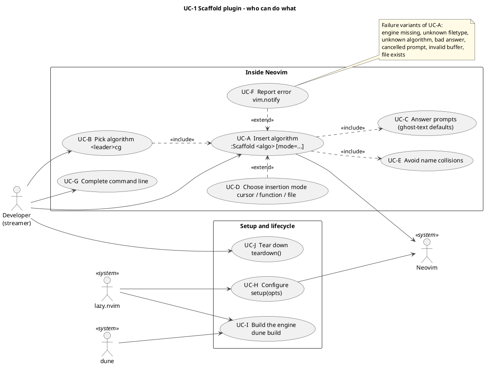

#### UC-2 - Interactive generation - success and failure paths

| Field | Note |
|---|---|
| ID / type | UC-2 · Use case |
| Purpose | Make every failure path of the main command explicit before writing the code that produces it. |
| Related functions | F-070, F-055, F-058, F-061, F-060 |
| Related files | `lua/scaffold/init.lua`, `lua/scaffold/client.lua` |
| Related Parts | Parts 8-9 |
| Reading guide | Each failure is an <<extend>> of the success case. Every one ends in a vim.notify at ERROR level, except cancel, which is silent. |
| What to notice | Cancel is not an error: nothing is inserted and nothing is shown. |
| How it helps | Each failure bubble has a test: engine_missing, unknown_lang, unknown_algo, bad_ident/bad_elem, file_exists, api_error. |
| What requires updating | Update when a new error code is added. |

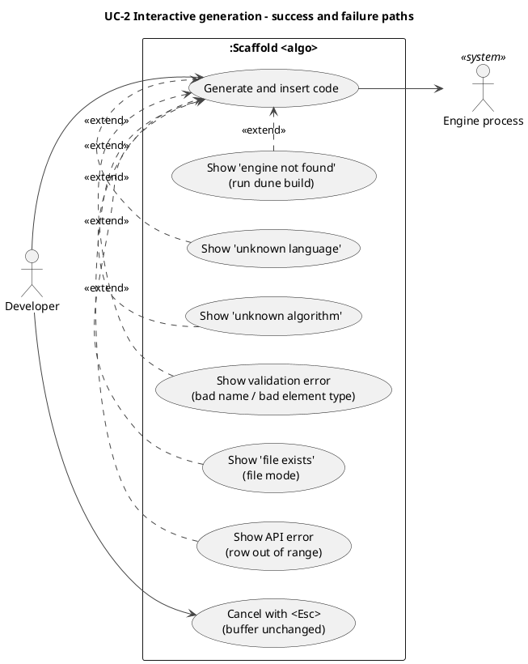

#### UC-3 - Engine command line (outside Neovim)

| Field | Note |
|---|---|
| ID / type | UC-3 · Use case |
| Purpose | Show that the OCaml engine is a complete program on its own and that Neovim is just one of its clients. |
| Related functions | F-051, F-049, F-050, F-052 |
| Related files | `lib/cli.ml`, `bin/main.ml` |
| Related Parts | Part 8 |
| Reading guide | Two kinds of client reach the same four commands. --json and --scan are options of the commands, not commands. |
| What to notice | The interactive ask command exists only here; Neovim does its own prompting with a floating window. |
| How it helps | Lets you test the whole engine from a shell before any Lua exists (Part 8 demo). |
| What requires updating | Add a use case per new command or flag. |

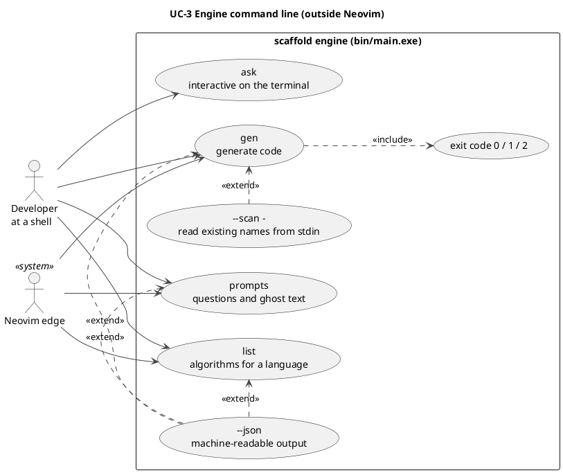

#### UC-4 - Lifecycle: install, build, configure, reload, remove

| Field | Note |
|---|---|
| ID / type | UC-4 · Use case |
| Purpose | Show the setup story end to end, including the build step that a pure-Lua plugin would not have. |
| Related functions | F-069, F-072, F-054, F-053 |
| Related files | `plugin/scaffold.lua`, `lua/scaffold/init.lua`, `lua/scaffold/client.lua` |
| Related Parts | Parts 0, 9 |
| Reading guide | Install and build happen once; configure and teardown happen in every session and every test. |
| What to notice | The lazy.nvim build hook is configuration, not code; its option names are unverified here. |
| How it helps | Explains why client.binary reports engine_missing with the hint to run dune build. |
| What requires updating | Update if the binary location rules change. |

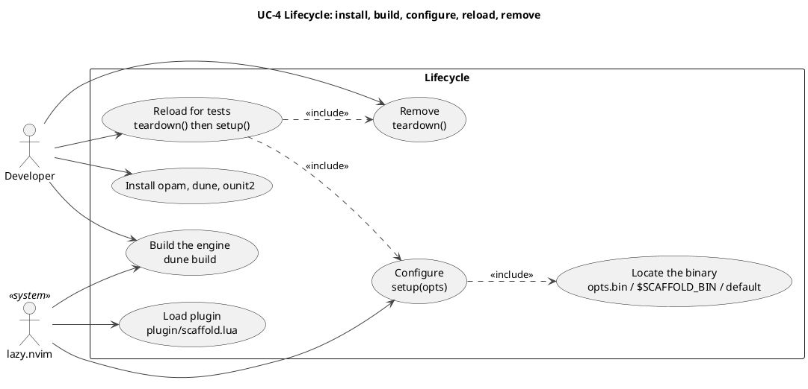

## 3. Class and data diagrams

OCaml has records and variants; Lua has tables. UML class notation is used for both; the stereotype on each box says which. CL-4 (the stereotype legend) is in Section 7.


#### CL-1 - OCaml data types (records and variants)

| Field | Note |
|---|---|
| ID / type | CL-1 · Class / data |
| Purpose | Show every record and variant the engine passes around, and which ones own others. |
| Related functions | F-012, F-013, F-014, F-043, F-045, F-051, F-035 |
| Related files | `lib/lang.mli`, `lib/catalog.mli`, `lib/template.mli`, `lib/insert.mli`, `lib/engine.mli`, `lib/session.mli`, `lib/cli.mli` |
| Related Parts | Parts 3-8 |
| Reading guide | Filled diamonds (*--) mean the record contains the other by value. The stereotype says what OCaml construct each box is (record, variant, or abstract type). |
| What to notice | Session.t is abstract: the .mli hides its fields, so callers can only use create, state, answers, pending, record and cancel. |
| How it helps | Writing the .mli types first (they are provided) tells you what each function receives and returns. |
| What requires updating | Update whenever a type in a .mli changes. |

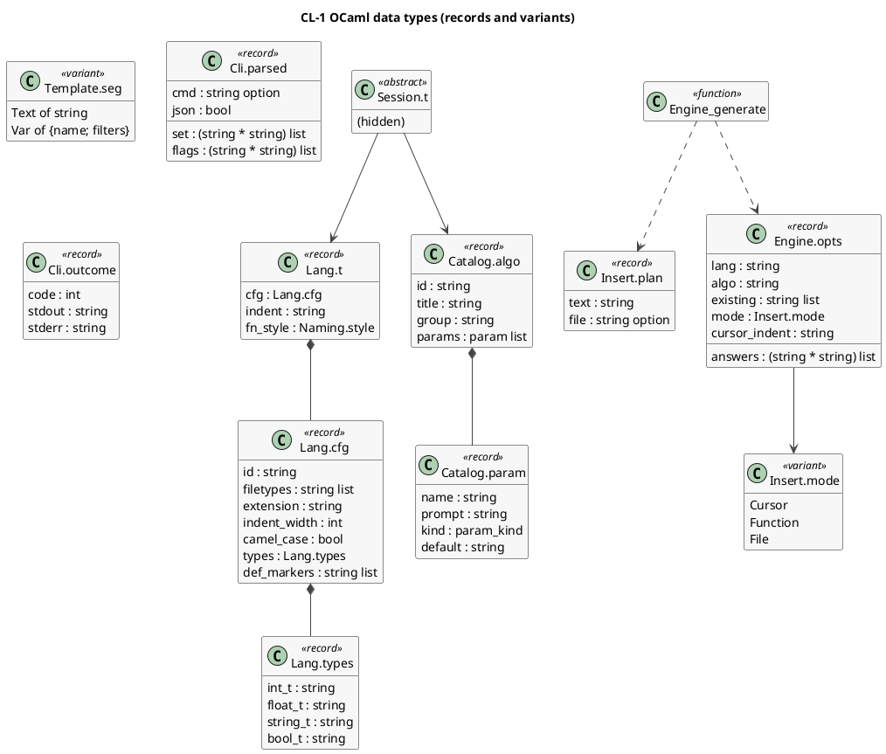

#### CL-2 - Module interfaces (public functions per module)

| Field | Note |
|---|---|
| ID / type | CL-2 · Class / data |
| Purpose | Show, for every module, which registry functions it exports (with their F-ids) and which modules depend on which. |
| Related functions | F-001..F-072 (72 functions) |
| Related files | `lib/*.mli`, `lua/scaffold/*.lua` |
| Related Parts | all |
| Reading guide | Each box is a module, not a class. The text after the F-id is the function's signature without its module prefix. Dashed arrows point from user to used. |
| What to notice | The OCaml arrows form a DAG (no cycles); the only edge between the two sides is lua_client to Main (a process spawn, not a call). |
| How it helps | Gives the build order (follow arrows backwards) and tells you which modules you may use while writing another. |
| What requires updating | Add or remove a function or dependency -> update the registry first, then this diagram is regenerated from it. |
| Limitation (stated honestly) | Generated from the function registry; arrows are the registry's `deps` lists, not read from source. |

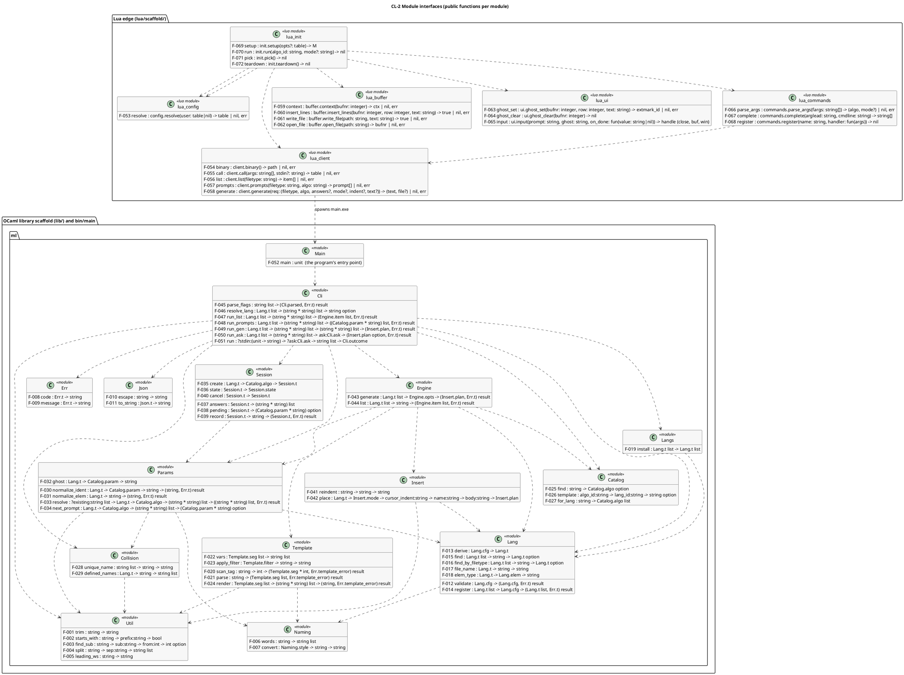

#### CL-3 - Error variants and where they are produced

| Field | Note |
|---|---|
| ID / type | CL-3 · Class / data |
| Purpose | Catalogue every error, its payload, and which exit code class it belongs to. |
| Related functions | F-008, F-009, F-051 |
| Related files | `lib/err.ml`, `lib/err.mli`, `lib/cli.ml` |
| Related Parts | Parts 2, 8 |
| Reading guide | One variant, 17 constructors plus the nested template errors. Err.code gives the stable machine name, Err.message the sentence. |
| What to notice | The usage/domain split decides the process exit code (2 or 1), not the message. |
| How it helps | Because the compiler checks every match, adding a constructor shows you every place that needs a new arm. |
| What requires updating | Update with every new constructor. |

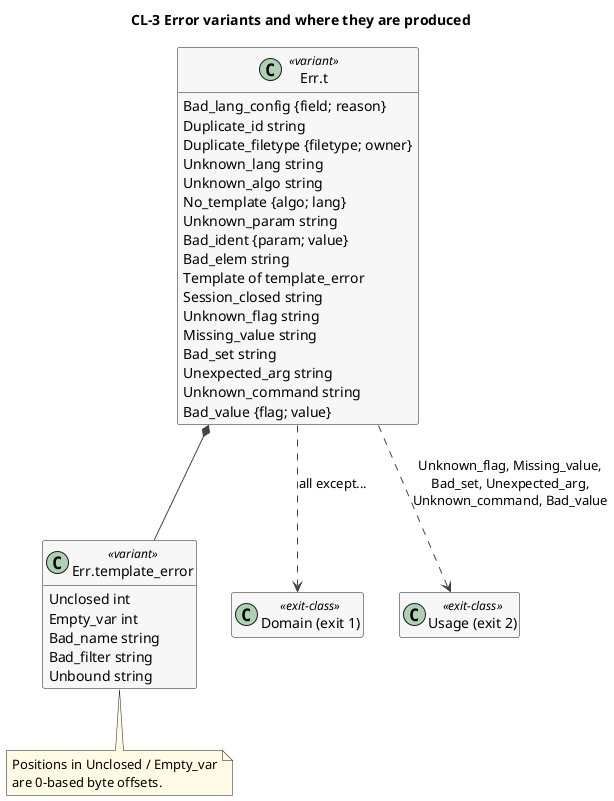

#### CL-5 - Lua edge: modules and the JSON protocol shapes

| Field | Note |
|---|---|
| ID / type | CL-5 · Class / data |
| Purpose | Show the six Lua modules and the four JSON reply shapes that cross the process boundary. |
| Related functions | F-055, F-056, F-057, F-058, F-070 |
| Related files | `lua/scaffold/*.lua` |
| Related Parts | Part 9 |
| Reading guide | Arrows are require/use relationships. The dashed arrows from client show what it decodes from the engine's stdout. |
| What to notice | JSON null becomes vim.NIL in Lua, so client.generate converts file back to nil. |
| How it helps | The whole Lua side is small because every decision lives in the engine. |
| What requires updating | Update when a reply shape changes (and the OCaml Cli.run formatting). |

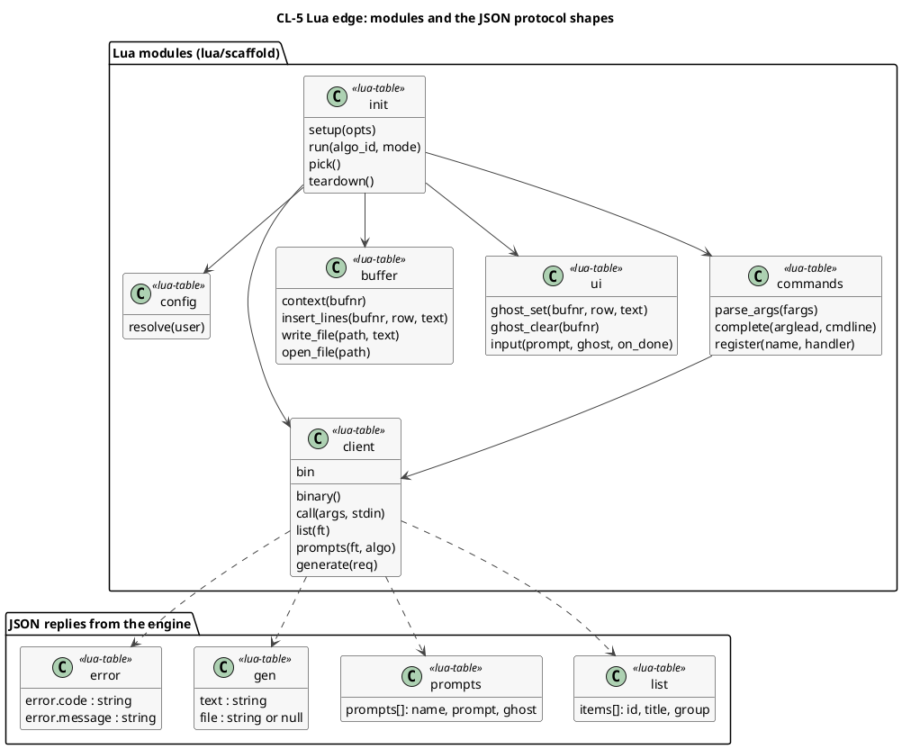

## 4. Activity diagrams (one per function)

Each diagram is the **execution trace of the intended responsibilities** of one function, in order, including every failure exit named in its contract. They contain no solution code. Cross-check each against its contract in the spec (Section 15) and the tests listed in the table above it.


#### AD-001 - `Util.trim` (F-001)

| Field | Note |
|---|---|
| ID / type | AD-001 · Activity |
| Purpose | Execution trace of F-001 `Util.trim`: Remove leading and trailing ASCII whitespace (space, tab, newline, CR, VT, FF). |
| Related functions | F-001 (callees: none) |
| Related files | `lib/util.ml` |
| Related Part | 0 |
| Reading guide | Start at the dot; follow arrows; diamonds branch on the question inside; pink = exception exit, yellow = explicit failure exit. |
| What to notice | 0 decision(s), 2 loop(s), 0 explicit-failure exit(s), 0 exception exit(s). The order of the checks is part of the contract. |
| How it helps | Gives the order of work before you write code; its exits match the *Raises* section of the contract and the tests T-001, T-002, T-003. |
| What requires updating | If the contract's Raises or check order for F-001 changes, update this diagram, its tests and the spec contract together. |

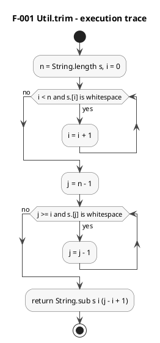

#### AD-002 - `Util.starts_with` (F-002)

| Field | Note |
|---|---|
| ID / type | AD-002 · Activity |
| Purpose | Execution trace of F-002 `Util.starts_with`: True when the string begins with the prefix (labelled argument `~prefix`). |
| Related functions | F-002 (callees: none) |
| Related files | `lib/util.ml` |
| Related Part | 0 |
| Reading guide | Start at the dot; follow arrows; diamonds branch on the question inside; pink = exception exit, yellow = explicit failure exit. |
| What to notice | 2 decision(s), 0 loop(s), 0 explicit-failure exit(s), 0 exception exit(s). The order of the checks is part of the contract. |
| How it helps | Gives the order of work before you write code; its exits match the *Raises* section of the contract and the tests T-004, T-005, T-006. |
| What requires updating | If the contract's Raises or check order for F-002 changes, update this diagram, its tests and the spec contract together. |

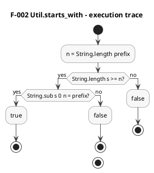

#### AD-003 - `Util.find_sub` (F-003)

| Field | Note |
|---|---|
| ID / type | AD-003 · Activity |
| Purpose | Execution trace of F-003 `Util.find_sub`: Index of the first occurrence of `sub` at or after `from`, or None. Plain text search, no patterns. |
| Related functions | F-003 (callees: none) |
| Related files | `lib/util.ml` |
| Related Part | 1 |
| Reading guide | Start at the dot; follow arrows; diamonds branch on the question inside; pink = exception exit, yellow = explicit failure exit. |
| What to notice | 3 decision(s), 0 loop(s), 0 explicit-failure exit(s), 1 exception exit(s). The order of the checks is part of the contract. |
| How it helps | Gives the order of work before you write code; its exits match the *Raises* section of the contract and the tests T-007, T-008, T-009, T-010. |
| What requires updating | If the contract's Raises or check order for F-003 changes, update this diagram, its tests and the spec contract together. |

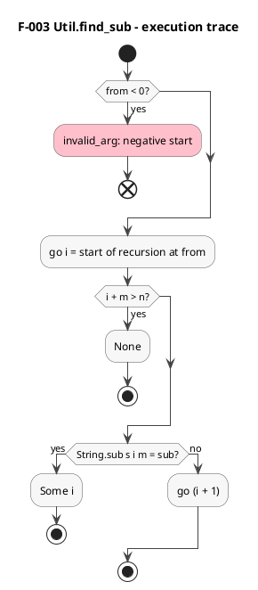

#### AD-004 - `Util.split` (F-004)

| Field | Note |
|---|---|
| ID / type | AD-004 · Activity |
| Purpose | Execution trace of F-004 `Util.split`: Split a string on a non-empty separator, keeping empty pieces (like String.split_on_char but for multi-character separators). |
| Related functions | F-004 (callees: F-003) |
| Related files | `lib/util.ml` |
| Related Part | 1 |
| Reading guide | Start at the dot; follow arrows; diamonds branch on the question inside; pink = exception exit, yellow = explicit failure exit. |
| What to notice | 2 decision(s), 0 loop(s), 0 explicit-failure exit(s), 1 exception exit(s). The order of the checks is part of the contract. |
| How it helps | Gives the order of work before you write code; its exits match the *Raises* section of the contract and the tests T-011, T-012, T-013, T-014. |
| What requires updating | If the contract's Raises or check order for F-004 changes, update this diagram, its tests and the spec contract together. |

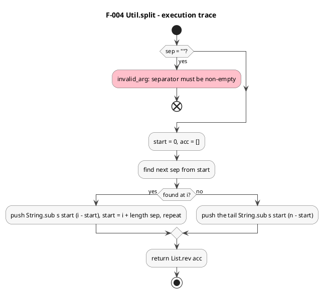

#### AD-005 - `Util.leading_ws` (F-005)

| Field | Note |
|---|---|
| ID / type | AD-005 · Activity |
| Purpose | Execution trace of F-005 `Util.leading_ws`: The run of spaces and tabs at the start of a line (the line's indentation). |
| Related functions | F-005 (callees: none) |
| Related files | `lib/util.ml` |
| Related Part | 1 |
| Reading guide | Start at the dot; follow arrows; diamonds branch on the question inside; pink = exception exit, yellow = explicit failure exit. |
| What to notice | 0 decision(s), 1 loop(s), 0 explicit-failure exit(s), 0 exception exit(s). The order of the checks is part of the contract. |
| How it helps | Gives the order of work before you write code; its exits match the *Raises* section of the contract and the tests T-015, T-016, T-017. |
| What requires updating | If the contract's Raises or check order for F-005 changes, update this diagram, its tests and the spec contract together. |

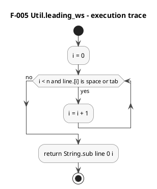

#### AD-006 - `Naming.words` (F-006)

| Field | Note |
|---|---|
| ID / type | AD-006 · Activity |
| Purpose | Execution trace of F-006 `Naming.words`: Split an identifier-like string into lowercase words at separators, lower-to-upper transitions, digit-to-upper transitions and acronym ends. |
| Related functions | F-006 (callees: none) |
| Related files | `lib/naming.ml` |
| Related Part | 1 |
| Reading guide | Start at the dot; follow arrows; diamonds branch on the question inside; pink = exception exit, yellow = explicit failure exit. |
| What to notice | 3 decision(s), 1 loop(s), 0 explicit-failure exit(s), 0 exception exit(s). The order of the checks is part of the contract. |
| How it helps | Gives the order of work before you write code; its exits match the *Raises* section of the contract and the tests T-018, T-019, T-020, T-021, T-022. |
| What requires updating | If the contract's Raises or check order for F-006 changes, update this diagram, its tests and the spec contract together. |

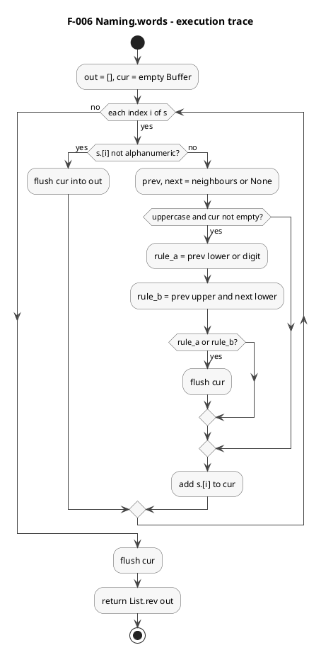

#### AD-007 - `Naming.convert` (F-007)

| Field | Note |
|---|---|
| ID / type | AD-007 · Activity |
| Purpose | Execution trace of F-007 `Naming.convert`: Re-style a string as snake_case, camelCase, PascalCase or UPPER_SNAKE using `words`. |
| Related functions | F-007 (callees: F-006) |
| Related files | `lib/naming.ml` |
| Related Part | 1 |
| Reading guide | Start at the dot; follow arrows; diamonds branch on the question inside; pink = exception exit, yellow = explicit failure exit. |
| What to notice | 3 decision(s), 0 loop(s), 0 explicit-failure exit(s), 0 exception exit(s). The order of the checks is part of the contract. |
| How it helps | Gives the order of work before you write code; its exits match the *Raises* section of the contract and the tests T-023, T-024, T-025, T-026, T-027. |
| What requires updating | If the contract's Raises or check order for F-007 changes, update this diagram, its tests and the spec contract together. |

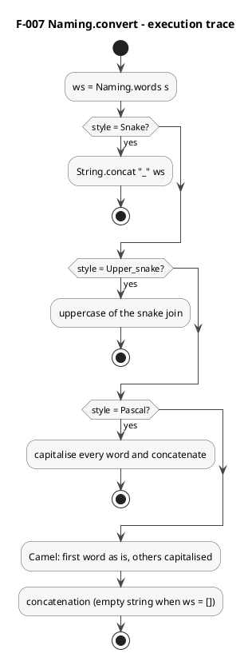

#### AD-008 - `Err.code` (F-008)

| Field | Note |
|---|---|
| ID / type | AD-008 · Activity |
| Purpose | Execution trace of F-008 `Err.code`: Map every error constructor to its stable snake_case code string. |
| Related functions | F-008 (callees: none) |
| Related files | `lib/err.ml` |
| Related Part | 2 |
| Reading guide | Start at the dot; follow arrows; diamonds branch on the question inside; pink = exception exit, yellow = explicit failure exit. |
| What to notice | 0 decision(s), 0 loop(s), 0 explicit-failure exit(s), 0 exception exit(s). The order of the checks is part of the contract. |
| How it helps | Gives the order of work before you write code; its exits match the *Raises* section of the contract and the tests T-028, T-029, T-030. |
| What requires updating | If the contract's Raises or check order for F-008 changes, update this diagram, its tests and the spec contract together. |

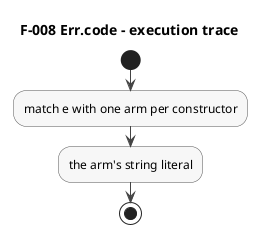

#### AD-009 - `Err.message` (F-009)

| Field | Note |
|---|---|
| ID / type | AD-009 · Activity |
| Purpose | Execution trace of F-009 `Err.message`: Render any error as a one-line human message. Template errors render through a nested match. |
| Related functions | F-009 (callees: F-008) |
| Related files | `lib/err.ml` |
| Related Part | 2 |
| Reading guide | Start at the dot; follow arrows; diamonds branch on the question inside; pink = exception exit, yellow = explicit failure exit. |
| What to notice | 1 decision(s), 0 loop(s), 0 explicit-failure exit(s), 0 exception exit(s). The order of the checks is part of the contract. |
| How it helps | Gives the order of work before you write code; its exits match the *Raises* section of the contract and the tests T-031, T-032, T-033, T-034, T-035. |
| What requires updating | If the contract's Raises or check order for F-009 changes, update this diagram, its tests and the spec contract together. |

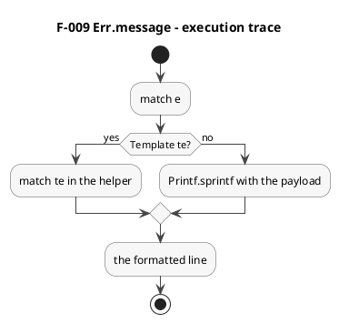

#### AD-010 - `Json.escape` (F-010)

| Field | Note |
|---|---|
| ID / type | AD-010 · Activity |
| Purpose | Execution trace of F-010 `Json.escape`: Escape a string for use inside a JSON string literal (quotes, backslash, control characters). |
| Related functions | F-010 (callees: none) |
| Related files | `lib/json.ml` |
| Related Part | 2 |
| Reading guide | Start at the dot; follow arrows; diamonds branch on the question inside; pink = exception exit, yellow = explicit failure exit. |
| What to notice | 2 decision(s), 1 loop(s), 0 explicit-failure exit(s), 0 exception exit(s). The order of the checks is part of the contract. |
| How it helps | Gives the order of work before you write code; its exits match the *Raises* section of the contract and the tests T-036, T-037, T-038, T-039. |
| What requires updating | If the contract's Raises or check order for F-010 changes, update this diagram, its tests and the spec contract together. |

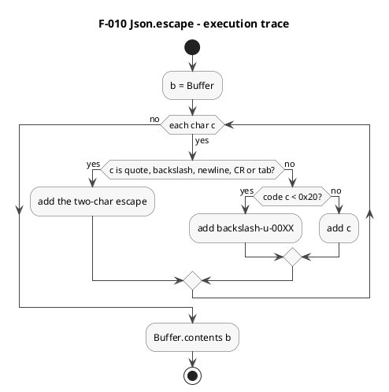

#### AD-011 - `Json.to_string` (F-011)

| Field | Note |
|---|---|
| ID / type | AD-011 · Activity |
| Purpose | Execution trace of F-011 `Json.to_string`: Serialise a Json.t as compact JSON (no spaces, object keys in the given order). |
| Related functions | F-011 (callees: F-010) |
| Related files | `lib/json.ml` |
| Related Part | 2 |
| Reading guide | Start at the dot; follow arrows; diamonds branch on the question inside; pink = exception exit, yellow = explicit failure exit. |
| What to notice | 2 decision(s), 0 loop(s), 0 explicit-failure exit(s), 0 exception exit(s). The order of the checks is part of the contract. |
| How it helps | Gives the order of work before you write code; its exits match the *Raises* section of the contract and the tests T-040, T-041, T-042, T-043, T-044. |
| What requires updating | If the contract's Raises or check order for F-011 changes, update this diagram, its tests and the spec contract together. |

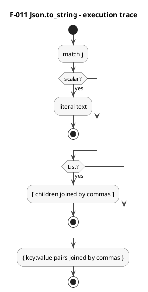

#### AD-012 - `Lang.validate` (F-012)

| Field | Note |
|---|---|
| ID / type | AD-012 · Activity |
| Purpose | Execution trace of F-012 `Lang.validate`: Check a language configuration and return it unchanged, or the first problem as Bad_lang_config {field; reason}. |
| Related functions | F-012 (callees: none) |
| Related files | `lib/lang.ml` |
| Related Part | 3 |
| Reading guide | Start at the dot; follow arrows; diamonds branch on the question inside; pink = exception exit, yellow = explicit failure exit. |
| What to notice | 6 decision(s), 0 loop(s), 6 explicit-failure exit(s), 0 exception exit(s). The order of the checks is part of the contract. |
| How it helps | Gives the order of work before you write code; its exits match the *Raises* section of the contract and the tests T-045, T-046, T-047, T-048, T-049, T-050, T-051, T-052. |
| What requires updating | If the contract's Raises or check order for F-012 changes, update this diagram, its tests and the spec contract together. |

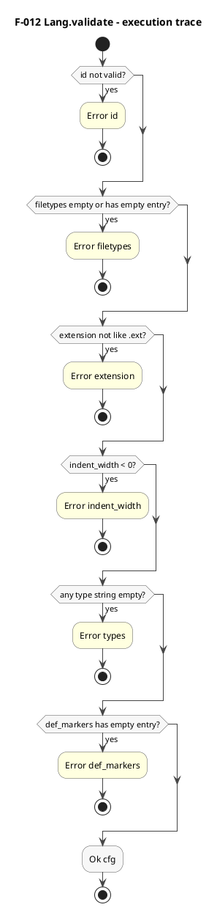

#### AD-013 - `Lang.derive` (F-013)

| Field | Note |
|---|---|
| ID / type | AD-013 · Activity |
| Purpose | Execution trace of F-013 `Lang.derive`: Compute the derived fields of a validated config: the indent string and the function-name style. |
| Related functions | F-013 (callees: F-012) |
| Related files | `lib/lang.ml` |
| Related Part | 3 |
| Reading guide | Start at the dot; follow arrows; diamonds branch on the question inside; pink = exception exit, yellow = explicit failure exit. |
| What to notice | 0 decision(s), 0 loop(s), 0 explicit-failure exit(s), 0 exception exit(s). The order of the checks is part of the contract. |
| How it helps | Gives the order of work before you write code; its exits match the *Raises* section of the contract and the tests T-053, T-054, T-055, T-056. |
| What requires updating | If the contract's Raises or check order for F-013 changes, update this diagram, its tests and the spec contract together. |

```plantuml
@startuml
skinparam shadowing false
skinparam defaultFontName Helvetica
skinparam ArrowColor #444444
skinparam ActivityBackgroundColor #F7F7F7
skinparam ActivityBorderColor #555555
skinparam NoteBackgroundColor #FFFBE6
skinparam ClassBackgroundColor #F7F7F7
skinparam ComponentBackgroundColor #F7F7F7
skinparam PackageBackgroundColor #FFFFFF
skinparam SequenceLifeLineBorderColor #888888
title F-013 Lang.derive - execution trace
start
:indent = String.make indent_width ' ';
:fn_style = Camel if camel_case else Snake;
:{cfg, indent, fn_style};
stop
@enduml
```

#### AD-014 - `Lang.register` (F-014)

| Field | Note |
|---|---|
| ID / type | AD-014 · Activity |
| Purpose | Execution trace of F-014 `Lang.register`: Validate a config, reject duplicate ids and duplicate filetypes, and append the derived language to the registry. |
| Related functions | F-014 (callees: F-012, F-013) |
| Related files | `lib/lang.ml` |
| Related Part | 3 |
| Reading guide | Start at the dot; follow arrows; diamonds branch on the question inside; pink = exception exit, yellow = explicit failure exit. |
| What to notice | 2 decision(s), 0 loop(s), 2 explicit-failure exit(s), 0 exception exit(s). The order of the checks is part of the contract. |
| How it helps | Gives the order of work before you write code; its exits match the *Raises* section of the contract and the tests T-057, T-058, T-059, T-060, T-061. |
| What requires updating | If the contract's Raises or check order for F-014 changes, update this diagram, its tests and the spec contract together. |

```plantuml
@startuml
skinparam shadowing false
skinparam defaultFontName Helvetica
skinparam ArrowColor #444444
skinparam ActivityBackgroundColor #F7F7F7
skinparam ActivityBorderColor #555555
skinparam NoteBackgroundColor #FFFBE6
skinparam ClassBackgroundColor #F7F7F7
skinparam ComponentBackgroundColor #F7F7F7
skinparam PackageBackgroundColor #FFFFFF
skinparam SequenceLifeLineBorderColor #888888
title F-014 Lang.register - execution trace
start
:validate cfg;
if (invalid?) then (yes)
  #LightYellow:Error Bad_lang_config;
  stop
endif
:scan registry for same id or shared filetype;
if (clash found?) then (yes)
  #LightYellow:Error Duplicate_id / Duplicate_filetype;
  stop
endif
:Ok (reg @ [derive cfg]);
stop
@enduml
```

#### AD-015 - `Lang.find` (F-015)

| Field | Note |
|---|---|
| ID / type | AD-015 · Activity |
| Purpose | Execution trace of F-015 `Lang.find`: Look a language up by its id. |
| Related functions | F-015 (callees: none) |
| Related files | `lib/lang.ml` |
| Related Part | 3 |
| Reading guide | Start at the dot; follow arrows; diamonds branch on the question inside; pink = exception exit, yellow = explicit failure exit. |
| What to notice | 0 decision(s), 0 loop(s), 0 explicit-failure exit(s), 0 exception exit(s). The order of the checks is part of the contract. |
| How it helps | Gives the order of work before you write code; its exits match the *Raises* section of the contract and the tests T-062, T-063, T-064. |
| What requires updating | If the contract's Raises or check order for F-015 changes, update this diagram, its tests and the spec contract together. |

```plantuml
@startuml
skinparam shadowing false
skinparam defaultFontName Helvetica
skinparam ArrowColor #444444
skinparam ActivityBackgroundColor #F7F7F7
skinparam ActivityBorderColor #555555
skinparam NoteBackgroundColor #FFFBE6
skinparam ClassBackgroundColor #F7F7F7
skinparam ComponentBackgroundColor #F7F7F7
skinparam PackageBackgroundColor #FFFFFF
skinparam SequenceLifeLineBorderColor #888888
title F-015 Lang.find - execution trace
start
:List.find_opt (id equal);
:the option;
stop
@enduml
```

#### AD-016 - `Lang.find_by_filetype` (F-016)

| Field | Note |
|---|---|
| ID / type | AD-016 · Activity |
| Purpose | Execution trace of F-016 `Lang.find_by_filetype`: Look a language up by a Neovim filetype (a language may own several, e.g. javascript and javascriptreact). |
| Related functions | F-016 (callees: none) |
| Related files | `lib/lang.ml` |
| Related Part | 3 |
| Reading guide | Start at the dot; follow arrows; diamonds branch on the question inside; pink = exception exit, yellow = explicit failure exit. |
| What to notice | 0 decision(s), 0 loop(s), 0 explicit-failure exit(s), 0 exception exit(s). The order of the checks is part of the contract. |
| How it helps | Gives the order of work before you write code; its exits match the *Raises* section of the contract and the tests T-065, T-066, T-067. |
| What requires updating | If the contract's Raises or check order for F-016 changes, update this diagram, its tests and the spec contract together. |

```plantuml
@startuml
skinparam shadowing false
skinparam defaultFontName Helvetica
skinparam ArrowColor #444444
skinparam ActivityBackgroundColor #F7F7F7
skinparam ActivityBorderColor #555555
skinparam NoteBackgroundColor #FFFBE6
skinparam ClassBackgroundColor #F7F7F7
skinparam ComponentBackgroundColor #F7F7F7
skinparam PackageBackgroundColor #FFFFFF
skinparam SequenceLifeLineBorderColor #888888
title F-016 Lang.find_by_filetype - execution trace
start
:List.find_opt (ft in filetypes);
:the option;
stop
@enduml
```

#### AD-017 - `Lang.file_name` (F-017)

| Field | Note |
|---|---|
| ID / type | AD-017 · Activity |
| Purpose | Execution trace of F-017 `Lang.file_name`: Build the file name for File insert mode: the base converted to the language's function style plus its extension. |
| Related functions | F-017 (callees: F-007) |
| Related files | `lib/lang.ml` |
| Related Part | 3 |
| Reading guide | Start at the dot; follow arrows; diamonds branch on the question inside; pink = exception exit, yellow = explicit failure exit. |
| What to notice | 1 decision(s), 0 loop(s), 0 explicit-failure exit(s), 1 exception exit(s). The order of the checks is part of the contract. |
| How it helps | Gives the order of work before you write code; its exits match the *Raises* section of the contract and the tests T-068, T-069, T-070, T-071. |
| What requires updating | If the contract's Raises or check order for F-017 changes, update this diagram, its tests and the spec contract together. |

```plantuml
@startuml
skinparam shadowing false
skinparam defaultFontName Helvetica
skinparam ArrowColor #444444
skinparam ActivityBackgroundColor #F7F7F7
skinparam ActivityBorderColor #555555
skinparam NoteBackgroundColor #FFFBE6
skinparam ClassBackgroundColor #F7F7F7
skinparam ComponentBackgroundColor #F7F7F7
skinparam PackageBackgroundColor #FFFFFF
skinparam SequenceLifeLineBorderColor #888888
title F-017 Lang.file_name - execution trace
start
:stem = Naming.convert fn_style base;
if (stem = empty?) then (yes)
  #Pink:invalid_arg;
  end
endif
:stem ^ extension;
stop
@enduml
```

#### AD-018 - `Lang.elem_type` (F-018)

| Field | Note |
|---|---|
| ID / type | AD-018 · Activity |
| Purpose | Execution trace of F-018 `Lang.elem_type`: The language's spelling of an element type (int, float, string, bool). |
| Related functions | F-018 (callees: none) |
| Related files | `lib/lang.ml` |
| Related Part | 3 |
| Reading guide | Start at the dot; follow arrows; diamonds branch on the question inside; pink = exception exit, yellow = explicit failure exit. |
| What to notice | 0 decision(s), 0 loop(s), 0 explicit-failure exit(s), 0 exception exit(s). The order of the checks is part of the contract. |
| How it helps | Gives the order of work before you write code; its exits match the *Raises* section of the contract and the tests T-072, T-073, T-074. |
| What requires updating | If the contract's Raises or check order for F-018 changes, update this diagram, its tests and the spec contract together. |

```plantuml
@startuml
skinparam shadowing false
skinparam defaultFontName Helvetica
skinparam ArrowColor #444444
skinparam ActivityBackgroundColor #F7F7F7
skinparam ActivityBorderColor #555555
skinparam NoteBackgroundColor #FFFBE6
skinparam ClassBackgroundColor #F7F7F7
skinparam ComponentBackgroundColor #F7F7F7
skinparam PackageBackgroundColor #FFFFFF
skinparam SequenceLifeLineBorderColor #888888
title F-018 Lang.elem_type - execution trace
start
:match e;
:the field of cfg.types;
stop
@enduml
```

#### AD-019 - `Langs.install` (F-019)

| Field | Note |
|---|---|
| ID / type | AD-019 · Activity |
| Purpose | Execution trace of F-019 `Langs.install`: Add the three built-in languages that are missing from a registry (python, javascript, ocaml). |
| Related functions | F-019 (callees: F-014, F-015) |
| Related files | `lib/langs.ml` |
| Related Part | 3 |
| Reading guide | Start at the dot; follow arrows; diamonds branch on the question inside; pink = exception exit, yellow = explicit failure exit. |
| What to notice | 2 decision(s), 0 loop(s), 0 explicit-failure exit(s), 1 exception exit(s). The order of the checks is part of the contract. |
| How it helps | Gives the order of work before you write code; its exits match the *Raises* section of the contract and the tests T-075, T-076, T-077, T-078. |
| What requires updating | If the contract's Raises or check order for F-019 changes, update this diagram, its tests and the spec contract together. |

```plantuml
@startuml
skinparam shadowing false
skinparam defaultFontName Helvetica
skinparam ArrowColor #444444
skinparam ActivityBackgroundColor #F7F7F7
skinparam ActivityBorderColor #555555
skinparam NoteBackgroundColor #FFFBE6
skinparam ClassBackgroundColor #F7F7F7
skinparam ComponentBackgroundColor #F7F7F7
skinparam PackageBackgroundColor #FFFFFF
skinparam SequenceLifeLineBorderColor #888888
title F-019 Langs.install - execution trace
start
:fold over Langs.configs;
if (id already registered?) then (yes)
  :keep reg;
else (no)
  :Lang.register reg cfg;
endif
if (register failed?) then (yes)
  #Pink:failwith;
  end
endif
:final registry;
stop
@enduml
```

#### AD-020 - `Template.scan_tag` (F-020)

| Field | Note |
|---|---|
| ID / type | AD-020 · Activity |
| Purpose | Execution trace of F-020 `Template.scan_tag`: Given the text and the byte offset of a `<%`, parse one tag `<% name \| filter \| filter %>` and return the Var segment plus the offset just after `%>`. |
| Related functions | F-020 (callees: F-003, F-004, F-001) |
| Related files | `lib/template.ml` |
| Related Part | 4 |
| Reading guide | Start at the dot; follow arrows; diamonds branch on the question inside; pink = exception exit, yellow = explicit failure exit. |
| What to notice | 4 decision(s), 1 loop(s), 4 explicit-failure exit(s), 0 exception exit(s). The order of the checks is part of the contract. |
| How it helps | Gives the order of work before you write code; its exits match the *Raises* section of the contract and the tests T-079, T-080, T-081, T-082, T-083, T-084, T-085. |
| What requires updating | If the contract's Raises or check order for F-020 changes, update this diagram, its tests and the spec contract together. |

```plantuml
@startuml
skinparam shadowing false
skinparam defaultFontName Helvetica
skinparam ArrowColor #444444
skinparam ActivityBackgroundColor #F7F7F7
skinparam ActivityBorderColor #555555
skinparam NoteBackgroundColor #FFFBE6
skinparam ClassBackgroundColor #F7F7F7
skinparam ComponentBackgroundColor #F7F7F7
skinparam PackageBackgroundColor #FFFFFF
skinparam SequenceLifeLineBorderColor #888888
title F-020 Template.scan_tag - execution trace
start
:find %> after open_pos+2;
if (not found?) then (yes)
  #LightYellow:Error Unclosed open_pos;
  stop
endif
:split inside on |;
:name = trim first piece;
if (name empty?) then (yes)
  #LightYellow:Error Empty_var;
  stop
endif
if (name not [a-z][a-z0-9_]*?) then (yes)
  #LightYellow:Error Bad_name;
  stop
endif
while (each remaining piece) is (yes)
  :trim, look up the filter;
  if (unknown?) then (yes)
    #LightYellow:Error Bad_filter;
    stop
  endif
endwhile (no)
:Ok (Var, close + 2);
stop
@enduml
```

#### AD-021 - `Template.parse` (F-021)

| Field | Note |
|---|---|
| ID / type | AD-021 · Activity |
| Purpose | Execution trace of F-021 `Template.parse`: Split template text into Text and Var segments, in order, with no empty Text segments. |
| Related functions | F-021 (callees: F-020, F-003) |
| Related files | `lib/template.ml` |
| Related Part | 4 |
| Reading guide | Start at the dot; follow arrows; diamonds branch on the question inside; pink = exception exit, yellow = explicit failure exit. |
| What to notice | 1 decision(s), 1 loop(s), 0 explicit-failure exit(s), 0 exception exit(s). The order of the checks is part of the contract. |
| How it helps | Gives the order of work before you write code; its exits match the *Raises* section of the contract and the tests T-086, T-087, T-088, T-089, T-090. |
| What requires updating | If the contract's Raises or check order for F-021 changes, update this diagram, its tests and the spec contract together. |

```plantuml
@startuml
skinparam shadowing false
skinparam defaultFontName Helvetica
skinparam ArrowColor #444444
skinparam ActivityBackgroundColor #F7F7F7
skinparam ActivityBorderColor #555555
skinparam NoteBackgroundColor #FFFBE6
skinparam ClassBackgroundColor #F7F7F7
skinparam ComponentBackgroundColor #F7F7F7
skinparam PackageBackgroundColor #FFFFFF
skinparam SequenceLifeLineBorderColor #888888
title F-021 Template.parse - execution trace
start
:pos = 0, acc = [];
while (pos < length text) is (yes)
  :find next <% from pos;
  if (none?) then (yes)
    :push Text of the rest, finish;
  else (no)
    :push Text before it if non-empty;
    :scan_tag, on error return it;
    :push Var, pos = next;
  endif
endwhile (no)
:Ok (List.rev acc);
stop
@enduml
```

#### AD-022 - `Template.vars` (F-022)

| Field | Note |
|---|---|
| ID / type | AD-022 · Activity |
| Purpose | Execution trace of F-022 `Template.vars`: The distinct variable names used by a template, in order of first appearance. |
| Related functions | F-022 (callees: none) |
| Related files | `lib/template.ml` |
| Related Part | 4 |
| Reading guide | Start at the dot; follow arrows; diamonds branch on the question inside; pink = exception exit, yellow = explicit failure exit. |
| What to notice | 1 decision(s), 1 loop(s), 0 explicit-failure exit(s), 0 exception exit(s). The order of the checks is part of the contract. |
| How it helps | Gives the order of work before you write code; its exits match the *Raises* section of the contract and the tests T-091, T-092, T-093. |
| What requires updating | If the contract's Raises or check order for F-022 changes, update this diagram, its tests and the spec contract together. |

```plantuml
@startuml
skinparam shadowing false
skinparam defaultFontName Helvetica
skinparam ArrowColor #444444
skinparam ActivityBackgroundColor #F7F7F7
skinparam ActivityBorderColor #555555
skinparam NoteBackgroundColor #FFFBE6
skinparam ClassBackgroundColor #F7F7F7
skinparam ComponentBackgroundColor #F7F7F7
skinparam PackageBackgroundColor #FFFFFF
skinparam SequenceLifeLineBorderColor #888888
title F-022 Template.vars - execution trace
start
:acc = [];
while (each segment) is (yes)
  if (Var and name not in acc?) then (yes)
    :append name;
  endif
endwhile (no)
:acc;
stop
@enduml
```

#### AD-023 - `Template.apply_filter` (F-023)

| Field | Note |
|---|---|
| ID / type | AD-023 · Activity |
| Purpose | Execution trace of F-023 `Template.apply_filter`: Apply one filter (snake, camel, pascal, upper_snake, upper, lower) to a value. |
| Related functions | F-023 (callees: F-007) |
| Related files | `lib/template.ml` |
| Related Part | 4 |
| Reading guide | Start at the dot; follow arrows; diamonds branch on the question inside; pink = exception exit, yellow = explicit failure exit. |
| What to notice | 0 decision(s), 0 loop(s), 0 explicit-failure exit(s), 0 exception exit(s). The order of the checks is part of the contract. |
| How it helps | Gives the order of work before you write code; its exits match the *Raises* section of the contract and the tests T-094, T-095, T-096. |
| What requires updating | If the contract's Raises or check order for F-023 changes, update this diagram, its tests and the spec contract together. |

```plantuml
@startuml
skinparam shadowing false
skinparam defaultFontName Helvetica
skinparam ArrowColor #444444
skinparam ActivityBackgroundColor #F7F7F7
skinparam ActivityBorderColor #555555
skinparam NoteBackgroundColor #FFFBE6
skinparam ClassBackgroundColor #F7F7F7
skinparam ComponentBackgroundColor #F7F7F7
skinparam PackageBackgroundColor #FFFFFF
skinparam SequenceLifeLineBorderColor #888888
title F-023 Template.apply_filter - execution trace
start
:match f;
:converted value;
stop
@enduml
```

#### AD-024 - `Template.render` (F-024)

| Field | Note |
|---|---|
| ID / type | AD-024 · Activity |
| Purpose | Execution trace of F-024 `Template.render`: Produce the output text: Text as is, each Var looked up in the environment and passed through its filters left to right. |
| Related functions | F-024 (callees: F-023) |
| Related files | `lib/template.ml` |
| Related Part | 4 |
| Reading guide | Start at the dot; follow arrows; diamonds branch on the question inside; pink = exception exit, yellow = explicit failure exit. |
| What to notice | 2 decision(s), 1 loop(s), 1 explicit-failure exit(s), 0 exception exit(s). The order of the checks is part of the contract. |
| How it helps | Gives the order of work before you write code; its exits match the *Raises* section of the contract and the tests T-097, T-098, T-099, T-100, T-101. |
| What requires updating | If the contract's Raises or check order for F-024 changes, update this diagram, its tests and the spec contract together. |

```plantuml
@startuml
skinparam shadowing false
skinparam defaultFontName Helvetica
skinparam ArrowColor #444444
skinparam ActivityBackgroundColor #F7F7F7
skinparam ActivityBorderColor #555555
skinparam NoteBackgroundColor #FFFBE6
skinparam ClassBackgroundColor #F7F7F7
skinparam ComponentBackgroundColor #F7F7F7
skinparam PackageBackgroundColor #FFFFFF
skinparam SequenceLifeLineBorderColor #888888
title F-024 Template.render - execution trace
start
:buf = Buffer;
while (each segment) is (yes)
  if (Text?) then (yes)
    :add text;
  else (no)
    :look up name in env;
    if (missing?) then (yes)
      #LightYellow:Error Unbound name;
      stop
    endif
    :fold filters over the value, add;
  endif
endwhile (no)
:Ok (Buffer.contents buf);
stop
@enduml
```

#### AD-025 - `Catalog.find` (F-025)

| Field | Note |
|---|---|
| ID / type | AD-025 · Activity |
| Purpose | Execution trace of F-025 `Catalog.find`: Look an algorithm up by id in the fixed catalog (binary-search, insertion-sort, stack, union-find). |
| Related functions | F-025 (callees: none) |
| Related files | `lib/catalog.ml` |
| Related Part | 5 |
| Reading guide | Start at the dot; follow arrows; diamonds branch on the question inside; pink = exception exit, yellow = explicit failure exit. |
| What to notice | 0 decision(s), 0 loop(s), 0 explicit-failure exit(s), 0 exception exit(s). The order of the checks is part of the contract. |
| How it helps | Gives the order of work before you write code; its exits match the *Raises* section of the contract and the tests T-102, T-103, T-104. |
| What requires updating | If the contract's Raises or check order for F-025 changes, update this diagram, its tests and the spec contract together. |

```plantuml
@startuml
skinparam shadowing false
skinparam defaultFontName Helvetica
skinparam ArrowColor #444444
skinparam ActivityBackgroundColor #F7F7F7
skinparam ActivityBorderColor #555555
skinparam NoteBackgroundColor #FFFBE6
skinparam ClassBackgroundColor #F7F7F7
skinparam ComponentBackgroundColor #F7F7F7
skinparam PackageBackgroundColor #FFFFFF
skinparam SequenceLifeLineBorderColor #888888
title F-025 Catalog.find - execution trace
start
:List.find_opt on Catalog.all;
:option;
stop
@enduml
```

#### AD-026 - `Catalog.template` (F-026)

| Field | Note |
|---|---|
| ID / type | AD-026 · Activity |
| Purpose | Execution trace of F-026 `Catalog.template`: The template text for an (algorithm, language) pair, or None when no template exists. |
| Related functions | F-026 (callees: none) |
| Related files | `lib/catalog.ml` |
| Related Part | 5 |
| Reading guide | Start at the dot; follow arrows; diamonds branch on the question inside; pink = exception exit, yellow = explicit failure exit. |
| What to notice | 0 decision(s), 0 loop(s), 0 explicit-failure exit(s), 0 exception exit(s). The order of the checks is part of the contract. |
| How it helps | Gives the order of work before you write code; its exits match the *Raises* section of the contract and the tests T-105, T-106, T-107. |
| What requires updating | If the contract's Raises or check order for F-026 changes, update this diagram, its tests and the spec contract together. |

```plantuml
@startuml
skinparam shadowing false
skinparam defaultFontName Helvetica
skinparam ArrowColor #444444
skinparam ActivityBackgroundColor #F7F7F7
skinparam ActivityBorderColor #555555
skinparam NoteBackgroundColor #FFFBE6
skinparam ClassBackgroundColor #F7F7F7
skinparam ComponentBackgroundColor #F7F7F7
skinparam PackageBackgroundColor #FFFFFF
skinparam SequenceLifeLineBorderColor #888888
title F-026 Catalog.template - execution trace
start
:table = Templates.<language> or [];
:List.assoc_opt algo_id table;
stop
@enduml
```

#### AD-027 - `Catalog.for_lang` (F-027)

| Field | Note |
|---|---|
| ID / type | AD-027 · Activity |
| Purpose | Execution trace of F-027 `Catalog.for_lang`: The algorithms that have a template for the given language id, in catalog order. |
| Related functions | F-027 (callees: F-026) |
| Related files | `lib/catalog.ml` |
| Related Part | 5 |
| Reading guide | Start at the dot; follow arrows; diamonds branch on the question inside; pink = exception exit, yellow = explicit failure exit. |
| What to notice | 0 decision(s), 0 loop(s), 0 explicit-failure exit(s), 0 exception exit(s). The order of the checks is part of the contract. |
| How it helps | Gives the order of work before you write code; its exits match the *Raises* section of the contract and the tests T-108, T-109, T-110. |
| What requires updating | If the contract's Raises or check order for F-027 changes, update this diagram, its tests and the spec contract together. |

```plantuml
@startuml
skinparam shadowing false
skinparam defaultFontName Helvetica
skinparam ArrowColor #444444
skinparam ActivityBackgroundColor #F7F7F7
skinparam ActivityBorderColor #555555
skinparam NoteBackgroundColor #FFFBE6
skinparam ClassBackgroundColor #F7F7F7
skinparam ComponentBackgroundColor #F7F7F7
skinparam PackageBackgroundColor #FFFFFF
skinparam SequenceLifeLineBorderColor #888888
title F-027 Catalog.for_lang - execution trace
start
:List.filter (template exists) Catalog.all;
:filtered list;
stop
@enduml
```

#### AD-028 - `Collision.unique_name` (F-028)

| Field | Note |
|---|---|
| ID / type | AD-028 · Activity |
| Purpose | Execution trace of F-028 `Collision.unique_name`: Return the name unchanged if free, otherwise name_2, name_3, ... the first free suffix. |
| Related functions | F-028 (callees: none) |
| Related files | `lib/collision.ml` |
| Related Part | 5 |
| Reading guide | Start at the dot; follow arrows; diamonds branch on the question inside; pink = exception exit, yellow = explicit failure exit. |
| What to notice | 1 decision(s), 1 loop(s), 0 explicit-failure exit(s), 0 exception exit(s). The order of the checks is part of the contract. |
| How it helps | Gives the order of work before you write code; its exits match the *Raises* section of the contract and the tests T-111, T-112, T-113, T-114. |
| What requires updating | If the contract's Raises or check order for F-028 changes, update this diagram, its tests and the spec contract together. |

```plantuml
@startuml
skinparam shadowing false
skinparam defaultFontName Helvetica
skinparam ArrowColor #444444
skinparam ActivityBackgroundColor #F7F7F7
skinparam ActivityBorderColor #555555
skinparam NoteBackgroundColor #FFFBE6
skinparam ClassBackgroundColor #F7F7F7
skinparam ComponentBackgroundColor #F7F7F7
skinparam PackageBackgroundColor #FFFFFF
skinparam SequenceLifeLineBorderColor #888888
title F-028 Collision.unique_name - execution trace
start
if (name not in existing?) then (yes)
  :name;
  stop
endif
:i = 2;
while (name_i in existing) is (yes)
  :i = i + 1;
endwhile (no)
:name_i;
stop
@enduml
```

#### AD-029 - `Collision.defined_names` (F-029)

| Field | Note |
|---|---|
| ID / type | AD-029 · Activity |
| Purpose | Execution trace of F-029 `Collision.defined_names`: Names the buffer text defines, found by looking at the start of each trimmed line for one of the language's def_markers. |
| Related functions | F-029 (callees: F-004, F-001, F-002) |
| Related files | `lib/collision.ml` |
| Related Part | 5 |
| Reading guide | Start at the dot; follow arrows; diamonds branch on the question inside; pink = exception exit, yellow = explicit failure exit. |
| What to notice | 2 decision(s), 1 loop(s), 0 explicit-failure exit(s), 0 exception exit(s). The order of the checks is part of the contract. |
| How it helps | Gives the order of work before you write code; its exits match the *Raises* section of the contract and the tests T-115, T-116, T-117, T-118, T-119, T-120, T-121. |
| What requires updating | If the contract's Raises or check order for F-029 changes, update this diagram, its tests and the spec contract together. |

```plantuml
@startuml
skinparam shadowing false
skinparam defaultFontName Helvetica
skinparam ArrowColor #444444
skinparam ActivityBackgroundColor #F7F7F7
skinparam ActivityBorderColor #555555
skinparam NoteBackgroundColor #FFFBE6
skinparam ClassBackgroundColor #F7F7F7
skinparam ComponentBackgroundColor #F7F7F7
skinparam PackageBackgroundColor #FFFFFF
skinparam SequenceLifeLineBorderColor #888888
title F-029 Collision.defined_names - execution trace
start
:lines = split text on newline;
while (each line) is (yes)
  :t = trim line;
  :find first def_marker t starts with;
  if (none?) then (yes)
    :skip;
  else (no)
    :name = word after the marker;
    if (name empty?) then (yes)
      :skip;
    else (no)
      :keep name;
    endif
  endif
endwhile (no)
:kept names in order;
stop
@enduml
```

#### AD-030 - `Params.normalize_ident` (F-030)

| Field | Note |
|---|---|
| ID / type | AD-030 · Activity |
| Purpose | Execution trace of F-030 `Params.normalize_ident`: Turn what the user typed for a name parameter into a valid identifier in the right style for the language and parameter kind. |
| Related functions | F-030 (callees: F-001, F-006, F-007) |
| Related files | `lib/params.ml` |
| Related Part | 6 |
| Reading guide | Start at the dot; follow arrows; diamonds branch on the question inside; pink = exception exit, yellow = explicit failure exit. |
| What to notice | 1 decision(s), 0 loop(s), 1 explicit-failure exit(s), 0 exception exit(s). The order of the checks is part of the contract. |
| How it helps | Gives the order of work before you write code; its exits match the *Raises* section of the contract and the tests T-122, T-123, T-124, T-125, T-126. |
| What requires updating | If the contract's Raises or check order for F-030 changes, update this diagram, its tests and the spec contract together. |

```plantuml
@startuml
skinparam shadowing false
skinparam defaultFontName Helvetica
skinparam ArrowColor #444444
skinparam ActivityBackgroundColor #F7F7F7
skinparam ActivityBorderColor #555555
skinparam NoteBackgroundColor #FFFBE6
skinparam ClassBackgroundColor #F7F7F7
skinparam ComponentBackgroundColor #F7F7F7
skinparam PackageBackgroundColor #FFFFFF
skinparam SequenceLifeLineBorderColor #888888
title F-030 Params.normalize_ident - execution trace
start
:v = trim raw;
if (no words or starts with a digit?) then (yes)
  #LightYellow:Error Bad_ident;
  stop
endif
:style = fn_style (functions) or Pascal (types);
:Ok (Naming.convert style v);
stop
@enduml
```

#### AD-031 - `Params.normalize_elem` (F-031)

| Field | Note |
|---|---|
| ID / type | AD-031 · Activity |
| Purpose | Execution trace of F-031 `Params.normalize_elem`: Map the user's element-type word (int, float, string, bool; any case) to the language's own type name. |
| Related functions | F-031 (callees: F-018, F-001) |
| Related files | `lib/params.ml` |
| Related Part | 6 |
| Reading guide | Start at the dot; follow arrows; diamonds branch on the question inside; pink = exception exit, yellow = explicit failure exit. |
| What to notice | 1 decision(s), 0 loop(s), 1 explicit-failure exit(s), 0 exception exit(s). The order of the checks is part of the contract. |
| How it helps | Gives the order of work before you write code; its exits match the *Raises* section of the contract and the tests T-127, T-128, T-129. |
| What requires updating | If the contract's Raises or check order for F-031 changes, update this diagram, its tests and the spec contract together. |

```plantuml
@startuml
skinparam shadowing false
skinparam defaultFontName Helvetica
skinparam ArrowColor #444444
skinparam ActivityBackgroundColor #F7F7F7
skinparam ActivityBorderColor #555555
skinparam NoteBackgroundColor #FFFBE6
skinparam ClassBackgroundColor #F7F7F7
skinparam ComponentBackgroundColor #F7F7F7
skinparam PackageBackgroundColor #FFFFFF
skinparam SequenceLifeLineBorderColor #888888
title F-031 Params.normalize_elem - execution trace
start
:w = lowercase (trim raw);
if (w in int, float, string, bool?) then (yes)
  :Ok (Lang.elem_type lang variant);
  stop
else (no)
  #LightYellow:Error Bad_elem raw;
  stop
endif
stop
@enduml
```

#### AD-032 - `Params.ghost` (F-032)

| Field | Note |
|---|---|
| ID / type | AD-032 · Activity |
| Purpose | Execution trace of F-032 `Params.ghost`: The ghost text (placeholder preview) for a prompt: the default, styled as the final identifier would be. |
| Related functions | F-032 (callees: F-007) |
| Related files | `lib/params.ml` |
| Related Part | 6 |
| Reading guide | Start at the dot; follow arrows; diamonds branch on the question inside; pink = exception exit, yellow = explicit failure exit. |
| What to notice | 1 decision(s), 0 loop(s), 0 explicit-failure exit(s), 0 exception exit(s). The order of the checks is part of the contract. |
| How it helps | Gives the order of work before you write code; its exits match the *Raises* section of the contract and the tests T-130, T-131, T-132. |
| What requires updating | If the contract's Raises or check order for F-032 changes, update this diagram, its tests and the spec contract together. |

```plantuml
@startuml
skinparam shadowing false
skinparam defaultFontName Helvetica
skinparam ArrowColor #444444
skinparam ActivityBackgroundColor #F7F7F7
skinparam ActivityBorderColor #555555
skinparam NoteBackgroundColor #FFFBE6
skinparam ClassBackgroundColor #F7F7F7
skinparam ComponentBackgroundColor #F7F7F7
skinparam PackageBackgroundColor #FFFFFF
skinparam SequenceLifeLineBorderColor #888888
title F-032 Params.ghost - execution trace
start
if (kind = Elem?) then (yes)
  :param.default;
  stop
endif
:Naming.convert (style_of lang param) param.default;
stop
@enduml
```

#### AD-033 - `Params.resolve` (F-033)

| Field | Note |
|---|---|
| ID / type | AD-033 · Activity |
| Purpose | Execution trace of F-033 `Params.resolve`: Turn the user's raw answers into final template values for every parameter of the algorithm: fill defaults, normalise, avoid existing names. |
| Related functions | F-033 (callees: F-030, F-031, F-028, F-001) |
| Related files | `lib/params.ml` |
| Related Part | 6 |
| Reading guide | Start at the dot; follow arrows; diamonds branch on the question inside; pink = exception exit, yellow = explicit failure exit. |
| What to notice | 3 decision(s), 1 loop(s), 2 explicit-failure exit(s), 0 exception exit(s). The order of the checks is part of the contract. |
| How it helps | Gives the order of work before you write code; its exits match the *Raises* section of the contract and the tests T-133, T-134, T-135, T-136, T-137, T-138, T-139, T-140. |
| What requires updating | If the contract's Raises or check order for F-033 changes, update this diagram, its tests and the spec contract together. |

```plantuml
@startuml
skinparam shadowing false
skinparam defaultFontName Helvetica
skinparam ArrowColor #444444
skinparam ActivityBackgroundColor #F7F7F7
skinparam ActivityBorderColor #555555
skinparam NoteBackgroundColor #FFFBE6
skinparam ClassBackgroundColor #F7F7F7
skinparam ComponentBackgroundColor #F7F7F7
skinparam PackageBackgroundColor #FFFFFF
skinparam SequenceLifeLineBorderColor #888888
title F-033 Params.resolve - execution trace
start
if (answer for a name that is not a param?) then (yes)
  #LightYellow:Error Unknown_param;
  stop
endif
:out = [];
while (each param in algorithm order) is (yes)
  :raw = non-blank answer, else default;
  if (kind = Elem?) then (yes)
    :v = normalize_elem;
  else (no)
    :v = normalize_ident, then unique_name existing;
  endif
  if (v is Error?) then (yes)
    #LightYellow:return the error;
    stop
  endif
  :append (name, v);
endwhile (no)
:Ok out;
stop
@enduml
```

#### AD-034 - `Params.next_prompt` (F-034)

| Field | Note |
|---|---|
| ID / type | AD-034 · Activity |
| Purpose | Execution trace of F-034 `Params.next_prompt`: The first parameter that has no answer yet, with its ghost text; None when all are answered. |
| Related functions | F-034 (callees: F-032) |
| Related files | `lib/params.ml` |
| Related Part | 6 |
| Reading guide | Start at the dot; follow arrows; diamonds branch on the question inside; pink = exception exit, yellow = explicit failure exit. |
| What to notice | 1 decision(s), 0 loop(s), 0 explicit-failure exit(s), 0 exception exit(s). The order of the checks is part of the contract. |
| How it helps | Gives the order of work before you write code; its exits match the *Raises* section of the contract and the tests T-141, T-142, T-143, T-144. |
| What requires updating | If the contract's Raises or check order for F-034 changes, update this diagram, its tests and the spec contract together. |

```plantuml
@startuml
skinparam shadowing false
skinparam defaultFontName Helvetica
skinparam ArrowColor #444444
skinparam ActivityBackgroundColor #F7F7F7
skinparam ActivityBorderColor #555555
skinparam NoteBackgroundColor #FFFBE6
skinparam ClassBackgroundColor #F7F7F7
skinparam ComponentBackgroundColor #F7F7F7
skinparam PackageBackgroundColor #FFFFFF
skinparam SequenceLifeLineBorderColor #888888
title F-034 Params.next_prompt - execution trace
start
:find first param not in answers;
if (found?) then (yes)
  :Some (param, ghost);
  stop
else (no)
  :None;
  stop
endif
stop
@enduml
```

#### AD-035 - `Session.create` (F-035)

| Field | Note |
|---|---|
| ID / type | AD-035 · Activity |
| Purpose | Execution trace of F-035 `Session.create`: Start a prompting session: no answers yet, state Collecting. |
| Related functions | F-035 (callees: none) |
| Related files | `lib/session.ml` |
| Related Part | 6 |
| Reading guide | Start at the dot; follow arrows; diamonds branch on the question inside; pink = exception exit, yellow = explicit failure exit. |
| What to notice | 0 decision(s), 0 loop(s), 0 explicit-failure exit(s), 0 exception exit(s). The order of the checks is part of the contract. |
| How it helps | Gives the order of work before you write code; its exits match the *Raises* section of the contract and the tests T-145. |
| What requires updating | If the contract's Raises or check order for F-035 changes, update this diagram, its tests and the spec contract together. |

```plantuml
@startuml
skinparam shadowing false
skinparam defaultFontName Helvetica
skinparam ArrowColor #444444
skinparam ActivityBackgroundColor #F7F7F7
skinparam ActivityBorderColor #555555
skinparam NoteBackgroundColor #FFFBE6
skinparam ClassBackgroundColor #F7F7F7
skinparam ComponentBackgroundColor #F7F7F7
skinparam PackageBackgroundColor #FFFFFF
skinparam SequenceLifeLineBorderColor #888888
title F-035 Session.create - execution trace
start
:{ lang, algo, rev_answers = [], st = Collecting };
:session;
stop
@enduml
```

#### AD-036 - `Session.state` (F-036)

| Field | Note |
|---|---|
| ID / type | AD-036 · Activity |
| Purpose | Execution trace of F-036 `Session.state`: Report Collecting, Ready or Cancelled. |
| Related functions | F-036 (callees: none) |
| Related files | `lib/session.ml` |
| Related Part | 6 |
| Reading guide | Start at the dot; follow arrows; diamonds branch on the question inside; pink = exception exit, yellow = explicit failure exit. |
| What to notice | 0 decision(s), 0 loop(s), 0 explicit-failure exit(s), 0 exception exit(s). The order of the checks is part of the contract. |
| How it helps | Gives the order of work before you write code; its exits match the *Raises* section of the contract and the tests T-146, T-147. |
| What requires updating | If the contract's Raises or check order for F-036 changes, update this diagram, its tests and the spec contract together. |

```plantuml
@startuml
skinparam shadowing false
skinparam defaultFontName Helvetica
skinparam ArrowColor #444444
skinparam ActivityBackgroundColor #F7F7F7
skinparam ActivityBorderColor #555555
skinparam NoteBackgroundColor #FFFBE6
skinparam ClassBackgroundColor #F7F7F7
skinparam ComponentBackgroundColor #F7F7F7
skinparam PackageBackgroundColor #FFFFFF
skinparam SequenceLifeLineBorderColor #888888
title F-036 Session.state - execution trace
start
:t.st;
stop
@enduml
```

#### AD-037 - `Session.answers` (F-037)

| Field | Note |
|---|---|
| ID / type | AD-037 · Activity |
| Purpose | Execution trace of F-037 `Session.answers`: Answers recorded so far, oldest first, as (param name, raw text). |
| Related functions | F-037 (callees: none) |
| Related files | `lib/session.ml` |
| Related Part | 6 |
| Reading guide | Start at the dot; follow arrows; diamonds branch on the question inside; pink = exception exit, yellow = explicit failure exit. |
| What to notice | 0 decision(s), 0 loop(s), 0 explicit-failure exit(s), 0 exception exit(s). The order of the checks is part of the contract. |
| How it helps | Gives the order of work before you write code; its exits match the *Raises* section of the contract and the tests T-148, T-149. |
| What requires updating | If the contract's Raises or check order for F-037 changes, update this diagram, its tests and the spec contract together. |

```plantuml
@startuml
skinparam shadowing false
skinparam defaultFontName Helvetica
skinparam ArrowColor #444444
skinparam ActivityBackgroundColor #F7F7F7
skinparam ActivityBorderColor #555555
skinparam NoteBackgroundColor #FFFBE6
skinparam ClassBackgroundColor #F7F7F7
skinparam ComponentBackgroundColor #F7F7F7
skinparam PackageBackgroundColor #FFFFFF
skinparam SequenceLifeLineBorderColor #888888
title F-037 Session.answers - execution trace
start
:List.rev t.rev_answers;
stop
@enduml
```

#### AD-038 - `Session.pending` (F-038)

| Field | Note |
|---|---|
| ID / type | AD-038 · Activity |
| Purpose | Execution trace of F-038 `Session.pending`: The next question (parameter and ghost), or None when none is left. |
| Related functions | F-038 (callees: F-034, F-037) |
| Related files | `lib/session.ml` |
| Related Part | 6 |
| Reading guide | Start at the dot; follow arrows; diamonds branch on the question inside; pink = exception exit, yellow = explicit failure exit. |
| What to notice | 0 decision(s), 0 loop(s), 0 explicit-failure exit(s), 0 exception exit(s). The order of the checks is part of the contract. |
| How it helps | Gives the order of work before you write code; its exits match the *Raises* section of the contract and the tests T-150, T-151. |
| What requires updating | If the contract's Raises or check order for F-038 changes, update this diagram, its tests and the spec contract together. |

```plantuml
@startuml
skinparam shadowing false
skinparam defaultFontName Helvetica
skinparam ArrowColor #444444
skinparam ActivityBackgroundColor #F7F7F7
skinparam ActivityBorderColor #555555
skinparam NoteBackgroundColor #FFFBE6
skinparam ClassBackgroundColor #F7F7F7
skinparam ComponentBackgroundColor #F7F7F7
skinparam PackageBackgroundColor #FFFFFF
skinparam SequenceLifeLineBorderColor #888888
title F-038 Session.pending - execution trace
start
:Params.next_prompt lang algo (answers t);
stop
@enduml
```

#### AD-039 - `Session.record` (F-039)

| Field | Note |
|---|---|
| ID / type | AD-039 · Activity |
| Purpose | Execution trace of F-039 `Session.record`: Record the answer to the pending question; become Ready when it was the last one. |
| Related functions | F-039 (callees: F-038) |
| Related files | `lib/session.ml` |
| Related Part | 6 |
| Reading guide | Start at the dot; follow arrows; diamonds branch on the question inside; pink = exception exit, yellow = explicit failure exit. |
| What to notice | 3 decision(s), 0 loop(s), 2 explicit-failure exit(s), 0 exception exit(s). The order of the checks is part of the contract. |
| How it helps | Gives the order of work before you write code; its exits match the *Raises* section of the contract and the tests T-152, T-153, T-154, T-155. |
| What requires updating | If the contract's Raises or check order for F-039 changes, update this diagram, its tests and the spec contract together. |

```plantuml
@startuml
skinparam shadowing false
skinparam defaultFontName Helvetica
skinparam ArrowColor #444444
skinparam ActivityBackgroundColor #F7F7F7
skinparam ActivityBorderColor #555555
skinparam NoteBackgroundColor #FFFBE6
skinparam ClassBackgroundColor #F7F7F7
skinparam ComponentBackgroundColor #F7F7F7
skinparam PackageBackgroundColor #FFFFFF
skinparam SequenceLifeLineBorderColor #888888
title F-039 Session.record - execution trace
start
if (state = Ready?) then (yes)
  #LightYellow:Error Session_closed ready;
  stop
endif
if (state = Cancelled?) then (yes)
  #LightYellow:Error Session_closed cancelled;
  stop
endif
:p = pending t;
:push (p.name, value);
if (pending of new session = None?) then (yes)
  :state = Ready;
endif
:Ok new session;
stop
@enduml
```

#### AD-040 - `Session.cancel` (F-040)

| Field | Note |
|---|---|
| ID / type | AD-040 · Activity |
| Purpose | Execution trace of F-040 `Session.cancel`: Cancel a Collecting session; Ready and Cancelled sessions are returned unchanged. |
| Related functions | F-040 (callees: none) |
| Related files | `lib/session.ml` |
| Related Part | 6 |
| Reading guide | Start at the dot; follow arrows; diamonds branch on the question inside; pink = exception exit, yellow = explicit failure exit. |
| What to notice | 1 decision(s), 0 loop(s), 0 explicit-failure exit(s), 0 exception exit(s). The order of the checks is part of the contract. |
| How it helps | Gives the order of work before you write code; its exits match the *Raises* section of the contract and the tests T-156, T-157, T-158. |
| What requires updating | If the contract's Raises or check order for F-040 changes, update this diagram, its tests and the spec contract together. |

```plantuml
@startuml
skinparam shadowing false
skinparam defaultFontName Helvetica
skinparam ArrowColor #444444
skinparam ActivityBackgroundColor #F7F7F7
skinparam ActivityBorderColor #555555
skinparam NoteBackgroundColor #FFFBE6
skinparam ClassBackgroundColor #F7F7F7
skinparam ComponentBackgroundColor #F7F7F7
skinparam PackageBackgroundColor #FFFFFF
skinparam SequenceLifeLineBorderColor #888888
title F-040 Session.cancel - execution trace
start
if (state = Collecting?) then (yes)
  :{ t with st = Cancelled };
  stop
else (no)
  :t;
  stop
endif
stop
@enduml
```

#### AD-041 - `Insert.reindent` (F-041)

| Field | Note |
|---|---|
| ID / type | AD-041 · Activity |
| Purpose | Execution trace of F-041 `Insert.reindent`: Prefix every non-blank line of a block with an indent string; blank lines stay blank. |
| Related functions | F-041 (callees: F-004, F-001) |
| Related files | `lib/insert.ml` |
| Related Part | 7 |
| Reading guide | Start at the dot; follow arrows; diamonds branch on the question inside; pink = exception exit, yellow = explicit failure exit. |
| What to notice | 1 decision(s), 1 loop(s), 0 explicit-failure exit(s), 0 exception exit(s). The order of the checks is part of the contract. |
| How it helps | Gives the order of work before you write code; its exits match the *Raises* section of the contract and the tests T-159, T-160, T-161, T-162, T-163. |
| What requires updating | If the contract's Raises or check order for F-041 changes, update this diagram, its tests and the spec contract together. |

```plantuml
@startuml
skinparam shadowing false
skinparam defaultFontName Helvetica
skinparam ArrowColor #444444
skinparam ActivityBackgroundColor #F7F7F7
skinparam ActivityBorderColor #555555
skinparam NoteBackgroundColor #FFFBE6
skinparam ClassBackgroundColor #F7F7F7
skinparam ComponentBackgroundColor #F7F7F7
skinparam PackageBackgroundColor #FFFFFF
skinparam SequenceLifeLineBorderColor #888888
title F-041 Insert.reindent - execution trace
start
:lines = split on newline;
while (each line) is (yes)
  if (trim line is empty?) then (yes)
    :keep line;
  else (no)
    :indent ^ line;
  endif
endwhile (no)
:join with newline;
stop
@enduml
```

#### AD-042 - `Insert.place` (F-042)

| Field | Note |
|---|---|
| ID / type | AD-042 · Activity |
| Purpose | Execution trace of F-042 `Insert.place`: Decide what to insert and where: Cursor re-indents; Function adds a blank line before and a newline after; File adds a final newline and a file name. |
| Related functions | F-042 (callees: F-041, F-017) |
| Related files | `lib/insert.ml` |
| Related Part | 7 |
| Reading guide | Start at the dot; follow arrows; diamonds branch on the question inside; pink = exception exit, yellow = explicit failure exit. |
| What to notice | 2 decision(s), 0 loop(s), 0 explicit-failure exit(s), 0 exception exit(s). The order of the checks is part of the contract. |
| How it helps | Gives the order of work before you write code; its exits match the *Raises* section of the contract and the tests T-164, T-165, T-166, T-167. |
| What requires updating | If the contract's Raises or check order for F-042 changes, update this diagram, its tests and the spec contract together. |

```plantuml
@startuml
skinparam shadowing false
skinparam defaultFontName Helvetica
skinparam ArrowColor #444444
skinparam ActivityBackgroundColor #F7F7F7
skinparam ActivityBorderColor #555555
skinparam NoteBackgroundColor #FFFBE6
skinparam ClassBackgroundColor #F7F7F7
skinparam ComponentBackgroundColor #F7F7F7
skinparam PackageBackgroundColor #FFFFFF
skinparam SequenceLifeLineBorderColor #888888
title F-042 Insert.place - execution trace
start
:match mode;
if (Cursor?) then (yes)
  :{text = reindent cursor_indent body, file = None};
  stop
endif
if (Function?) then (yes)
  :{text = newline + body + newline, file = None};
  stop
endif
:{text = body + newline, file = Some (Lang.file_name lang name)};
stop
@enduml
```

#### AD-043 - `Engine.generate` (F-043)

| Field | Note |
|---|---|
| ID / type | AD-043 · Activity |
| Purpose | Execution trace of F-043 `Engine.generate`: The whole pipeline: language, algorithm, template, parameters, parse, render, place. The first failing stage returns its error. |
| Related functions | F-043 (callees: F-015, F-025, F-026, F-033, F-021, F-024, F-042) |
| Related files | `lib/engine.ml` |
| Related Part | 7 |
| Reading guide | Start at the dot; follow arrows; diamonds branch on the question inside; pink = exception exit, yellow = explicit failure exit. |
| What to notice | 3 decision(s), 0 loop(s), 3 explicit-failure exit(s), 0 exception exit(s). The order of the checks is part of the contract. |
| How it helps | Gives the order of work before you write code; its exits match the *Raises* section of the contract and the tests T-168, T-169, T-170, T-171, T-172, T-173, T-174, T-175, T-176, T-177, T-178. |
| What requires updating | If the contract's Raises or check order for F-043 changes, update this diagram, its tests and the spec contract together. |

```plantuml
@startuml
skinparam shadowing false
skinparam defaultFontName Helvetica
skinparam ArrowColor #444444
skinparam ActivityBackgroundColor #F7F7F7
skinparam ActivityBorderColor #555555
skinparam NoteBackgroundColor #FFFBE6
skinparam ClassBackgroundColor #F7F7F7
skinparam ComponentBackgroundColor #F7F7F7
skinparam PackageBackgroundColor #FFFFFF
skinparam SequenceLifeLineBorderColor #888888
title F-043 Engine.generate - execution trace
start
:lang = Lang.find;
if (None?) then (yes)
  #LightYellow:Error Unknown_lang;
  stop
endif
:algo = Catalog.find;
if (None?) then (yes)
  #LightYellow:Error Unknown_algo;
  stop
endif
:text = Catalog.template;
if (None?) then (yes)
  #LightYellow:Error No_template;
  stop
endif
:values = Params.resolve;
:segs = Template.parse;
:body = Template.render;
:name = first non-elem param value, else algo id;
:Ok (Insert.place ...);
stop
@enduml
```

#### AD-044 - `Engine.list` (F-044)

| Field | Note |
|---|---|
| ID / type | AD-044 · Activity |
| Purpose | Execution trace of F-044 `Engine.list`: The algorithms available for a language id, as {id; group; title} items. |
| Related functions | F-044 (callees: F-015, F-027) |
| Related files | `lib/engine.ml` |
| Related Part | 7 |
| Reading guide | Start at the dot; follow arrows; diamonds branch on the question inside; pink = exception exit, yellow = explicit failure exit. |
| What to notice | 1 decision(s), 0 loop(s), 1 explicit-failure exit(s), 0 exception exit(s). The order of the checks is part of the contract. |
| How it helps | Gives the order of work before you write code; its exits match the *Raises* section of the contract and the tests T-179, T-180, T-181. |
| What requires updating | If the contract's Raises or check order for F-044 changes, update this diagram, its tests and the spec contract together. |

```plantuml
@startuml
skinparam shadowing false
skinparam defaultFontName Helvetica
skinparam ArrowColor #444444
skinparam ActivityBackgroundColor #F7F7F7
skinparam ActivityBorderColor #555555
skinparam NoteBackgroundColor #FFFBE6
skinparam ClassBackgroundColor #F7F7F7
skinparam ComponentBackgroundColor #F7F7F7
skinparam PackageBackgroundColor #FFFFFF
skinparam SequenceLifeLineBorderColor #888888
title F-044 Engine.list - execution trace
start
:Lang.find regs lang_id;
if (None?) then (yes)
  #LightYellow:Error Unknown_lang;
  stop
endif
:Ok (map Catalog.for_lang to items);
stop
@enduml
```

#### AD-045 - `Cli.parse_flags` (F-045)

| Field | Note |
|---|---|
| ID / type | AD-045 · Activity |
| Purpose | Execution trace of F-045 `Cli.parse_flags`: Parse argv (without the program name) into command, --set pairs, value flags and the --json switch. |
| Related functions | F-045 (callees: F-002) |
| Related files | `lib/cli.ml` |
| Related Part | 8 |
| Reading guide | Start at the dot; follow arrows; diamonds branch on the question inside; pink = exception exit, yellow = explicit failure exit. |
| What to notice | 7 decision(s), 1 loop(s), 4 explicit-failure exit(s), 0 exception exit(s). The order of the checks is part of the contract. |
| How it helps | Gives the order of work before you write code; its exits match the *Raises* section of the contract and the tests T-182, T-183, T-184, T-185, T-186, T-187, T-188, T-189, T-190. |
| What requires updating | If the contract's Raises or check order for F-045 changes, update this diagram, its tests and the spec contract together. |

```plantuml
@startuml
skinparam shadowing false
skinparam defaultFontName Helvetica
skinparam ArrowColor #444444
skinparam ActivityBackgroundColor #F7F7F7
skinparam ActivityBorderColor #555555
skinparam NoteBackgroundColor #FFFBE6
skinparam ClassBackgroundColor #F7F7F7
skinparam ComponentBackgroundColor #F7F7F7
skinparam PackageBackgroundColor #FFFFFF
skinparam SequenceLifeLineBorderColor #888888
title F-045 Cli.parse_flags - execution trace
start
:p = empty parsed, args = argv;
while (args left) is (yes)
  if (starts with - -?) then (yes)
    if (- -json?) then (yes)
      :p.json = true;
    else (no)
      if (not a value flag?) then (yes)
        #LightYellow:Error Unknown_flag;
        stop
      endif
      if (no value follows?) then (yes)
        #LightYellow:Error Missing_value;
        stop
      endif
      if (- -set?) then (yes)
        if (no = or empty name?) then (yes)
          #LightYellow:Error Bad_set;
          stop
        endif
        :push (k, v) onto set;
      else (no)
        :push (name, value) onto flags;
      endif
    endif
  else (no)
    if (command already set?) then (yes)
      #LightYellow:Error Unexpected_arg;
      stop
    endif
    :command = this word;
  endif
endwhile (no)
:Ok p (set reversed back to written order);
stop
@enduml
```

#### AD-046 - `Cli.resolve_lang` (F-046)

| Field | Note |
|---|---|
| ID / type | AD-046 · Activity |
| Purpose | Execution trace of F-046 `Cli.resolve_lang`: Pick the language id from the flags: --lang wins; otherwise map --ft through the registry; an unmapped --ft is returned as is (so the engine reports unknown_lang with that text). |
| Related functions | F-046 (callees: F-016) |
| Related files | `lib/cli.ml` |
| Related Part | 8 |
| Reading guide | Start at the dot; follow arrows; diamonds branch on the question inside; pink = exception exit, yellow = explicit failure exit. |
| What to notice | 3 decision(s), 0 loop(s), 0 explicit-failure exit(s), 0 exception exit(s). The order of the checks is part of the contract. |
| How it helps | Gives the order of work before you write code; its exits match the *Raises* section of the contract and the tests T-191, T-192, T-193, T-194. |
| What requires updating | If the contract's Raises or check order for F-046 changes, update this diagram, its tests and the spec contract together. |

```plantuml
@startuml
skinparam shadowing false
skinparam defaultFontName Helvetica
skinparam ArrowColor #444444
skinparam ActivityBackgroundColor #F7F7F7
skinparam ActivityBorderColor #555555
skinparam NoteBackgroundColor #FFFBE6
skinparam ClassBackgroundColor #F7F7F7
skinparam ComponentBackgroundColor #F7F7F7
skinparam PackageBackgroundColor #FFFFFF
skinparam SequenceLifeLineBorderColor #888888
title F-046 Cli.resolve_lang - execution trace
start
if (- -lang given?) then (yes)
  :Some lang;
  stop
endif
if (- -ft given?) then (yes)
  :find_by_filetype;
  if (found?) then (yes)
    :Some its id;
    stop
  else (no)
    :Some raw ft;
    stop
  endif
endif
:None;
stop
@enduml
```

#### AD-047 - `Cli.run_list` (F-047)

| Field | Note |
|---|---|
| ID / type | AD-047 · Activity |
| Purpose | Execution trace of F-047 `Cli.run_list`: The `list` command: resolve the language and list its algorithms. |
| Related functions | F-047 (callees: F-046, F-044) |
| Related files | `lib/cli.ml` |
| Related Part | 8 |
| Reading guide | Start at the dot; follow arrows; diamonds branch on the question inside; pink = exception exit, yellow = explicit failure exit. |
| What to notice | 0 decision(s), 0 loop(s), 0 explicit-failure exit(s), 0 exception exit(s). The order of the checks is part of the contract. |
| How it helps | Gives the order of work before you write code; its exits match the *Raises* section of the contract and the tests T-195, T-196, T-197. |
| What requires updating | If the contract's Raises or check order for F-047 changes, update this diagram, its tests and the spec contract together. |

```plantuml
@startuml
skinparam shadowing false
skinparam defaultFontName Helvetica
skinparam ArrowColor #444444
skinparam ActivityBackgroundColor #F7F7F7
skinparam ActivityBorderColor #555555
skinparam NoteBackgroundColor #FFFBE6
skinparam ClassBackgroundColor #F7F7F7
skinparam ComponentBackgroundColor #F7F7F7
skinparam PackageBackgroundColor #FFFFFF
skinparam SequenceLifeLineBorderColor #888888
title F-047 Cli.run_list - execution trace
start
:lang_id = resolve_lang or empty;
:Engine.list regs lang_id;
stop
@enduml
```

#### AD-048 - `Cli.run_prompts` (F-048)

| Field | Note |
|---|---|
| ID / type | AD-048 · Activity |
| Purpose | Execution trace of F-048 `Cli.run_prompts`: The `prompts` command: every parameter of an algorithm, each with its ghost text. |
| Related functions | F-048 (callees: F-046, F-032, F-025, F-015) |
| Related files | `lib/cli.ml` |
| Related Part | 8 |
| Reading guide | Start at the dot; follow arrows; diamonds branch on the question inside; pink = exception exit, yellow = explicit failure exit. |
| What to notice | 2 decision(s), 0 loop(s), 2 explicit-failure exit(s), 0 exception exit(s). The order of the checks is part of the contract. |
| How it helps | Gives the order of work before you write code; its exits match the *Raises* section of the contract and the tests T-198, T-199, T-200. |
| What requires updating | If the contract's Raises or check order for F-048 changes, update this diagram, its tests and the spec contract together. |

```plantuml
@startuml
skinparam shadowing false
skinparam defaultFontName Helvetica
skinparam ArrowColor #444444
skinparam ActivityBackgroundColor #F7F7F7
skinparam ActivityBorderColor #555555
skinparam NoteBackgroundColor #FFFBE6
skinparam ClassBackgroundColor #F7F7F7
skinparam ComponentBackgroundColor #F7F7F7
skinparam PackageBackgroundColor #FFFFFF
skinparam SequenceLifeLineBorderColor #888888
title F-048 Cli.run_prompts - execution trace
start
:lang_id and algo_id from flags (empty when missing);
if (language unknown?) then (yes)
  #LightYellow:Error Unknown_lang;
  stop
endif
if (algorithm unknown?) then (yes)
  #LightYellow:Error Unknown_algo;
  stop
endif
:Ok (params paired with ghosts);
stop
@enduml
```

#### AD-049 - `Cli.run_gen` (F-049)

| Field | Note |
|---|---|
| ID / type | AD-049 · Activity |
| Purpose | Execution trace of F-049 `Cli.run_gen`: The `gen` command: validate --mode and --indent, collect existing names (from --scan text, else --existing list), then call Engine.generate. |
| Related functions | F-049 (callees: F-046, F-029, F-043, F-004) |
| Related files | `lib/cli.ml` |
| Related Part | 8 |
| Reading guide | Start at the dot; follow arrows; diamonds branch on the question inside; pink = exception exit, yellow = explicit failure exit. |
| What to notice | 3 decision(s), 0 loop(s), 2 explicit-failure exit(s), 0 exception exit(s). The order of the checks is part of the contract. |
| How it helps | Gives the order of work before you write code; its exits match the *Raises* section of the contract and the tests T-201, T-202, T-203, T-204, T-205, T-206, T-207, T-208, T-209, T-210, T-211. |
| What requires updating | If the contract's Raises or check order for F-049 changes, update this diagram, its tests and the spec contract together. |

```plantuml
@startuml
skinparam shadowing false
skinparam defaultFontName Helvetica
skinparam ArrowColor #444444
skinparam ActivityBackgroundColor #F7F7F7
skinparam ActivityBorderColor #555555
skinparam NoteBackgroundColor #FFFBE6
skinparam ClassBackgroundColor #F7F7F7
skinparam ComponentBackgroundColor #F7F7F7
skinparam PackageBackgroundColor #FFFFFF
skinparam SequenceLifeLineBorderColor #888888
title F-049 Cli.run_gen - execution trace
start
:mode = parse - -mode (default cursor);
if (invalid?) then (yes)
  #LightYellow:Error Bad_value - -mode;
  stop
endif
:indent = parse - -indent (default 0);
if (not an int >= 0?) then (yes)
  #LightYellow:Error Bad_value - -indent;
  stop
endif
if (- -scan given and language known?) then (yes)
  :existing = defined_names;
else (no)
  :existing = - -existing split on commas, without empties;
endif
:Engine.generate regs {...};
stop
@enduml
```

#### AD-050 - `Cli.run_ask` (F-050)

| Field | Note |
|---|---|
| ID / type | AD-050 · Activity |
| Purpose | Execution trace of F-050 `Cli.run_ask`: The interactive `ask` command: drive a Session by calling the `ask` callback for each pending question, then run_gen with the collected answers. A callback answer of None cancels. |
| Related functions | F-050 (callees: F-035, F-038, F-039, F-037, F-049) |
| Related files | `lib/cli.ml` |
| Related Part | 8 |
| Reading guide | Start at the dot; follow arrows; diamonds branch on the question inside; pink = exception exit, yellow = explicit failure exit. |
| What to notice | 2 decision(s), 1 loop(s), 1 explicit-failure exit(s), 0 exception exit(s). The order of the checks is part of the contract. |
| How it helps | Gives the order of work before you write code; its exits match the *Raises* section of the contract and the tests T-212, T-213, T-214, T-215, T-216, T-217. |
| What requires updating | If the contract's Raises or check order for F-050 changes, update this diagram, its tests and the spec contract together. |

```plantuml
@startuml
skinparam shadowing false
skinparam defaultFontName Helvetica
skinparam ArrowColor #444444
skinparam ActivityBackgroundColor #F7F7F7
skinparam ActivityBorderColor #555555
skinparam NoteBackgroundColor #FFFBE6
skinparam ClassBackgroundColor #F7F7F7
skinparam ComponentBackgroundColor #F7F7F7
skinparam PackageBackgroundColor #FFFFFF
skinparam SequenceLifeLineBorderColor #888888
title F-050 Cli.run_ask - execution trace
start
:find lang and algo;
if (either missing?) then (yes)
  #LightYellow:Error Unknown_*;
  stop
endif
:s = Session.create;
while (Session.pending s is Some) is (yes)
  :reply = ask ~prompt ~ghost;
  if (None?) then (yes)
    :Ok None;
    stop
  endif
  :s = Session.record s reply;
endwhile (no)
:plan = run_gen regs flags (Session.answers s);
:Ok (Some plan);
stop
@enduml
```

#### AD-051 - `Cli.run` (F-051)

| Field | Note |
|---|---|
| ID / type | AD-051 · Activity |
| Purpose | Execution trace of F-051 `Cli.run`: The command line as a pure function: argv in, {code; stdout; stderr} out. Dispatches list / prompts / gen / ask and formats results as text or JSON. |
| Related functions | F-051 (callees: F-045, F-047, F-048, F-049, F-050, F-011, F-019, F-008, F-009) |
| Related files | `lib/cli.ml` |
| Related Part | 8 |
| Reading guide | Start at the dot; follow arrows; diamonds branch on the question inside; pink = exception exit, yellow = explicit failure exit. |
| What to notice | 4 decision(s), 0 loop(s), 1 explicit-failure exit(s), 0 exception exit(s). The order of the checks is part of the contract. |
| How it helps | Gives the order of work before you write code; its exits match the *Raises* section of the contract and the tests T-218, T-219, T-220, T-221, T-222, T-223, T-224, T-225, T-226, T-227, T-228, T-229, T-230, T-231, T-232, T-233, T-234, T-235, T-236, T-237, T-238. |
| What requires updating | If the contract's Raises or check order for F-051 changes, update this diagram, its tests and the spec contract together. |

```plantuml
@startuml
skinparam shadowing false
skinparam defaultFontName Helvetica
skinparam ArrowColor #444444
skinparam ActivityBackgroundColor #F7F7F7
skinparam ActivityBorderColor #555555
skinparam NoteBackgroundColor #FFFBE6
skinparam ClassBackgroundColor #F7F7F7
skinparam ComponentBackgroundColor #F7F7F7
skinparam PackageBackgroundColor #FFFFFF
skinparam SequenceLifeLineBorderColor #888888
title F-051 Cli.run - execution trace
start
:parse_flags argv;
if (Error?) then (yes)
  #LightYellow:outcome from the error (JSON if - -json is present);
  stop
endif
:regs = Langs.install [];
if (- -scan - ?) then (yes)
  :replace with stdin ();
endif
:dispatch on command;
if (list / prompts / gen / ask ok?) then (yes)
  :format text or JSON, code 0;
else (no)
  if (usage error?) then (yes)
    :code 2;
  else (no)
    :code 1;
  endif
  :stderr text or stdout JSON error;
endif
:outcome;
stop
@enduml
```

#### AD-052 - `Main.main` (F-052)

| Field | Note |
|---|---|
| ID / type | AD-052 · Activity |
| Purpose | Execution trace of F-052 `Main.main`: Connect Cli.run to the real process: read argv, stdin, an interactive `ask` callback on the terminal, print the outcome, and exit with its code. |
| Related functions | F-052 (callees: F-051) |
| Related files | `bin/main.ml` |
| Related Part | 8 |
| Reading guide | Start at the dot; follow arrows; diamonds branch on the question inside; pink = exception exit, yellow = explicit failure exit. |
| What to notice | 2 decision(s), 0 loop(s), 0 explicit-failure exit(s), 0 exception exit(s). The order of the checks is part of the contract. |
| How it helps | Gives the order of work before you write code; its exits match the *Raises* section of the contract and the tests A-01..A-06. |
| What requires updating | If the contract's Raises or check order for F-052 changes, update this diagram, its tests and the spec contract together. |

```plantuml
@startuml
skinparam shadowing false
skinparam defaultFontName Helvetica
skinparam ArrowColor #444444
skinparam ActivityBackgroundColor #F7F7F7
skinparam ActivityBorderColor #555555
skinparam NoteBackgroundColor #FFFBE6
skinparam ClassBackgroundColor #F7F7F7
skinparam ComponentBackgroundColor #F7F7F7
skinparam PackageBackgroundColor #FFFFFF
skinparam SequenceLifeLineBorderColor #888888
title F-052 Main.main - execution trace
start
:argv = tl Sys.argv;
:define read_all and ask callbacks;
:o = Cli.run ~stdin ~ask argv;
if (o.stdout not empty?) then (yes)
  :print_endline stdout;
endif
if (o.stderr not empty?) then (yes)
  :prerr_endline stderr;
endif
:exit o.code;
stop
@enduml
```

#### AD-053 - `config.resolve` (F-053)

| Field | Note |
|---|---|
| ID / type | AD-053 · Activity |
| Purpose | Execution trace of F-053 `config.resolve`: Merge the user's opts over the defaults and validate them. Defaults: mode="cursor", keymap="<leader>cg", command="Scaffold", bin=nil. |
| Related functions | F-053 (callees: none) |
| Related files | `lua/scaffold/config.lua` |
| Related Part | 9 |
| Reading guide | Start at the dot; follow arrows; diamonds branch on the question inside; pink = exception exit, yellow = explicit failure exit. |
| What to notice | 4 decision(s), 0 loop(s), 4 explicit-failure exit(s), 0 exception exit(s). The order of the checks is part of the contract. |
| How it helps | Gives the order of work before you write code; its exits match the *Raises* section of the contract and the tests T-239, T-240, T-241, T-242, T-243, T-244, T-245, T-246. |
| What requires updating | If the contract's Raises or check order for F-053 changes, update this diagram, its tests and the spec contract together. |

```plantuml
@startuml
skinparam shadowing false
skinparam defaultFontName Helvetica
skinparam ArrowColor #444444
skinparam ActivityBackgroundColor #F7F7F7
skinparam ActivityBorderColor #555555
skinparam NoteBackgroundColor #FFFBE6
skinparam ClassBackgroundColor #F7F7F7
skinparam ComponentBackgroundColor #F7F7F7
skinparam PackageBackgroundColor #FFFFFF
skinparam SequenceLifeLineBorderColor #888888
title F-053 config.resolve - execution trace
start
if (user is not nil and not a table?) then (yes)
  #LightYellow:nil, bad_config opts;
  stop
endif
:cfg = tbl_deep_extend(force, DEFAULTS, user or {});
if (mode not cursor/function/file?) then (yes)
  #LightYellow:nil, bad_config mode;
  stop
endif
if (command not a string starting uppercase?) then (yes)
  #LightYellow:nil, bad_config command;
  stop
endif
if (bin not nil and not a string?) then (yes)
  #LightYellow:nil, bad_config bin;
  stop
endif
:cfg;
stop
@enduml
```

#### AD-054 - `client.binary` (F-054)

| Field | Note |
|---|---|
| ID / type | AD-054 · Activity |
| Purpose | Execution trace of F-054 `client.binary`: Locate the engine executable: client.bin if set, else $SCAFFOLD_BIN, else <plugin root>/_build/default/bin/main.exe. Fail if it is not executable. |
| Related functions | F-054 (callees: none) |
| Related files | `lua/scaffold/client.lua` |
| Related Part | 9 |
| Reading guide | Start at the dot; follow arrows; diamonds branch on the question inside; pink = exception exit, yellow = explicit failure exit. |
| What to notice | 1 decision(s), 0 loop(s), 1 explicit-failure exit(s), 0 exception exit(s). The order of the checks is part of the contract. |
| How it helps | Gives the order of work before you write code; its exits match the *Raises* section of the contract and the tests T-247, T-248, T-249, T-250, T-251. |
| What requires updating | If the contract's Raises or check order for F-054 changes, update this diagram, its tests and the spec contract together. |

```plantuml
@startuml
skinparam shadowing false
skinparam defaultFontName Helvetica
skinparam ArrowColor #444444
skinparam ActivityBackgroundColor #F7F7F7
skinparam ActivityBorderColor #555555
skinparam NoteBackgroundColor #FFFBE6
skinparam ClassBackgroundColor #F7F7F7
skinparam ComponentBackgroundColor #F7F7F7
skinparam PackageBackgroundColor #FFFFFF
skinparam SequenceLifeLineBorderColor #888888
title F-054 client.binary - execution trace
start
:path = client.bin or $SCAFFOLD_BIN or default;
if (executable(path) == 0?) then (yes)
  #LightYellow:nil, engine_missing;
  stop
endif
:path;
stop
@enduml
```

#### AD-055 - `client.call` (F-055)

| Field | Note |
|---|---|
| ID / type | AD-055 · Activity |
| Purpose | Execution trace of F-055 `client.call`: Run the engine with args plus --json, wait for it, decode its stdout as JSON, and turn an {"error":...} reply into (nil, {code, message}). |
| Related functions | F-055 (callees: F-054) |
| Related files | `lua/scaffold/client.lua` |
| Related Part | 9 |
| Reading guide | Start at the dot; follow arrows; diamonds branch on the question inside; pink = exception exit, yellow = explicit failure exit. |
| What to notice | 4 decision(s), 0 loop(s), 4 explicit-failure exit(s), 0 exception exit(s). The order of the checks is part of the contract. |
| How it helps | Gives the order of work before you write code; its exits match the *Raises* section of the contract and the tests T-252, T-253, T-254, T-255, T-256, T-257, T-258, T-259, T-260. |
| What requires updating | If the contract's Raises or check order for F-055 changes, update this diagram, its tests and the spec contract together. |

```plantuml
@startuml
skinparam shadowing false
skinparam defaultFontName Helvetica
skinparam ArrowColor #444444
skinparam ActivityBackgroundColor #F7F7F7
skinparam ActivityBorderColor #555555
skinparam NoteBackgroundColor #FFFBE6
skinparam ClassBackgroundColor #F7F7F7
skinparam ComponentBackgroundColor #F7F7F7
skinparam PackageBackgroundColor #FFFFFF
skinparam SequenceLifeLineBorderColor #888888
title F-055 client.call - execution trace
start
:bin = client.binary();
if (no binary?) then (yes)
  #LightYellow:nil, engine_missing;
  stop
endif
:cmd = {bin, args..., '- -json'};
:res = pcall(vim.system(cmd, ...):wait());
if (could not run?) then (yes)
  #LightYellow:nil, engine_failed;
  stop
endif
:data = pcall(vim.json.decode, stdout);
if (not a table?) then (yes)
  #LightYellow:nil, bad_json;
  stop
endif
if (data.error?) then (yes)
  #LightYellow:nil, {code, message} from the engine;
  stop
endif
:data;
stop
@enduml
```

#### AD-056 - `client.list` (F-056)

| Field | Note |
|---|---|
| ID / type | AD-056 · Activity |
| Purpose | Execution trace of F-056 `client.list`: The algorithms the engine offers for a Neovim filetype: a list of {id, title, group}. |
| Related functions | F-056 (callees: F-055) |
| Related files | `lua/scaffold/client.lua` |
| Related Part | 9 |
| Reading guide | Start at the dot; follow arrows; diamonds branch on the question inside; pink = exception exit, yellow = explicit failure exit. |
| What to notice | 1 decision(s), 0 loop(s), 1 explicit-failure exit(s), 0 exception exit(s). The order of the checks is part of the contract. |
| How it helps | Gives the order of work before you write code; its exits match the *Raises* section of the contract and the tests T-261, T-262, T-263. |
| What requires updating | If the contract's Raises or check order for F-056 changes, update this diagram, its tests and the spec contract together. |

```plantuml
@startuml
skinparam shadowing false
skinparam defaultFontName Helvetica
skinparam ArrowColor #444444
skinparam ActivityBackgroundColor #F7F7F7
skinparam ActivityBorderColor #555555
skinparam NoteBackgroundColor #FFFBE6
skinparam ClassBackgroundColor #F7F7F7
skinparam ComponentBackgroundColor #F7F7F7
skinparam PackageBackgroundColor #FFFFFF
skinparam SequenceLifeLineBorderColor #888888
title F-056 client.list - execution trace
start
:data, err = client.call({'list','- -ft',filetype});
if (no data?) then (yes)
  #LightYellow:nil, err;
  stop
endif
:data.items;
stop
@enduml
```

#### AD-057 - `client.prompts` (F-057)

| Field | Note |
|---|---|
| ID / type | AD-057 · Activity |
| Purpose | Execution trace of F-057 `client.prompts`: The questions to ask for an algorithm: a list of {name, prompt, ghost}. |
| Related functions | F-057 (callees: F-055) |
| Related files | `lua/scaffold/client.lua` |
| Related Part | 9 |
| Reading guide | Start at the dot; follow arrows; diamonds branch on the question inside; pink = exception exit, yellow = explicit failure exit. |
| What to notice | 1 decision(s), 0 loop(s), 1 explicit-failure exit(s), 0 exception exit(s). The order of the checks is part of the contract. |
| How it helps | Gives the order of work before you write code; its exits match the *Raises* section of the contract and the tests T-264, T-265, T-266, T-267. |
| What requires updating | If the contract's Raises or check order for F-057 changes, update this diagram, its tests and the spec contract together. |

```plantuml
@startuml
skinparam shadowing false
skinparam defaultFontName Helvetica
skinparam ArrowColor #444444
skinparam ActivityBackgroundColor #F7F7F7
skinparam ActivityBorderColor #555555
skinparam NoteBackgroundColor #FFFBE6
skinparam ClassBackgroundColor #F7F7F7
skinparam ComponentBackgroundColor #F7F7F7
skinparam PackageBackgroundColor #FFFFFF
skinparam SequenceLifeLineBorderColor #888888
title F-057 client.prompts - execution trace
start
:data, err = client.call({'prompts',...});
if (no data?) then (yes)
  #LightYellow:nil, err;
  stop
endif
:data.prompts;
stop
@enduml
```

#### AD-058 - `client.generate` (F-058)

| Field | Note |
|---|---|
| ID / type | AD-058 · Activity |
| Purpose | Execution trace of F-058 `client.generate`: Ask the engine to generate code. The buffer text goes to the engine on stdin (`--scan -`) so it can avoid name clashes; answers become repeated `--set name=value`. |
| Related functions | F-058 (callees: F-055) |
| Related files | `lua/scaffold/client.lua` |
| Related Part | 9 |
| Reading guide | Start at the dot; follow arrows; diamonds branch on the question inside; pink = exception exit, yellow = explicit failure exit. |
| What to notice | 1 decision(s), 1 loop(s), 1 explicit-failure exit(s), 0 exception exit(s). The order of the checks is part of the contract. |
| How it helps | Gives the order of work before you write code; its exits match the *Raises* section of the contract and the tests T-268, T-269, T-270, T-271, T-272, T-273, T-274, T-275. |
| What requires updating | If the contract's Raises or check order for F-058 changes, update this diagram, its tests and the spec contract together. |

```plantuml
@startuml
skinparam shadowing false
skinparam defaultFontName Helvetica
skinparam ArrowColor #444444
skinparam ActivityBackgroundColor #F7F7F7
skinparam ActivityBorderColor #555555
skinparam NoteBackgroundColor #FFFBE6
skinparam ClassBackgroundColor #F7F7F7
skinparam ComponentBackgroundColor #F7F7F7
skinparam PackageBackgroundColor #FFFFFF
skinparam SequenceLifeLineBorderColor #888888
title F-058 client.generate - execution trace
start
:args = gen, - -ft, - -algo, - -mode, - -indent, - -scan -;
while (each answer) is (yes)
  :append - -set name=value;
endwhile (no)
:data, err = client.call(args, req.text or '');
if (no data?) then (yes)
  #LightYellow:nil, err;
  stop
endif
:{text = data.text, file = data.file unless vim.NIL};
stop
@enduml
```

#### AD-059 - `buffer.context` (F-059)

| Field | Note |
|---|---|
| ID / type | AD-059 · Activity |
| Purpose | Execution trace of F-059 `buffer.context`: Read what the engine needs from a buffer: filetype, cursor row (1-based), indentation of the cursor line, the full text, and the file name. |
| Related functions | F-059 (callees: none) |
| Related files | `lua/scaffold/buffer.lua` |
| Related Part | 9 |
| Reading guide | Start at the dot; follow arrows; diamonds branch on the question inside; pink = exception exit, yellow = explicit failure exit. |
| What to notice | 1 decision(s), 0 loop(s), 1 explicit-failure exit(s), 0 exception exit(s). The order of the checks is part of the contract. |
| How it helps | Gives the order of work before you write code; its exits match the *Raises* section of the contract and the tests T-276, T-277, T-278, T-279, T-280. |
| What requires updating | If the contract's Raises or check order for F-059 changes, update this diagram, its tests and the spec contract together. |

```plantuml
@startuml
skinparam shadowing false
skinparam defaultFontName Helvetica
skinparam ArrowColor #444444
skinparam ActivityBackgroundColor #F7F7F7
skinparam ActivityBorderColor #555555
skinparam NoteBackgroundColor #FFFBE6
skinparam ClassBackgroundColor #F7F7F7
skinparam ComponentBackgroundColor #F7F7F7
skinparam PackageBackgroundColor #FFFFFF
skinparam SequenceLifeLineBorderColor #888888
title F-059 buffer.context - execution trace
start
if (buffer invalid?) then (yes)
  #LightYellow:nil, invalid_buffer;
  stop
endif
:row = cursor row of the current window;
:line = line at row (or empty);
:text = all lines joined with newline;
:{filetype, row, indent, text, name};
stop
@enduml
```

#### AD-060 - `buffer.insert_lines` (F-060)

| Field | Note |
|---|---|
| ID / type | AD-060 · Activity |
| Purpose | Execution trace of F-060 `buffer.insert_lines`: Insert text (which may span several lines) AFTER line `row` (1-based; row 0 inserts at the top). |
| Related functions | F-060 (callees: none) |
| Related files | `lua/scaffold/buffer.lua` |
| Related Part | 9 |
| Reading guide | Start at the dot; follow arrows; diamonds branch on the question inside; pink = exception exit, yellow = explicit failure exit. |
| What to notice | 2 decision(s), 0 loop(s), 2 explicit-failure exit(s), 0 exception exit(s). The order of the checks is part of the contract. |
| How it helps | Gives the order of work before you write code; its exits match the *Raises* section of the contract and the tests T-281, T-282, T-283, T-284, T-285, T-286. |
| What requires updating | If the contract's Raises or check order for F-060 changes, update this diagram, its tests and the spec contract together. |

```plantuml
@startuml
skinparam shadowing false
skinparam defaultFontName Helvetica
skinparam ArrowColor #444444
skinparam ActivityBackgroundColor #F7F7F7
skinparam ActivityBorderColor #555555
skinparam NoteBackgroundColor #FFFBE6
skinparam ClassBackgroundColor #F7F7F7
skinparam ComponentBackgroundColor #F7F7F7
skinparam PackageBackgroundColor #FFFFFF
skinparam SequenceLifeLineBorderColor #888888
title F-060 buffer.insert_lines - execution trace
start
if (buffer invalid?) then (yes)
  #LightYellow:nil, invalid_buffer;
  stop
endif
:lines = split text on newline (plain);
:pcall(set_lines, bufnr, row, row, true, lines);
if (pcall failed?) then (yes)
  #LightYellow:nil, api_error;
  stop
endif
:true;
stop
@enduml
```

#### AD-061 - `buffer.write_file` (F-061)

| Field | Note |
|---|---|
| ID / type | AD-061 · Activity |
| Purpose | Execution trace of F-061 `buffer.write_file`: Create a new file containing the text; refuse to overwrite an existing path. |
| Related functions | F-061 (callees: none) |
| Related files | `lua/scaffold/buffer.lua` |
| Related Part | 9 |
| Reading guide | Start at the dot; follow arrows; diamonds branch on the question inside; pink = exception exit, yellow = explicit failure exit. |
| What to notice | 2 decision(s), 0 loop(s), 2 explicit-failure exit(s), 0 exception exit(s). The order of the checks is part of the contract. |
| How it helps | Gives the order of work before you write code; its exits match the *Raises* section of the contract and the tests T-287, T-288, T-289. |
| What requires updating | If the contract's Raises or check order for F-061 changes, update this diagram, its tests and the spec contract together. |

```plantuml
@startuml
skinparam shadowing false
skinparam defaultFontName Helvetica
skinparam ArrowColor #444444
skinparam ActivityBackgroundColor #F7F7F7
skinparam ActivityBorderColor #555555
skinparam NoteBackgroundColor #FFFBE6
skinparam ClassBackgroundColor #F7F7F7
skinparam ComponentBackgroundColor #F7F7F7
skinparam PackageBackgroundColor #FFFFFF
skinparam SequenceLifeLineBorderColor #888888
title F-061 buffer.write_file - execution trace
start
if (fs_stat(path) exists?) then (yes)
  #LightYellow:nil, file_exists;
  stop
endif
:pcall(writefile, lines, path);
if (failed?) then (yes)
  #LightYellow:nil, api_error;
  stop
endif
:true;
stop
@enduml
```

#### AD-062 - `buffer.open_file` (F-062)

| Field | Note |
|---|---|
| ID / type | AD-062 · Activity |
| Purpose | Execution trace of F-062 `buffer.open_file`: Open a file in the current window and return its buffer number. |
| Related functions | F-062 (callees: none) |
| Related files | `lua/scaffold/buffer.lua` |
| Related Part | 9 |
| Reading guide | Start at the dot; follow arrows; diamonds branch on the question inside; pink = exception exit, yellow = explicit failure exit. |
| What to notice | 1 decision(s), 0 loop(s), 1 explicit-failure exit(s), 0 exception exit(s). The order of the checks is part of the contract. |
| How it helps | Gives the order of work before you write code; its exits match the *Raises* section of the contract and the tests T-290, T-291, T-292. |
| What requires updating | If the contract's Raises or check order for F-062 changes, update this diagram, its tests and the spec contract together. |

```plantuml
@startuml
skinparam shadowing false
skinparam defaultFontName Helvetica
skinparam ArrowColor #444444
skinparam ActivityBackgroundColor #F7F7F7
skinparam ActivityBorderColor #555555
skinparam NoteBackgroundColor #FFFBE6
skinparam ClassBackgroundColor #F7F7F7
skinparam ComponentBackgroundColor #F7F7F7
skinparam PackageBackgroundColor #FFFFFF
skinparam SequenceLifeLineBorderColor #888888
title F-062 buffer.open_file - execution trace
start
:pcall(vim.cmd.edit, fnameescape(path));
if (failed?) then (yes)
  #LightYellow:nil, api_error;
  stop
endif
:current buffer number;
stop
@enduml
```

#### AD-063 - `ui.ghost_set` (F-063)

| Field | Note |
|---|---|
| ID / type | AD-063 · Activity |
| Purpose | Execution trace of F-063 `ui.ghost_set`: Show grey 'ghost' text at the end of line `row` (1-based) using a virtual-text extmark in the plugin's own namespace. |
| Related functions | F-063 (callees: none) |
| Related files | `lua/scaffold/ui.lua` |
| Related Part | 10 |
| Reading guide | Start at the dot; follow arrows; diamonds branch on the question inside; pink = exception exit, yellow = explicit failure exit. |
| What to notice | 1 decision(s), 0 loop(s), 1 explicit-failure exit(s), 0 exception exit(s). The order of the checks is part of the contract. |
| How it helps | Gives the order of work before you write code; its exits match the *Raises* section of the contract and the tests T-293, T-294, T-295. |
| What requires updating | If the contract's Raises or check order for F-063 changes, update this diagram, its tests and the spec contract together. |

```plantuml
@startuml
skinparam shadowing false
skinparam defaultFontName Helvetica
skinparam ArrowColor #444444
skinparam ActivityBackgroundColor #F7F7F7
skinparam ActivityBorderColor #555555
skinparam NoteBackgroundColor #FFFBE6
skinparam ClassBackgroundColor #F7F7F7
skinparam ComponentBackgroundColor #F7F7F7
skinparam PackageBackgroundColor #FFFFFF
skinparam SequenceLifeLineBorderColor #888888
title F-063 ui.ghost_set - execution trace
start
if (buffer invalid?) then (yes)
  #LightYellow:nil, invalid_buffer;
  stop
endif
:nvim_buf_set_extmark(buf, ns, row-1, 0, {virt_text, eol});
stop
@enduml
```

#### AD-064 - `ui.ghost_clear` (F-064)

| Field | Note |
|---|---|
| ID / type | AD-064 · Activity |
| Purpose | Execution trace of F-064 `ui.ghost_clear`: Remove every ghost extmark of this plugin from the buffer. Silent for invalid buffers. |
| Related functions | F-064 (callees: F-063) |
| Related files | `lua/scaffold/ui.lua` |
| Related Part | 10 |
| Reading guide | Start at the dot; follow arrows; diamonds branch on the question inside; pink = exception exit, yellow = explicit failure exit. |
| What to notice | 1 decision(s), 0 loop(s), 0 explicit-failure exit(s), 0 exception exit(s). The order of the checks is part of the contract. |
| How it helps | Gives the order of work before you write code; its exits match the *Raises* section of the contract and the tests T-296, T-297. |
| What requires updating | If the contract's Raises or check order for F-064 changes, update this diagram, its tests and the spec contract together. |

```plantuml
@startuml
skinparam shadowing false
skinparam defaultFontName Helvetica
skinparam ArrowColor #444444
skinparam ActivityBackgroundColor #F7F7F7
skinparam ActivityBorderColor #555555
skinparam NoteBackgroundColor #FFFBE6
skinparam ClassBackgroundColor #F7F7F7
skinparam ComponentBackgroundColor #F7F7F7
skinparam PackageBackgroundColor #FFFFFF
skinparam SequenceLifeLineBorderColor #888888
title F-064 ui.ghost_clear - execution trace
start
if (buffer valid?) then (yes)
  :clear the namespace;
endif
stop
@enduml
```

#### AD-065 - `ui.input` (F-065)

| Field | Note |
|---|---|
| ID / type | AD-065 · Activity |
| Purpose | Execution trace of F-065 `ui.input`: Open a one-line floating window titled with the prompt, show the ghost text, and call on_done(line) on <CR> or on_done(nil) on <Esc>. on_done runs exactly once, asynchronously (vim.schedule), after the window is closed. |
| Related functions | F-065 (callees: F-063, F-064) |
| Related files | `lua/scaffold/ui.lua` |
| Related Part | 10 |
| Reading guide | Start at the dot; follow arrows; diamonds branch on the question inside; pink = exception exit, yellow = explicit failure exit. |
| What to notice | 1 decision(s), 0 loop(s), 0 explicit-failure exit(s), 1 exception exit(s). The order of the checks is part of the contract. |
| How it helps | Gives the order of work before you write code; its exits match the *Raises* section of the contract and the tests T-298, T-299, T-300, T-301, T-302, T-303, T-304. |
| What requires updating | If the contract's Raises or check order for F-065 changes, update this diagram, its tests and the spec contract together. |

```plantuml
@startuml
skinparam shadowing false
skinparam defaultFontName Helvetica
skinparam ArrowColor #444444
skinparam ActivityBackgroundColor #F7F7F7
skinparam ActivityBorderColor #555555
skinparam NoteBackgroundColor #FFFBE6
skinparam ClassBackgroundColor #F7F7F7
skinparam ComponentBackgroundColor #F7F7F7
skinparam PackageBackgroundColor #FFFFFF
skinparam SequenceLifeLineBorderColor #888888
title F-065 ui.input - execution trace
start
if (on_done not a function?) then (yes)
  #Pink:error(on_done must be a function);
  end
endif
:buf = scratch buffer, win = floating window;
:ghost_set(buf, 1, ghost);
:closed = false;
:map <CR> (insert): value = first line, close(value);
:map <Esc>: close(nil);
:startinsert;
:{close, buf, win};
stop
@enduml
```

#### AD-066 - `commands.parse_args` (F-066)

| Field | Note |
|---|---|
| ID / type | AD-066 · Activity |
| Purpose | Execution trace of F-066 `commands.parse_args`: Turn the command's words into {algo, mode}. The first word is the algorithm id; later words must be `mode=<value>`. |
| Related functions | F-066 (callees: none) |
| Related files | `lua/scaffold/commands.lua` |
| Related Part | 10 |
| Reading guide | Start at the dot; follow arrows; diamonds branch on the question inside; pink = exception exit, yellow = explicit failure exit. |
| What to notice | 1 decision(s), 1 loop(s), 1 explicit-failure exit(s), 0 exception exit(s). The order of the checks is part of the contract. |
| How it helps | Gives the order of work before you write code; its exits match the *Raises* section of the contract and the tests T-305, T-306, T-307, T-308, T-309, T-310. |
| What requires updating | If the contract's Raises or check order for F-066 changes, update this diagram, its tests and the spec contract together. |

```plantuml
@startuml
skinparam shadowing false
skinparam defaultFontName Helvetica
skinparam ArrowColor #444444
skinparam ActivityBackgroundColor #F7F7F7
skinparam ActivityBorderColor #555555
skinparam NoteBackgroundColor #FFFBE6
skinparam ClassBackgroundColor #F7F7F7
skinparam ComponentBackgroundColor #F7F7F7
skinparam PackageBackgroundColor #FFFFFF
skinparam SequenceLifeLineBorderColor #888888
title F-066 commands.parse_args - execution trace
start
:out = {algo = fargs[1]};
while (each later word) is (yes)
  :k, v = match ^(%w+)=(.+)$;
  if (k == mode?) then (yes)
    :out.mode = v;
  else (no)
    #LightYellow:nil, bad_arg;
    stop
  endif
endwhile (no)
:out;
stop
@enduml
```

#### AD-067 - `commands.complete` (F-067)

| Field | Note |
|---|---|
| ID / type | AD-067 · Activity |
| Purpose | Execution trace of F-067 `commands.complete`: Command-line completion: the first argument completes to algorithm ids for the current buffer's filetype; later arguments complete to mode=cursor\|function\|file. |
| Related functions | F-067 (callees: F-056) |
| Related files | `lua/scaffold/commands.lua` |
| Related Part | 10 |
| Reading guide | Start at the dot; follow arrows; diamonds branch on the question inside; pink = exception exit, yellow = explicit failure exit. |
| What to notice | 1 decision(s), 0 loop(s), 0 explicit-failure exit(s), 0 exception exit(s). The order of the checks is part of the contract. |
| How it helps | Gives the order of work before you write code; its exits match the *Raises* section of the contract and the tests T-311, T-312, T-313, T-314, T-315, T-316. |
| What requires updating | If the contract's Raises or check order for F-067 changes, update this diagram, its tests and the spec contract together. |

```plantuml
@startuml
skinparam shadowing false
skinparam defaultFontName Helvetica
skinparam ArrowColor #444444
skinparam ActivityBackgroundColor #F7F7F7
skinparam ActivityBorderColor #555555
skinparam NoteBackgroundColor #FFFBE6
skinparam ClassBackgroundColor #F7F7F7
skinparam ComponentBackgroundColor #F7F7F7
skinparam PackageBackgroundColor #FFFFFF
skinparam SequenceLifeLineBorderColor #888888
title F-067 commands.complete - execution trace
start
:parts = split cmdline on space;
if (#parts <= 2?) then (yes)
  :items = client.list(filetype) or {};
  :keep ids that start with arglead;
else (no)
  :keep mode=... words that start with arglead;
endif
:matches;
stop
@enduml
```

#### AD-068 - `commands.register` (F-068)

| Field | Note |
|---|---|
| ID / type | AD-068 · Activity |
| Purpose | Execution trace of F-068 `commands.register`: Create the user command `name` (nargs="+", with completion). It parses its arguments; on bad arguments it notifies an error, otherwise it calls handler(args). |
| Related functions | F-068 (callees: F-066, F-067) |
| Related files | `lua/scaffold/commands.lua` |
| Related Part | 10 |
| Reading guide | Start at the dot; follow arrows; diamonds branch on the question inside; pink = exception exit, yellow = explicit failure exit. |
| What to notice | 1 decision(s), 0 loop(s), 1 explicit-failure exit(s), 0 exception exit(s). The order of the checks is part of the contract. |
| How it helps | Gives the order of work before you write code; its exits match the *Raises* section of the contract and the tests T-317, T-318, T-319, T-320. |
| What requires updating | If the contract's Raises or check order for F-068 changes, update this diagram, its tests and the spec contract together. |

```plantuml
@startuml
skinparam shadowing false
skinparam defaultFontName Helvetica
skinparam ArrowColor #444444
skinparam ActivityBackgroundColor #F7F7F7
skinparam ActivityBorderColor #555555
skinparam NoteBackgroundColor #FFFBE6
skinparam ClassBackgroundColor #F7F7F7
skinparam ComponentBackgroundColor #F7F7F7
skinparam PackageBackgroundColor #FFFFFF
skinparam SequenceLifeLineBorderColor #888888
title F-068 commands.register - execution trace
start
:nvim_create_user_command(name, callback, opts);
:callback: a, err = parse_args(o.fargs);
if (no a?) then (yes)
  #LightYellow:notify ERROR Scaffold: code;
  stop
endif
:handler(a);
stop
@enduml
```

#### AD-069 - `init.setup` (F-069)

| Field | Note |
|---|---|
| ID / type | AD-069 · Activity |
| Purpose | Execution trace of F-069 `init.setup`: Resolve config, remember it, point the client at cfg.bin, create the augroup, register the command and the pick keymap. Bad config is an error() naming the field. |
| Related functions | F-069 (callees: F-053, F-068) |
| Related files | `lua/scaffold/init.lua` |
| Related Part | 10 |
| Reading guide | Start at the dot; follow arrows; diamonds branch on the question inside; pink = exception exit, yellow = explicit failure exit. |
| What to notice | 1 decision(s), 0 loop(s), 0 explicit-failure exit(s), 1 exception exit(s). The order of the checks is part of the contract. |
| How it helps | Gives the order of work before you write code; its exits match the *Raises* section of the contract and the tests T-321, T-322, T-323, T-324, T-325. |
| What requires updating | If the contract's Raises or check order for F-069 changes, update this diagram, its tests and the spec contract together. |

```plantuml
@startuml
skinparam shadowing false
skinparam defaultFontName Helvetica
skinparam ArrowColor #444444
skinparam ActivityBackgroundColor #F7F7F7
skinparam ActivityBorderColor #555555
skinparam NoteBackgroundColor #FFFBE6
skinparam ClassBackgroundColor #F7F7F7
skinparam ComponentBackgroundColor #F7F7F7
skinparam PackageBackgroundColor #FFFFFF
skinparam SequenceLifeLineBorderColor #888888
title F-069 init.setup - execution trace
start
:cfg, err = config.resolve(opts);
if (no cfg?) then (yes)
  #Pink:error scaffold.setup: field reason;
  end
endif
:M._cfg = cfg, client.bin = cfg.bin;
:augroup scaffold (clear);
:commands.register(cfg.command, run);
:keymap cfg.keymap -> pick;
:M;
stop
@enduml
```

#### AD-070 - `init.run` (F-070)

| Field | Note |
|---|---|
| ID / type | AD-070 · Activity |
| Purpose | Execution trace of F-070 `init.run`: Run one insertion: read the buffer, fetch the prompts, ask each with ui.input (asynchronously), then generate and insert — as text, or as a new file that is written and opened. Any error is shown with vim.notify at ERROR level; cancelling (nil) stops silently. |
| Related functions | F-070 (callees: F-059, F-057, F-058, F-060, F-061, F-062, F-065) |
| Related files | `lua/scaffold/init.lua` |
| Related Part | 10 |
| Reading guide | Start at the dot; follow arrows; diamonds branch on the question inside; pink = exception exit, yellow = explicit failure exit. |
| What to notice | 6 decision(s), 0 loop(s), 3 explicit-failure exit(s), 0 exception exit(s). The order of the checks is part of the contract. |
| How it helps | Gives the order of work before you write code; its exits match the *Raises* section of the contract and the tests T-326, T-327, T-328, T-329, T-330, T-331, T-332, T-333. |
| What requires updating | If the contract's Raises or check order for F-070 changes, update this diagram, its tests and the spec contract together. |

```plantuml
@startuml
skinparam shadowing false
skinparam defaultFontName Helvetica
skinparam ArrowColor #444444
skinparam ActivityBackgroundColor #F7F7F7
skinparam ActivityBorderColor #555555
skinparam NoteBackgroundColor #FFFBE6
skinparam ClassBackgroundColor #F7F7F7
skinparam ComponentBackgroundColor #F7F7F7
skinparam PackageBackgroundColor #FFFFFF
skinparam SequenceLifeLineBorderColor #888888
title F-070 init.run - execution trace
start
:ctx = buffer.context(current buffer);
if (no ctx?) then (yes)
  #LightYellow:notify ERROR;
  stop
endif
:prompts = client.prompts(ft, algo);
if (no prompts?) then (yes)
  #LightYellow:notify ERROR;
  stop
endif
:step(1);
if (all prompts answered?) then (yes)
  :r = client.generate{...};
  if (error?) then (yes)
    #LightYellow:notify ERROR;
    stop
  endif
  if (r.file?) then (yes)
    :write_file, open_file;
  else (no)
    :insert_lines(bufnr, ctx.row, r.text);
  endif
else (no)
  :ui.input(prompt, ghost, callback);
  if (callback value nil?) then (yes)
    :stop;
  else (no)
    :record answer, step(i + 1);
  endif
endif
stop
@enduml
```

#### AD-071 - `init.pick` (F-071)

| Field | Note |
|---|---|
| ID / type | AD-071 · Activity |
| Purpose | Execution trace of F-071 `init.pick`: Let the user choose an algorithm for the current filetype with vim.ui.select, then run it. |
| Related functions | F-071 (callees: F-056, F-070) |
| Related files | `lua/scaffold/init.lua` |
| Related Part | 10 |
| Reading guide | Start at the dot; follow arrows; diamonds branch on the question inside; pink = exception exit, yellow = explicit failure exit. |
| What to notice | 2 decision(s), 0 loop(s), 1 explicit-failure exit(s), 0 exception exit(s). The order of the checks is part of the contract. |
| How it helps | Gives the order of work before you write code; its exits match the *Raises* section of the contract and the tests T-334, T-335, T-336, T-337. |
| What requires updating | If the contract's Raises or check order for F-071 changes, update this diagram, its tests and the spec contract together. |

```plantuml
@startuml
skinparam shadowing false
skinparam defaultFontName Helvetica
skinparam ArrowColor #444444
skinparam ActivityBackgroundColor #F7F7F7
skinparam ActivityBorderColor #555555
skinparam NoteBackgroundColor #FFFBE6
skinparam ClassBackgroundColor #F7F7F7
skinparam ComponentBackgroundColor #F7F7F7
skinparam PackageBackgroundColor #FFFFFF
skinparam SequenceLifeLineBorderColor #888888
title F-071 init.pick - execution trace
start
:items, err = client.list(filetype);
if (no items?) then (yes)
  #LightYellow:notify ERROR;
  stop
endif
:vim.ui.select(items, opts, callback);
if (choice?) then (yes)
  :run(choice.id);
endif
stop
@enduml
```

#### AD-072 - `init.teardown` (F-072)

| Field | Note |
|---|---|
| ID / type | AD-072 · Activity |
| Purpose | Execution trace of F-072 `init.teardown`: Undo setup: delete the augroup, the user command and the keymap, forget the config and clear client.bin. Safe to call twice. |
| Related functions | F-072 (callees: none) |
| Related files | `lua/scaffold/init.lua` |
| Related Part | 10 |
| Reading guide | Start at the dot; follow arrows; diamonds branch on the question inside; pink = exception exit, yellow = explicit failure exit. |
| What to notice | 2 decision(s), 0 loop(s), 0 explicit-failure exit(s), 0 exception exit(s). The order of the checks is part of the contract. |
| How it helps | Gives the order of work before you write code; its exits match the *Raises* section of the contract and the tests T-338, T-339, T-340. |
| What requires updating | If the contract's Raises or check order for F-072 changes, update this diagram, its tests and the spec contract together. |

```plantuml
@startuml
skinparam shadowing false
skinparam defaultFontName Helvetica
skinparam ArrowColor #444444
skinparam ActivityBackgroundColor #F7F7F7
skinparam ActivityBorderColor #555555
skinparam NoteBackgroundColor #FFFBE6
skinparam ClassBackgroundColor #F7F7F7
skinparam ComponentBackgroundColor #F7F7F7
skinparam PackageBackgroundColor #FFFFFF
skinparam SequenceLifeLineBorderColor #888888
title F-072 init.teardown - execution trace
start
if (augroup stored?) then (yes)
  :delete it;
endif
if (config stored?) then (yes)
  :pcall del_user_command;
  :pcall keymap.del;
endif
:client.bin = nil, M._cfg = nil;
stop
@enduml
```

## 5. Component diagrams

Technical overview first, then the two subsystems, then **one diagram per client-facing feature** (`CMP-F1`..`CMP-F13`).


#### CMP-1 - Technical overview: Neovim, Lua edge, engine process

| Field | Note |
|---|---|
| ID / type | CMP-1 · Component |
| Purpose | Show the three layers and the single process boundary between them. |
| Related functions | F-055, F-051, F-043, F-070 |
| Related files | `lua/scaffold/*.lua`, `lib/*.ml`, `bin/main.ml` |
| Related Parts | Parts 8-9 |
| Reading guide | Everything left of the arrow labelled argv + stdin is Lua; everything right of it is OCaml. That one arrow is the whole protocol. |
| What to notice | The OCaml library has no dependency on Neovim, and the Lua edge has no dependency on how code is generated. |
| How it helps | This is the reason the project can be learned in two halves: first OCaml with only a terminal, then Lua with a finished engine. |
| What requires updating | Update when a module is added to either side. |

```plantuml
@startuml
skinparam shadowing false
skinparam defaultFontName Helvetica
skinparam ArrowColor #444444
skinparam ActivityBackgroundColor #F7F7F7
skinparam ActivityBorderColor #555555
skinparam NoteBackgroundColor #FFFBE6
skinparam ClassBackgroundColor #F7F7F7
skinparam ComponentBackgroundColor #F7F7F7
skinparam PackageBackgroundColor #FFFFFF
skinparam SequenceLifeLineBorderColor #888888
title CMP-1 Technical overview: Neovim, Lua edge, engine process
node "Neovim process" {
  component "plugin/scaffold.lua\n(guard)" as PL
  package "Lua edge" {
    [init] as I
    [commands] as C
    [config] as CF
    [ui] as U
    [buffer] as B
    [client] as CL
  }
}
node "Engine process (child)" {
  component "bin/main.exe" as M
  package "OCaml library scaffold" {
    [Cli] as Cli
    [Engine] as En
    [Params] as Pa
    [Template] as Tp
    [Insert] as In
    [Lang / Langs] as La
  }
}
database "Buffer / files" as FS
PL ..> I
I --> C
I --> CF
I --> U
I --> B
I --> CL
CL --> M : "argv + --json\nstdin text\nstdout JSON"
M --> Cli
Cli --> En
En --> Pa
En --> Tp
En --> In
En --> La
B --> FS
@enduml
```

#### CMP-2 - OCaml engine: the pure core

| Field | Note |
|---|---|
| ID / type | CMP-2 · Component |
| Purpose | Show the module dependency order of the OCaml library: the order you write them in. |
| Related functions | F-051, F-043, F-033, F-024, F-014 |
| Related files | `lib/*.ml`, `lib/*.mli` |
| Related Parts | Parts 1-8 |
| Reading guide | Arrows point from a module to a module it uses. There are no cycles: dune would refuse to build them. |
| What to notice | Main depends only on Cli. Only Main performs I/O. |
| How it helps | Gives you the topological build order: Util, Naming, Err, Json, Lang, Template, Catalog, Collision, Params, Session, Insert, Engine, Cli, Main. |
| What requires updating | Update when a module starts using another. |

```plantuml
@startuml
skinparam shadowing false
skinparam defaultFontName Helvetica
skinparam ArrowColor #444444
skinparam ActivityBackgroundColor #F7F7F7
skinparam ActivityBorderColor #555555
skinparam NoteBackgroundColor #FFFBE6
skinparam ClassBackgroundColor #F7F7F7
skinparam ComponentBackgroundColor #F7F7F7
skinparam PackageBackgroundColor #FFFFFF
skinparam SequenceLifeLineBorderColor #888888
title CMP-2 OCaml engine: the pure core
package "scaffold library" {
  [Util] as Ut
  [Naming] as Na
  [Err] as Er
  [Json] as Js
  [Lang] as Lg
  [Langs] as Ls
  [Template] as Tp
  [Templates (data)] as Tt
  [Catalog] as Ca
  [Collision] as Co
  [Params] as Pa
  [Insert] as In
  [Session] as Se
  [Engine] as En
  [Cli] as Cl
}
[Main] as Mn
Na --> Ut
Lg --> Na
Lg --> Er
Ls --> Lg
Tp --> Ut
Tp --> Na
Tp --> Er
Ca --> Tt
Co --> Ut
Co --> Lg
Pa --> Lg
Pa --> Ca
Pa --> Co
Pa --> Na
In --> Lg
Se --> Pa
En --> Pa
En --> Tp
En --> In
En --> Ca
Cl --> En
Cl --> Se
Cl --> Js
Cl --> Ls
Mn --> Cl
@enduml
```

#### CMP-3 - Lua edge: the thin shell

| Field | Note |
|---|---|
| ID / type | CMP-3 · Component |
| Purpose | Show which Lua module talks to which outside thing. |
| Related functions | F-069, F-059, F-065, F-055, F-068 |
| Related files | `lua/scaffold/*.lua` |
| Related Parts | Part 9 |
| Reading guide | client talks to the engine; buffer, ui and commands talk to Neovim; init only wires. |
| What to notice | Nothing in Lua decides what code to generate. |
| How it helps | Tells you what to mock in a test: replace ui.input and vim.ui.select, keep the rest real. |
| What requires updating | Update when an edge module is added. |

```plantuml
@startuml
skinparam shadowing false
skinparam defaultFontName Helvetica
skinparam ArrowColor #444444
skinparam ActivityBackgroundColor #F7F7F7
skinparam ActivityBorderColor #555555
skinparam NoteBackgroundColor #FFFBE6
skinparam ClassBackgroundColor #F7F7F7
skinparam ComponentBackgroundColor #F7F7F7
skinparam PackageBackgroundColor #FFFFFF
skinparam SequenceLifeLineBorderColor #888888
title CMP-3 Lua edge: the thin shell
component "plugin/scaffold.lua" as PL
package "scaffold (Lua)" {
  [init] as I
  [config] as CF
  [commands] as C
  [client] as CL
  [buffer] as B
  [ui] as U
}
node "Neovim API" as API
node "Engine process" as ENG
PL ..> I : "require on demand"
I --> CF
I --> C
I --> CL
I --> B
I --> U
C --> CL
CL --> ENG : "vim.system"
B --> API : "nvim_buf_*"
U --> API : "nvim_open_win, extmarks"
C --> API : "nvim_create_user_command"
I --> API : "keymap, augroup"
@enduml
```

#### CMP-F1 - CF1 Generation pipeline and JSON output

| Field | Note |
|---|---|
| ID / type | CMP-F1 · Component |
| Purpose | Show which modules deliver client-facing feature CF1 (Generation pipeline and JSON output) and what each depends on. |
| Related functions | F-010..F-055 (9 functions) |
| Related files | `lib/catalog.ml`, `lib/cli.ml`, `lib/engine.ml`, `lib/json.ml`, `lua/scaffold/client.lua` |
| Related Parts | Parts 2, 5, 7, 8, 9 |
| Reading guide | Boxes list the registry functions that implement the feature (F-id and name). Grey boxes are modules this feature uses but another feature owns. |
| What to notice | 9 functions in 5 module(s); arrows go from user to used. |
| How it helps | Answers 'what must be working before this feature works?' |
| What requires updating | If a function joins or leaves CF1, change its `feat` list in the registry and regenerate. |

```plantuml
@startuml
skinparam shadowing false
skinparam defaultFontName Helvetica
skinparam ArrowColor #444444
skinparam ActivityBackgroundColor #F7F7F7
skinparam ActivityBorderColor #555555
skinparam NoteBackgroundColor #FFFBE6
skinparam ClassBackgroundColor #F7F7F7
skinparam ComponentBackgroundColor #F7F7F7
skinparam PackageBackgroundColor #FFFFFF
skinparam SequenceLifeLineBorderColor #888888
title CMP-F1 CF1 Generation pipeline and JSON output
component "Json\nF-010 escape\nF-011 to_string" as Json
component "Catalog\nF-025 find\nF-026 template\nF-027 for_lang" as Catalog
component "Engine\nF-043 generate\nF-044 list" as Engine
component "Cli\nF-051 run" as Cli
component "lua_client\nF-055 call" as lua_client
component "Lang\n(used, other feature)" as Lang #E8E8E8
component "Params\n(used, other feature)" as Params #E8E8E8
component "Template\n(used, other feature)" as Template #E8E8E8
component "Insert\n(used, other feature)" as Insert #E8E8E8
component "Langs\n(used, other feature)" as Langs #E8E8E8
component "Err\n(used, other feature)" as Err #E8E8E8
Engine ..> Lang
Engine ..> Catalog
Engine ..> Params
Engine ..> Template
Engine ..> Insert
Cli ..> Json
Cli ..> Langs
Cli ..> Err
legend bottom
One pure pipeline turns (language, algorithm, answers, existing names, mode) into a placement plan, results and errors can be printed as JSON.
endlegend
@enduml
```

#### CMP-F2 - CF2 Naming and parameters

| Field | Note |
|---|---|
| ID / type | CMP-F2 · Component |
| Purpose | Show which modules deliver client-facing feature CF2 (Naming and parameters) and what each depends on. |
| Related functions | F-006, F-007, F-023, F-030, F-031, F-032, F-033 |
| Related files | `lib/naming.ml`, `lib/params.ml`, `lib/template.ml` |
| Related Parts | Parts 1, 4, 6 |
| Reading guide | Boxes list the registry functions that implement the feature (F-id and name). Grey boxes are modules this feature uses but another feature owns. |
| What to notice | 7 functions in 3 module(s); arrows go from user to used. |
| How it helps | Answers 'what must be working before this feature works?' |
| What requires updating | If a function joins or leaves CF2, change its `feat` list in the registry and regenerate. |

```plantuml
@startuml
skinparam shadowing false
skinparam defaultFontName Helvetica
skinparam ArrowColor #444444
skinparam ActivityBackgroundColor #F7F7F7
skinparam ActivityBorderColor #555555
skinparam NoteBackgroundColor #FFFBE6
skinparam ClassBackgroundColor #F7F7F7
skinparam ComponentBackgroundColor #F7F7F7
skinparam PackageBackgroundColor #FFFFFF
skinparam SequenceLifeLineBorderColor #888888
title CMP-F2 CF2 Naming and parameters
component "Naming\nF-006 words\nF-007 convert" as Naming
component "Template\nF-023 apply_filter" as Template
component "Params\nF-030 normalize_ident\nF-031 normalize_elem\nF-032 ghost\nF-033 resolve" as Params
component "Util\n(used, other feature)" as Util #E8E8E8
component "Lang\n(used, other feature)" as Lang #E8E8E8
component "Collision\n(used, other feature)" as Collision #E8E8E8
Template ..> Naming
Params ..> Util
Params ..> Naming
Params ..> Lang
Params ..> Collision
legend bottom
Words are split from any spelling and re-joined in snake/camel/pascal/upper_snake, answers are normalized, defaulted and checked.
endlegend
@enduml
```

#### CMP-F3 - CF3 Template language

| Field | Note |
|---|---|
| ID / type | CMP-F3 · Component |
| Purpose | Show which modules deliver client-facing feature CF3 (Template language) and what each depends on. |
| Related functions | F-003, F-004, F-020, F-021, F-022, F-023, F-024, F-043 |
| Related files | `lib/engine.ml`, `lib/template.ml`, `lib/util.ml` |
| Related Parts | Parts 1, 4, 7 |
| Reading guide | Boxes list the registry functions that implement the feature (F-id and name). Grey boxes are modules this feature uses but another feature owns. |
| What to notice | 8 functions in 3 module(s); arrows go from user to used. |
| How it helps | Answers 'what must be working before this feature works?' |
| What requires updating | If a function joins or leaves CF3, change its `feat` list in the registry and regenerate. |

```plantuml
@startuml
skinparam shadowing false
skinparam defaultFontName Helvetica
skinparam ArrowColor #444444
skinparam ActivityBackgroundColor #F7F7F7
skinparam ActivityBorderColor #555555
skinparam NoteBackgroundColor #FFFBE6
skinparam ClassBackgroundColor #F7F7F7
skinparam ComponentBackgroundColor #F7F7F7
skinparam PackageBackgroundColor #FFFFFF
skinparam SequenceLifeLineBorderColor #888888
title CMP-F3 CF3 Template language
component "Util\nF-003 find_sub\nF-004 split" as Util
component "Template\nF-020 scan_tag\nF-021 parse\nF-022 vars\nF-023 apply_filter\nF-024 render" as Template
component "Engine\nF-043 generate" as Engine
component "Naming\n(used, other feature)" as Naming #E8E8E8
component "Lang\n(used, other feature)" as Lang #E8E8E8
component "Catalog\n(used, other feature)" as Catalog #E8E8E8
component "Params\n(used, other feature)" as Params #E8E8E8
component "Insert\n(used, other feature)" as Insert #E8E8E8
Template ..> Util
Template ..> Naming
Engine ..> Lang
Engine ..> Catalog
Engine ..> Params
Engine ..> Template
Engine ..> Insert
legend bottom
Templates are data written with `<% name | filter %>`, they are scanned, parsed, checked for variables and rendered.
endlegend
@enduml
```

#### CMP-F4 - CF4 Insertion modes and collisions

| Field | Note |
|---|---|
| ID / type | CMP-F4 · Component |
| Purpose | Show which modules deliver client-facing feature CF4 (Insertion modes and collisions) and what each depends on. |
| Related functions | F-005..F-070 (12 functions) |
| Related files | `lib/cli.ml`, `lib/collision.ml`, `lib/engine.ml`, `lib/insert.ml`, `lib/lang.ml`, `lib/params.ml`, `lib/util.ml`, `lua/scaffold/buffer.lua`, `lua/scaffold/client.lua`, `lua/scaffold/init.lua` |
| Related Parts | Parts 1, 3, 5, 6, 7, 8, 9, 10 |
| Reading guide | Boxes list the registry functions that implement the feature (F-id and name). Grey boxes are modules this feature uses but another feature owns. |
| What to notice | 12 functions in 10 module(s); arrows go from user to used. |
| How it helps | Answers 'what must be working before this feature works?' |
| What requires updating | If a function joins or leaves CF4, change its `feat` list in the registry and regenerate. |

```plantuml
@startuml
skinparam shadowing false
skinparam defaultFontName Helvetica
skinparam ArrowColor #444444
skinparam ActivityBackgroundColor #F7F7F7
skinparam ActivityBorderColor #555555
skinparam NoteBackgroundColor #FFFBE6
skinparam ClassBackgroundColor #F7F7F7
skinparam ComponentBackgroundColor #F7F7F7
skinparam PackageBackgroundColor #FFFFFF
skinparam SequenceLifeLineBorderColor #888888
title CMP-F4 CF4 Insertion modes and collisions
component "Util\nF-005 leading_ws" as Util
component "Lang\nF-017 file_name" as Lang
component "Collision\nF-028 unique_name\nF-029 defined_names" as Collision
component "Params\nF-033 resolve" as Params
component "Insert\nF-041 reindent\nF-042 place" as Insert
component "Engine\nF-043 generate" as Engine
component "Cli\nF-049 run_gen" as Cli
component "lua_client\nF-058 generate" as lua_client
component "lua_buffer\nF-061 write_file" as lua_buffer
component "lua_init\nF-070 run" as lua_init
component "Naming\n(used, other feature)" as Naming #E8E8E8
component "Catalog\n(used, other feature)" as Catalog #E8E8E8
component "Template\n(used, other feature)" as Template #E8E8E8
component "lua_ui\n(used, other feature)" as lua_ui #E8E8E8
Lang ..> Naming
Collision ..> Util
Params ..> Collision
Params ..> Util
Insert ..> Util
Insert ..> Lang
Engine ..> Lang
Engine ..> Catalog
Engine ..> Params
Engine ..> Template
Engine ..> Insert
Cli ..> Collision
Cli ..> Engine
Cli ..> Util
lua_init ..> lua_buffer
lua_init ..> lua_client
lua_init ..> lua_ui
legend bottom
Text is placed at the cursor, as a function, or as a new file, names already defined in the buffer are never reused.
endlegend
@enduml
```

#### CMP-F5 - CF5 String utilities

| Field | Note |
|---|---|
| ID / type | CMP-F5 · Component |
| Purpose | Show which modules deliver client-facing feature CF5 (String utilities) and what each depends on. |
| Related functions | F-001, F-002, F-003, F-004 |
| Related files | `lib/util.ml` |
| Related Parts | Parts 0, 1 |
| Reading guide | Boxes list the registry functions that implement the feature (F-id and name). Grey boxes are modules this feature uses but another feature owns. |
| What to notice | 4 functions in 1 module(s); arrows go from user to used. |
| How it helps | Answers 'what must be working before this feature works?' |
| What requires updating | If a function joins or leaves CF5, change its `feat` list in the registry and regenerate. |

```plantuml
@startuml
skinparam shadowing false
skinparam defaultFontName Helvetica
skinparam ArrowColor #444444
skinparam ActivityBackgroundColor #F7F7F7
skinparam ActivityBorderColor #555555
skinparam NoteBackgroundColor #FFFBE6
skinparam ClassBackgroundColor #F7F7F7
skinparam ComponentBackgroundColor #F7F7F7
skinparam PackageBackgroundColor #FFFFFF
skinparam SequenceLifeLineBorderColor #888888
title CMP-F5 CF5 String utilities
component "Util\nF-001 trim\nF-002 starts_with\nF-003 find_sub\nF-004 split" as Util
legend bottom
Trim, prefix test, plain substring search, split and leading whitespace: the standard library has no versions of the last three that fit.
endlegend
@enduml
```

#### CMP-F6 - CF6 Language registry

| Field | Note |
|---|---|
| ID / type | CMP-F6 · Component |
| Purpose | Show which modules deliver client-facing feature CF6 (Language registry) and what each depends on. |
| Related functions | F-012, F-013, F-014, F-015, F-016, F-017, F-018, F-019 |
| Related files | `lib/lang.ml`, `lib/langs.ml` |
| Related Parts | Parts 3 |
| Reading guide | Boxes list the registry functions that implement the feature (F-id and name). Grey boxes are modules this feature uses but another feature owns. |
| What to notice | 8 functions in 2 module(s); arrows go from user to used. |
| How it helps | Answers 'what must be working before this feature works?' |
| What requires updating | If a function joins or leaves CF6, change its `feat` list in the registry and regenerate. |

```plantuml
@startuml
skinparam shadowing false
skinparam defaultFontName Helvetica
skinparam ArrowColor #444444
skinparam ActivityBackgroundColor #F7F7F7
skinparam ActivityBorderColor #555555
skinparam NoteBackgroundColor #FFFBE6
skinparam ClassBackgroundColor #F7F7F7
skinparam ComponentBackgroundColor #F7F7F7
skinparam PackageBackgroundColor #FFFFFF
skinparam SequenceLifeLineBorderColor #888888
title CMP-F6 CF6 Language registry
component "Lang\nF-012 validate\nF-013 derive\nF-014 register\nF-015 find\nF-016 find_by_filetype\nF-017 file_name\nF-018 elem_type" as Lang
component "Langs\nF-019 install" as Langs
component "Naming\n(used, other feature)" as Naming #E8E8E8
Lang ..> Naming
Langs ..> Lang
legend bottom
Python, JavaScript (+JSX) and OCaml are built in, a new language is one validated record.
endlegend
@enduml
```

#### CMP-F7 - CF7 Prompt sessions

| Field | Note |
|---|---|
| ID / type | CMP-F7 · Component |
| Purpose | Show which modules deliver client-facing feature CF7 (Prompt sessions) and what each depends on. |
| Related functions | F-004..F-070 (13 functions) |
| Related files | `lib/cli.ml`, `lib/params.ml`, `lib/session.ml`, `lib/util.ml`, `lua/scaffold/client.lua`, `lua/scaffold/init.lua` |
| Related Parts | Parts 1, 6, 8, 9, 10 |
| Reading guide | Boxes list the registry functions that implement the feature (F-id and name). Grey boxes are modules this feature uses but another feature owns. |
| What to notice | 13 functions in 6 module(s); arrows go from user to used. |
| How it helps | Answers 'what must be working before this feature works?' |
| What requires updating | If a function joins or leaves CF7, change its `feat` list in the registry and regenerate. |

```plantuml
@startuml
skinparam shadowing false
skinparam defaultFontName Helvetica
skinparam ArrowColor #444444
skinparam ActivityBackgroundColor #F7F7F7
skinparam ActivityBorderColor #555555
skinparam NoteBackgroundColor #FFFBE6
skinparam ClassBackgroundColor #F7F7F7
skinparam ComponentBackgroundColor #F7F7F7
skinparam PackageBackgroundColor #FFFFFF
skinparam SequenceLifeLineBorderColor #888888
title CMP-F7 CF7 Prompt sessions
component "Util\nF-004 split" as Util
component "Params\nF-032 ghost\nF-034 next_prompt" as Params
component "Session\nF-035 create\nF-036 state\nF-037 answers\nF-038 pending\nF-039 record\nF-040 cancel" as Session
component "Cli\nF-048 run_prompts\nF-050 run_ask" as Cli
component "lua_client\nF-057 prompts" as lua_client
component "lua_init\nF-070 run" as lua_init
component "Naming\n(used, other feature)" as Naming #E8E8E8
component "Catalog\n(used, other feature)" as Catalog #E8E8E8
component "Lang\n(used, other feature)" as Lang #E8E8E8
component "lua_buffer\n(used, other feature)" as lua_buffer #E8E8E8
component "lua_ui\n(used, other feature)" as lua_ui #E8E8E8
Params ..> Naming
Session ..> Params
Cli ..> Params
Cli ..> Catalog
Cli ..> Lang
Cli ..> Session
lua_init ..> lua_buffer
lua_init ..> lua_client
lua_init ..> lua_ui
legend bottom
Questions are asked one at a time with a styled default (ghost text), a session records answers or is cancelled.
endlegend
@enduml
```

#### CMP-F8 - CF8 Errors as values

| Field | Note |
|---|---|
| ID / type | CMP-F8 · Component |
| Purpose | Show which modules deliver client-facing feature CF8 (Errors as values) and what each depends on. |
| Related functions | F-008, F-009, F-030, F-033, F-051 |
| Related files | `lib/cli.ml`, `lib/err.ml`, `lib/params.ml` |
| Related Parts | Parts 2, 6, 8 |
| Reading guide | Boxes list the registry functions that implement the feature (F-id and name). Grey boxes are modules this feature uses but another feature owns. |
| What to notice | 5 functions in 3 module(s); arrows go from user to used. |
| How it helps | Answers 'what must be working before this feature works?' |
| What requires updating | If a function joins or leaves CF8, change its `feat` list in the registry and regenerate. |

```plantuml
@startuml
skinparam shadowing false
skinparam defaultFontName Helvetica
skinparam ArrowColor #444444
skinparam ActivityBackgroundColor #F7F7F7
skinparam ActivityBorderColor #555555
skinparam NoteBackgroundColor #FFFBE6
skinparam ClassBackgroundColor #F7F7F7
skinparam ComponentBackgroundColor #F7F7F7
skinparam PackageBackgroundColor #FFFFFF
skinparam SequenceLifeLineBorderColor #888888
title CMP-F8 CF8 Errors as values
component "Err\nF-008 code\nF-009 message" as Err
component "Params\nF-030 normalize_ident\nF-033 resolve" as Params
component "Cli\nF-051 run" as Cli
component "Util\n(used, other feature)" as Util #E8E8E8
component "Naming\n(used, other feature)" as Naming #E8E8E8
component "Collision\n(used, other feature)" as Collision #E8E8E8
component "Json\n(used, other feature)" as Json #E8E8E8
component "Langs\n(used, other feature)" as Langs #E8E8E8
Params ..> Util
Params ..> Naming
Params ..> Collision
Cli ..> Json
Cli ..> Langs
Cli ..> Err
legend bottom
Every user-caused failure is a value with a stable code and message, programmer mistakes raise.
endlegend
@enduml
```

#### CMP-F9 - CF9 Engine command line

| Field | Note |
|---|---|
| ID / type | CMP-F9 · Component |
| Purpose | Show which modules deliver client-facing feature CF9 (Engine command line) and what each depends on. |
| Related functions | F-045, F-046, F-047, F-048, F-049, F-050, F-051, F-052 |
| Related files | `bin/main.ml`, `lib/cli.ml` |
| Related Parts | Parts 8 |
| Reading guide | Boxes list the registry functions that implement the feature (F-id and name). Grey boxes are modules this feature uses but another feature owns. |
| What to notice | 8 functions in 2 module(s); arrows go from user to used. |
| How it helps | Answers 'what must be working before this feature works?' |
| What requires updating | If a function joins or leaves CF9, change its `feat` list in the registry and regenerate. |

```plantuml
@startuml
skinparam shadowing false
skinparam defaultFontName Helvetica
skinparam ArrowColor #444444
skinparam ActivityBackgroundColor #F7F7F7
skinparam ActivityBorderColor #555555
skinparam NoteBackgroundColor #FFFBE6
skinparam ClassBackgroundColor #F7F7F7
skinparam ComponentBackgroundColor #F7F7F7
skinparam PackageBackgroundColor #FFFFFF
skinparam SequenceLifeLineBorderColor #888888
title CMP-F9 CF9 Engine command line
component "Cli\nF-045 parse_flags\nF-046 resolve_lang\nF-047 run_list\nF-048 run_prompts\nF-049 run_gen\nF-050 run_ask\nF-051 run" as Cli
component "Main\nF-052 main" as Main
component "Util\n(used, other feature)" as Util #E8E8E8
component "Lang\n(used, other feature)" as Lang #E8E8E8
component "Engine\n(used, other feature)" as Engine #E8E8E8
component "Params\n(used, other feature)" as Params #E8E8E8
component "Catalog\n(used, other feature)" as Catalog #E8E8E8
component "Collision\n(used, other feature)" as Collision #E8E8E8
component "Session\n(used, other feature)" as Session #E8E8E8
component "Json\n(used, other feature)" as Json #E8E8E8
component "Langs\n(used, other feature)" as Langs #E8E8E8
component "Err\n(used, other feature)" as Err #E8E8E8
actor "Shell or client.lua" as CALLER
CALLER --> Cli : argv, stdin
Cli ..> Util
Cli ..> Lang
Cli ..> Engine
Cli ..> Params
Cli ..> Catalog
Cli ..> Collision
Cli ..> Session
Cli ..> Json
Cli ..> Langs
Cli ..> Err
Main ..> Cli
legend bottom
`main.exe list | prompts | gen | ask` with flags, stdin and exit codes 0/1/2, this is the only interface Lua uses.
endlegend
@enduml
```

#### CMP-F10 - CF10 Neovim commands, setup and lifecycle

| Field | Note |
|---|---|
| ID / type | CMP-F10 · Component |
| Purpose | Show which modules deliver client-facing feature CF10 (Neovim commands, setup and lifecycle) and what each depends on. |
| Related functions | F-053, F-066, F-067, F-068, F-069, F-070, F-071, F-072 |
| Related files | `lua/scaffold/commands.lua`, `lua/scaffold/config.lua`, `lua/scaffold/init.lua` |
| Related Parts | Parts 9, 10 |
| Reading guide | Boxes list the registry functions that implement the feature (F-id and name). Grey boxes are modules this feature uses but another feature owns. |
| What to notice | 8 functions in 3 module(s); arrows go from user to used. |
| How it helps | Answers 'what must be working before this feature works?' |
| What requires updating | If a function joins or leaves CF10, change its `feat` list in the registry and regenerate. |

```plantuml
@startuml
skinparam shadowing false
skinparam defaultFontName Helvetica
skinparam ArrowColor #444444
skinparam ActivityBackgroundColor #F7F7F7
skinparam ActivityBorderColor #555555
skinparam NoteBackgroundColor #FFFBE6
skinparam ClassBackgroundColor #F7F7F7
skinparam ComponentBackgroundColor #F7F7F7
skinparam PackageBackgroundColor #FFFFFF
skinparam SequenceLifeLineBorderColor #888888
title CMP-F10 CF10 Neovim commands, setup and lifecycle
component "lua_config\nF-053 resolve" as lua_config
component "lua_commands\nF-066 parse_args\nF-067 complete\nF-068 register" as lua_commands
component "lua_init\nF-069 setup\nF-070 run\nF-071 pick\nF-072 teardown" as lua_init
component "lua_client\n(used, other feature)" as lua_client #E8E8E8
component "lua_buffer\n(used, other feature)" as lua_buffer #E8E8E8
component "lua_ui\n(used, other feature)" as lua_ui #E8E8E8
node "Neovim" as NV
NV --> lua_init : plugin loader / lazy.nvim
lua_commands ..> NV : nvim_create_user_command
lua_commands ..> lua_client
lua_init ..> lua_config
lua_init ..> lua_commands
lua_init ..> lua_buffer
lua_init ..> lua_client
lua_init ..> lua_ui
legend bottom
`setup(opts)` stores validated options, registers the command, keymap and augroup, `run`, `pick`, `teardown` drive and undo it.
endlegend
@enduml
```

#### CMP-F11 - CF11 Engine client

| Field | Note |
|---|---|
| ID / type | CMP-F11 · Component |
| Purpose | Show which modules deliver client-facing feature CF11 (Engine client) and what each depends on. |
| Related functions | F-054, F-055, F-056, F-057, F-058, F-069 |
| Related files | `lua/scaffold/client.lua`, `lua/scaffold/init.lua` |
| Related Parts | Parts 9, 10 |
| Reading guide | Boxes list the registry functions that implement the feature (F-id and name). Grey boxes are modules this feature uses but another feature owns. |
| What to notice | 6 functions in 2 module(s); arrows go from user to used. |
| How it helps | Answers 'what must be working before this feature works?' |
| What requires updating | If a function joins or leaves CF11, change its `feat` list in the registry and regenerate. |

```plantuml
@startuml
skinparam shadowing false
skinparam defaultFontName Helvetica
skinparam ArrowColor #444444
skinparam ActivityBackgroundColor #F7F7F7
skinparam ActivityBorderColor #555555
skinparam NoteBackgroundColor #FFFBE6
skinparam ClassBackgroundColor #F7F7F7
skinparam ComponentBackgroundColor #F7F7F7
skinparam PackageBackgroundColor #FFFFFF
skinparam SequenceLifeLineBorderColor #888888
title CMP-F11 CF11 Engine client
component "lua_client\nF-054 binary\nF-055 call\nF-056 list\nF-057 prompts\nF-058 generate" as lua_client
component "lua_init\nF-069 setup" as lua_init
component "lua_config\n(used, other feature)" as lua_config #E8E8E8
component "lua_commands\n(used, other feature)" as lua_commands #E8E8E8
node "main.exe (engine process)" as ENG
lua_client --> ENG : vim.system argv + stdin, JSON on stdout
lua_init ..> lua_client
lua_init ..> lua_config
lua_init ..> lua_commands
legend bottom
The only Lua module that spawns the engine process, sends stdin, decodes JSON and turns protocol errors into `nil, err`.
endlegend
@enduml
```

#### CMP-F12 - CF12 Buffer and file edge

| Field | Note |
|---|---|
| ID / type | CMP-F12 · Component |
| Purpose | Show which modules deliver client-facing feature CF12 (Buffer and file edge) and what each depends on. |
| Related functions | F-059, F-060, F-061, F-062 |
| Related files | `lua/scaffold/buffer.lua` |
| Related Parts | Parts 9 |
| Reading guide | Boxes list the registry functions that implement the feature (F-id and name). Grey boxes are modules this feature uses but another feature owns. |
| What to notice | 4 functions in 1 module(s); arrows go from user to used. |
| How it helps | Answers 'what must be working before this feature works?' |
| What requires updating | If a function joins or leaves CF12, change its `feat` list in the registry and regenerate. |

```plantuml
@startuml
skinparam shadowing false
skinparam defaultFontName Helvetica
skinparam ArrowColor #444444
skinparam ActivityBackgroundColor #F7F7F7
skinparam ActivityBorderColor #555555
skinparam NoteBackgroundColor #FFFBE6
skinparam ClassBackgroundColor #F7F7F7
skinparam ComponentBackgroundColor #F7F7F7
skinparam PackageBackgroundColor #FFFFFF
skinparam SequenceLifeLineBorderColor #888888
title CMP-F12 CF12 Buffer and file edge
component "lua_buffer\nF-059 context\nF-060 insert_lines\nF-061 write_file\nF-062 open_file" as lua_buffer
node "Neovim buffers and files" as NV
lua_buffer --> NV : nvim_buf_set_lines, fs_stat, edit
legend bottom
The only Lua module that reads or writes buffers and files.
endlegend
@enduml
```

#### CMP-F13 - CF13 Prompt UI

| Field | Note |
|---|---|
| ID / type | CMP-F13 · Component |
| Purpose | Show which modules deliver client-facing feature CF13 (Prompt UI) and what each depends on. |
| Related functions | F-063, F-064, F-065 |
| Related files | `lua/scaffold/ui.lua` |
| Related Parts | Parts 10 |
| Reading guide | Boxes list the registry functions that implement the feature (F-id and name). Grey boxes are modules this feature uses but another feature owns. |
| What to notice | 3 functions in 1 module(s); arrows go from user to used. |
| How it helps | Answers 'what must be working before this feature works?' |
| What requires updating | If a function joins or leaves CF13, change its `feat` list in the registry and regenerate. |

```plantuml
@startuml
skinparam shadowing false
skinparam defaultFontName Helvetica
skinparam ArrowColor #444444
skinparam ActivityBackgroundColor #F7F7F7
skinparam ActivityBorderColor #555555
skinparam NoteBackgroundColor #FFFBE6
skinparam ClassBackgroundColor #F7F7F7
skinparam ComponentBackgroundColor #F7F7F7
skinparam PackageBackgroundColor #FFFFFF
skinparam SequenceLifeLineBorderColor #888888
title CMP-F13 CF13 Prompt UI
component "lua_ui\nF-063 ghost_set\nF-064 ghost_clear\nF-065 input" as lua_ui
node "Neovim windows and extmarks" as NV
lua_ui --> NV : nvim_open_win, nvim_buf_set_extmark
legend bottom
Ghost text (extmarks) and the floating one-line input.
endlegend
@enduml
```

## 6. Deployment diagrams

There is no server: everything runs on one machine, as a Neovim plugin that spawns a local executable (plus headless runs for tests and the command line).


#### DEP-1 - Developer workstation (streaming setup)

| Field | Note |
|---|---|
| ID / type | DEP-1 · Deployment |
| Purpose | Show what runs where on the developer's machine. |
| Related functions | F-055, F-054, F-052 |
| Related files | `_build/default/bin/main.exe`, `lua/scaffold/client.lua` |
| Related Parts | Parts 0, 8-9 |
| Reading guide | Neovim spawns the engine for each request and waits. The OCaml toolchain is only needed to BUILD; the compiled binary is all Neovim uses. |
| What to notice | There is no network anywhere in this design. |
| How it helps | Makes the security story simple (see STREAMING_SECURITY.md): the only thing launched is a path you built yourself. |
| What requires updating | Update if a daemon or long-lived process is ever introduced. |
| Limitation (stated honestly) | On native Windows (without WSL2) the binary would be main.exe built by a Windows OCaml toolchain; that route is untested here. |

```plantuml
@startuml
skinparam shadowing false
skinparam defaultFontName Helvetica
skinparam ArrowColor #444444
skinparam ActivityBackgroundColor #F7F7F7
skinparam ActivityBorderColor #555555
skinparam NoteBackgroundColor #FFFBE6
skinparam ClassBackgroundColor #F7F7F7
skinparam ComponentBackgroundColor #F7F7F7
skinparam PackageBackgroundColor #FFFFFF
skinparam SequenceLifeLineBorderColor #888888
title DEP-1 Developer workstation (streaming setup)
node "Workstation (Linux, macOS or Windows+WSL2)" {
  node "Neovim 0.10+ process" as NV {
    artifact "plugin/scaffold.lua" as A1
    artifact "lua/scaffold/*.lua" as A2
  }
  node "Engine child process (short-lived)" as EN {
    artifact "_build/default/bin/main.exe" as A3
  }
  node "opam switch" as OP {
    artifact "ocaml >= 4.14" as O1
    artifact "dune" as O2
    artifact "ounit2" as O3
  }
  database "Project directory\n(outside the docs folder)" as FS
}
NV --> EN : "spawn per request\nargv, stdin, stdout"
NV --> FS : "read/write buffers, files"
OP ..> A3 : "dune build produces"
note right of EN
  One process per call.
  No daemon, no socket, no port.
end note
@enduml
```

#### DEP-2 - Headless test run

| Field | Note |
|---|---|
| ID / type | DEP-2 · Deployment |
| Purpose | Show the three test layers and what each one exercises. |
| Related functions | F-052, F-055 |
| Related files | `test/*.ml`, `test/acceptance.sh`, `lua_test/*.lua` |
| Related Parts | Parts 0-9 |
| Reading guide | Layer 1 tests the OCaml library in-process; layer 2 tests the real binary; layer 3 tests Lua against the real binary. |
| What to notice | Lua tests need `dune build` first. |
| How it helps | Tells you which command to run after changing which file. |
| What requires updating | Update when a test layer is added. |

```plantuml
@startuml
skinparam shadowing false
skinparam defaultFontName Helvetica
skinparam ArrowColor #444444
skinparam ActivityBackgroundColor #F7F7F7
skinparam ActivityBorderColor #555555
skinparam NoteBackgroundColor #FFFBE6
skinparam ClassBackgroundColor #F7F7F7
skinparam ComponentBackgroundColor #F7F7F7
skinparam PackageBackgroundColor #FFFFFF
skinparam SequenceLifeLineBorderColor #888888
title DEP-2 Headless test run
node "Terminal" {
  node "dune test" as DT {
    artifact "test/main.exe (ounit2)" as T1
  }
  node "sh test/acceptance.sh" as AC
  node "nvim --headless -u NONE -l lua_test/run.lua" as NV {
    artifact "lua_test/*_spec.lua" as T2
  }
  node "engine binary" as EN
}
DT --> EN : "links the library\nno process"
AC --> EN : "runs the real binary"
NV --> EN : "client.call spawns it"
@enduml
```

#### DEP-3 - CLI usage from a shell

| Field | Note |
|---|---|
| ID / type | DEP-3 · Deployment |
| Purpose | Show the engine used on its own. |
| Related functions | F-051, F-052 |
| Related files | `bin/main.ml` |
| Related Parts | Part 8 |
| Reading guide | The shell sees exactly what Neovim sees: the same stdout/stderr/exit code. |
| What to notice | In --json mode errors move from stderr to stdout. |
| How it helps | Lets you debug the edge by running the same argv by hand. |
| What requires updating | Update when output channels change. |

```plantuml
@startuml
skinparam shadowing false
skinparam defaultFontName Helvetica
skinparam ArrowColor #444444
skinparam ActivityBackgroundColor #F7F7F7
skinparam ActivityBorderColor #555555
skinparam NoteBackgroundColor #FFFBE6
skinparam ClassBackgroundColor #F7F7F7
skinparam ComponentBackgroundColor #F7F7F7
skinparam PackageBackgroundColor #FFFFFF
skinparam SequenceLifeLineBorderColor #888888
title DEP-3 CLI usage from a shell
node "Shell" as SH {
  artifact "echo text | main.exe gen --scan - ..." as C1
}
node "Engine process" as EN
SH --> EN : "argv, stdin"
EN --> SH : "stdout (code or JSON)\nstderr (human errors)\nexit 0/1/2"
@enduml
```

## 7. Other UML families

Only used where honest and useful. PlantUML 1.2020.02 does not natively draw every UML family; where I used an approximation, the diagram's table says so under *Limitation*.

| UML family | Drawn? | Diagram(s) | Native in PlantUML 1.2020? | Limitation |
|---|---|---|---|---|
| Sequence | yes | SEQ-1..SEQ-6 | yes | none |
| Communication | approximation | COM-1 | no | object diagram with numbered messages |
| State machine | yes | ST-1..ST-3 | yes | none |
| Object | yes | OBJ-1, OBJ-2 | yes | values illustrative |
| Package | yes | PKG-1 | yes | mirrors the directory tree |
| Timing | yes | TIM-1 | yes | ordering only, not measured |
| Interaction overview | approximation | IOV-1 | no | activity diagram with references |
| Composite structure | approximation | CS-1 | no | nested components |
| Profile | approximation | CL-4 | no | stereotypes as labels |


#### SEQ-1 - Interactive :Scaffold stack (success)

| Field | Note |
|---|---|
| ID / type | SEQ-1 · Sequence |
| Purpose | Follow one successful insertion across Lua, the process boundary and the editor. |
| Related functions | F-066, F-070, F-059, F-057, F-065, F-058, F-060 |
| Related files | `lua/scaffold/*.lua` |
| Related Parts | Part 9 |
| Reading guide | Two engine calls (prompts, then gen), one UI round trip per prompt, one buffer write. The callback arrives on a later tick (vim.schedule). |
| What to notice | The buffer text is sent to the engine on stdin so it can avoid name clashes; nothing is written to disk. |
| How it helps | Shows why init.run must recurse from inside the callback instead of looping. |
| What requires updating | Update when a call is added or the order changes. |

```plantuml
@startuml
skinparam shadowing false
skinparam defaultFontName Helvetica
skinparam ArrowColor #444444
skinparam ActivityBackgroundColor #F7F7F7
skinparam ActivityBorderColor #555555
skinparam NoteBackgroundColor #FFFBE6
skinparam ClassBackgroundColor #F7F7F7
skinparam ComponentBackgroundColor #F7F7F7
skinparam PackageBackgroundColor #FFFFFF
skinparam SequenceLifeLineBorderColor #888888
title SEQ-1 Interactive :Scaffold stack (success)
autonumber
actor Dev
participant "Neovim" as NV
participant "commands" as C
participant "init" as I
participant "buffer" as B
participant "client" as CL
participant "engine\n(process)" as EN
participant "ui" as U
Dev -> NV : :Scaffold stack
NV -> C : callback(fargs)
C -> C : parse_args
C -> I : run("stack", nil)
I -> B : context(bufnr)
B --> I : {filetype,row,indent,text}
I -> CL : prompts(ft, "stack")
CL -> EN : prompts --ft python --algo stack --json
EN --> CL : {"prompts":[...]}
CL --> I : prompts[]
loop each prompt
  I -> U : input(prompt, ghost, cb)
  U --> Dev : floating window + ghost
  Dev -> U : text, <CR>
  U -> I : cb(value) via vim.schedule
end
I -> CL : generate{answers,text,indent,mode}
CL -> EN : gen ... --scan - (stdin = buffer text)
EN --> CL : {"text":"...","file":null}
CL --> I : {text}
I -> B : insert_lines(bufnr, row, text)
B --> NV : nvim_buf_set_lines
NV --> Dev : code appears below the cursor
@enduml
```

#### SEQ-2 - Cancel, engine-missing and domain-error paths

| Field | Note |
|---|---|
| ID / type | SEQ-2 · Sequence |
| Purpose | Contrast the three non-success outcomes of one command. |
| Related functions | F-070, F-055, F-054, F-065 |
| Related files | `lua/scaffold/init.lua`, `lua/scaffold/client.lua` |
| Related Parts | Part 9 |
| Reading guide | Cancel is silent; the other two end in one error notification each. |
| What to notice | The engine reports domain errors as JSON on stdout with a non-zero exit code; client.call treats the JSON error object as authoritative. |
| How it helps | Each lane has a test (T-IDs in the traceability matrix). |
| What requires updating | Update when a new failure outcome is added. |

```plantuml
@startuml
skinparam shadowing false
skinparam defaultFontName Helvetica
skinparam ArrowColor #444444
skinparam ActivityBackgroundColor #F7F7F7
skinparam ActivityBorderColor #555555
skinparam NoteBackgroundColor #FFFBE6
skinparam ClassBackgroundColor #F7F7F7
skinparam ComponentBackgroundColor #F7F7F7
skinparam PackageBackgroundColor #FFFFFF
skinparam SequenceLifeLineBorderColor #888888
title SEQ-2 Cancel, engine-missing and domain-error paths
autonumber
actor Dev
participant "init" as I
participant "ui" as U
participant "client" as CL
participant "engine" as EN
participant "vim.notify" as N
== Cancel ==
I -> U : input(...)
Dev -> U : <Esc>
U -> I : cb(nil)
I -> I : stop (nothing inserted, nothing shown)
== Engine missing ==
I -> CL : prompts(ft, algo)
CL -> CL : binary() -> executable? no
CL --> I : nil, {code="engine_missing"}
I -> N : ERROR "engine binary not found ... run dune build"
== Domain error ==
I -> CL : generate{...}
CL -> EN : gen ... --json
EN --> CL : {"error":{"code":"bad_elem",...}} exit 1
CL --> I : nil, {code="bad_elem",message}
I -> N : ERROR message
@enduml
```

#### SEQ-3 - Shell: engine gen with stdin scan

| Field | Note |
|---|---|
| ID / type | SEQ-3 · Sequence |
| Purpose | Show where stdin is read and where the exit code comes from. |
| Related functions | F-052, F-051, F-049, F-043 |
| Related files | `bin/main.ml`, `lib/cli.ml` |
| Related Parts | Part 8 |
| Reading guide | Only Main touches the real process; Cli.run gets stdin as a function and returns data. |
| What to notice | stdin is read lazily: not at all unless --scan - is present. |
| How it helps | This is the shape that makes Cli.run unit-testable. |
| What requires updating | Update when I/O moves between Main and Cli. |

```plantuml
@startuml
skinparam shadowing false
skinparam defaultFontName Helvetica
skinparam ArrowColor #444444
skinparam ActivityBackgroundColor #F7F7F7
skinparam ActivityBorderColor #555555
skinparam NoteBackgroundColor #FFFBE6
skinparam ClassBackgroundColor #F7F7F7
skinparam ComponentBackgroundColor #F7F7F7
skinparam PackageBackgroundColor #FFFFFF
skinparam SequenceLifeLineBorderColor #888888
title SEQ-3 Shell: engine gen with stdin scan
autonumber
actor Dev
participant "shell" as SH
participant "Main" as M
participant "Cli.run" as C
participant "Engine" as E
Dev -> SH : cat file.py | main.exe gen --lang python --algo stack --scan -
SH -> M : argv, stdin
M -> C : run ~stdin ~ask argv
C -> C : parse_flags
C -> M : stdin() (only because of --scan -)
C -> C : run_gen: validate mode, indent; defined_names
C -> E : generate regs opts
E --> C : Ok plan
C --> M : {code=0; stdout=text; stderr=""}
M -> SH : print stdout; exit 0
@enduml
```

#### SEQ-4 - setup and teardown

| Field | Note |
|---|---|
| ID / type | SEQ-4 · Sequence |
| Purpose | Show everything setup creates and teardown removes. |
| Related functions | F-069, F-072, F-053, F-068 |
| Related files | `lua/scaffold/init.lua` |
| Related Parts | Part 9 |
| Reading guide | Setup creates four things (state, augroup, command, keymap); teardown removes the same four. |
| What to notice | A failed setup must change nothing: resolve runs first. |
| How it helps | Gives you the checklist for the teardown tests. |
| What requires updating | Update if setup creates something new. |

```plantuml
@startuml
skinparam shadowing false
skinparam defaultFontName Helvetica
skinparam ArrowColor #444444
skinparam ActivityBackgroundColor #F7F7F7
skinparam ActivityBorderColor #555555
skinparam NoteBackgroundColor #FFFBE6
skinparam ClassBackgroundColor #F7F7F7
skinparam ComponentBackgroundColor #F7F7F7
skinparam PackageBackgroundColor #FFFFFF
skinparam SequenceLifeLineBorderColor #888888
title SEQ-4 setup and teardown
autonumber
participant "lazy.nvim" as LZ
participant "init" as I
participant "config" as CF
participant "client" as CL
participant "commands" as C
participant "Neovim" as NV
LZ -> I : setup(opts)
I -> CF : resolve(opts)
CF --> I : cfg (or nil, err -> error())
I -> CL : bin = cfg.bin
I -> NV : create_augroup("scaffold", clear)
I -> C : register(cfg.command, handler)
C -> NV : nvim_create_user_command
I -> NV : keymap.set("n", cfg.keymap, pick)
LZ -> I : teardown()
I -> NV : del_augroup, del_user_command, keymap.del
I -> CL : bin = nil
@enduml
```

#### SEQ-5 - Picker

| Field | Note |
|---|---|
| ID / type | SEQ-5 · Sequence |
| Purpose | Show how the keymap reaches the same run function as the command. |
| Related functions | F-071, F-056, F-070 |
| Related files | `lua/scaffold/init.lua` |
| Related Parts | Part 9 |
| Reading guide | The picker only chooses an id; run does everything else. |
| What to notice | Cancelling the menu calls on_choice(nil): nothing happens. |
| How it helps | One code path for both entry points means one set of bugs. |
| What requires updating | Update if the picker gains options. |

```plantuml
@startuml
skinparam shadowing false
skinparam defaultFontName Helvetica
skinparam ArrowColor #444444
skinparam ActivityBackgroundColor #F7F7F7
skinparam ActivityBorderColor #555555
skinparam NoteBackgroundColor #FFFBE6
skinparam ClassBackgroundColor #F7F7F7
skinparam ComponentBackgroundColor #F7F7F7
skinparam PackageBackgroundColor #FFFFFF
skinparam SequenceLifeLineBorderColor #888888
title SEQ-5 Picker
autonumber
actor Dev
participant "init" as I
participant "client" as CL
participant "engine" as EN
participant "vim.ui.select" as S
Dev -> I : <leader>cg (pick)
I -> CL : list(vim.bo.filetype)
CL -> EN : list --ft python --json
EN --> CL : {"items":[...]}
CL --> I : items
I -> S : select(items, {prompt="Algorithm", format_item=title})
Dev -> S : choose "Stack"
S -> I : on_choice(item)
I -> I : run(item.id)
@enduml
```

#### SEQ-6 - Inside the engine: Engine.generate

| Field | Note |
|---|---|
| ID / type | SEQ-6 · Sequence |
| Purpose | Fix the order of the seven stages that Engine.generate must follow; the first failure wins. |
| Related functions | F-043, F-033, F-021, F-024, F-042 |
| Related files | `lib/engine.ml` |
| Related Parts | Part 7 |
| Reading guide | Each arrow is a call whose Error ends the pipeline. The order is part of the behaviour: lang is checked before algo, algo before template. |
| What to notice | Template parse and render errors are wrapped in the Template constructor. |
| How it helps | Tests T- for Engine.generate assert this order (e.g. unknown language beats unknown algorithm). |
| What requires updating | Update if a stage is added. |

```plantuml
@startuml
skinparam shadowing false
skinparam defaultFontName Helvetica
skinparam ArrowColor #444444
skinparam ActivityBackgroundColor #F7F7F7
skinparam ActivityBorderColor #555555
skinparam NoteBackgroundColor #FFFBE6
skinparam ClassBackgroundColor #F7F7F7
skinparam ComponentBackgroundColor #F7F7F7
skinparam PackageBackgroundColor #FFFFFF
skinparam SequenceLifeLineBorderColor #888888
title SEQ-6 Inside the engine: Engine.generate
autonumber
participant "Cli.run_gen" as CG
participant "Engine.generate" as E
participant "Lang" as L
participant "Catalog" as CA
participant "Params" as P
participant "Template" as T
participant "Insert" as I
CG -> E : generate regs opts
E -> L : find regs opts.lang
E -> CA : find opts.algo
E -> CA : template ~algo_id ~lang_id
E -> P : resolve ~existing lang algo answers
P -> P : normalize each, unique_name
E -> T : parse text
E -> T : render segs values
E -> I : place lang mode ~cursor_indent ~name ~body
I --> E : plan
E --> CG : Ok plan
@enduml
```

#### COM-1 - Objects collaborating during one prompt

| Field | Note |
|---|---|
| ID / type | COM-1 · Communication (approximation) |
| Purpose | Show who talks to whom, numbered by message, for one round. |
| Related functions | F-070, F-065, F-055 |
| Related files | `lua/scaffold/init.lua` |
| Related Parts | Part 9 |
| Reading guide | Numbers give the order of messages; links show who knows whom. |
| What to notice | Drawn as an object diagram with numbered labels because PlantUML has no communication diagram. |
| How it helps | Same facts as SEQ-1, organised by collaborator. |
| What requires updating | Update with SEQ-1. |
| Limitation (stated honestly) | Approximation: object diagram with numbered messages. |

```plantuml
@startuml
skinparam shadowing false
skinparam defaultFontName Helvetica
skinparam ArrowColor #444444
skinparam ActivityBackgroundColor #F7F7F7
skinparam ActivityBorderColor #555555
skinparam NoteBackgroundColor #FFFBE6
skinparam ClassBackgroundColor #F7F7F7
skinparam ComponentBackgroundColor #F7F7F7
skinparam PackageBackgroundColor #FFFFFF
skinparam SequenceLifeLineBorderColor #888888
title COM-1 Objects collaborating during one prompt
object init
object ui
object client
object "Engine (process)" as session_in_engine
init --> ui : 1: input(prompt, ghost, cb)
ui --> init : 2: cb(value)
init --> client : 3: prompts / generate
client --> session_in_engine : 4: argv + stdin
session_in_engine --> client : 5: JSON
@enduml
```

#### ST-1 - Session lifecycle

| Field | Note |
|---|---|
| ID / type | ST-1 · State machine |
| Purpose | State the three states of the prompting session and every legal transition. |
| Related functions | F-035, F-039, F-040, F-036 |
| Related files | `lib/session.ml` |
| Related Parts | Part 6 |
| Reading guide | Ready and Cancelled are final. record never changes a closed session. |
| What to notice | The session is immutable: every transition returns a NEW value. |
| How it helps | The transition table is exactly the test list for Session. |
| What requires updating | Update if a state is added. |

```plantuml
@startuml
skinparam shadowing false
skinparam defaultFontName Helvetica
skinparam ArrowColor #444444
skinparam ActivityBackgroundColor #F7F7F7
skinparam ActivityBorderColor #555555
skinparam NoteBackgroundColor #FFFBE6
skinparam ClassBackgroundColor #F7F7F7
skinparam ComponentBackgroundColor #F7F7F7
skinparam PackageBackgroundColor #FFFFFF
skinparam SequenceLifeLineBorderColor #888888
title ST-1 Session lifecycle
[*] --> Collecting : create
Collecting --> Collecting : record (more params pending)
Collecting --> Ready : record (last param answered)
Collecting --> Cancelled : cancel
Ready --> Ready : cancel (unchanged)
Cancelled --> Cancelled : cancel (unchanged)
Ready --> [*]
Cancelled --> [*]
note right of Ready
  record in Ready or Cancelled
  returns Error (Session_closed ...)
end note
@enduml
```

#### ST-2 - ui.input window lifecycle

| Field | Note |
|---|---|
| ID / type | ST-2 · State machine |
| Purpose | Define when the callback fires and why closing twice is harmless. |
| Related functions | F-065, F-063, F-064 |
| Related files | `lua/scaffold/ui.lua` |
| Related Parts | Part 9 |
| Reading guide | There is only one way into Closed and only one callback. |
| What to notice | The closed flag is a closure variable, not a global. |
| How it helps | Guides the idempotence test. |
| What requires updating | Update if new keys are bound. |

```plantuml
@startuml
skinparam shadowing false
skinparam defaultFontName Helvetica
skinparam ArrowColor #444444
skinparam ActivityBackgroundColor #F7F7F7
skinparam ActivityBorderColor #555555
skinparam NoteBackgroundColor #FFFBE6
skinparam ClassBackgroundColor #F7F7F7
skinparam ComponentBackgroundColor #F7F7F7
skinparam PackageBackgroundColor #FFFFFF
skinparam SequenceLifeLineBorderColor #888888
title ST-2 ui.input window lifecycle
[*] --> Open : input() opens float, ghost shown, keymaps set
Open --> Closed : close(value) via <CR>
Open --> Closed : close(nil) via <Esc>
Closed --> Closed : close(...) again (ignored)
Closed --> [*] : on_done scheduled once
note right of Closed
  window closed, ghost cleared,
  callback runs on a later tick
end note
@enduml
```

#### ST-3 - Plugin lifecycle

| Field | Note |
|---|---|
| ID / type | ST-3 · State machine |
| Purpose | Show what setup and teardown do to the plugin's state. |
| Related functions | F-069, F-072 |
| Related files | `plugin/scaffold.lua`, `lua/scaffold/init.lua` |
| Related Parts | Part 9 |
| Reading guide | Failed setup stays in Loaded; teardown is safe in any state. |
| What to notice | A second setup replaces the first instead of stacking commands. |
| How it helps | Maps directly onto the init.setup and init.teardown tests. |
| What requires updating | Update if a state is added. |

```plantuml
@startuml
skinparam shadowing false
skinparam defaultFontName Helvetica
skinparam ArrowColor #444444
skinparam ActivityBackgroundColor #F7F7F7
skinparam ActivityBorderColor #555555
skinparam NoteBackgroundColor #FFFBE6
skinparam ClassBackgroundColor #F7F7F7
skinparam ComponentBackgroundColor #F7F7F7
skinparam PackageBackgroundColor #FFFFFF
skinparam SequenceLifeLineBorderColor #888888
title ST-3 Plugin lifecycle
[*] --> Unloaded
Unloaded --> Loaded : plugin/scaffold.lua sourced (guard set)
Loaded --> Configured : setup(opts) succeeds
Loaded --> Loaded : setup(opts) fails (error, no change)
Configured --> Configured : setup(opts) again (replaces)
Configured --> Loaded : teardown()
Loaded --> Loaded : teardown() (no-op)
@enduml
```

#### OBJ-1 - Snapshot while the second prompt is open

| Field | Note |
|---|---|
| ID / type | OBJ-1 · Object |
| Purpose | Show concrete values in the middle of a session. |
| Related functions | F-039, F-038, F-034 |
| Related files | `lib/session.ml` |
| Related Parts | Part 6 |
| Reading guide | After one answer, the first param is answered and elem is pending with its ghost text. |
| What to notice | The values are illustrative, not captured output. |
| How it helps | Gives you a picture to check your Session.pending against. |
| What requires updating | Update if Session gets new fields. |
| Limitation (stated honestly) | Values are illustrative. |

```plantuml
@startuml
skinparam shadowing false
skinparam defaultFontName Helvetica
skinparam ArrowColor #444444
skinparam ActivityBackgroundColor #F7F7F7
skinparam ActivityBorderColor #555555
skinparam NoteBackgroundColor #FFFBE6
skinparam ClassBackgroundColor #F7F7F7
skinparam ComponentBackgroundColor #F7F7F7
skinparam PackageBackgroundColor #FFFFFF
skinparam SequenceLifeLineBorderColor #888888
title OBJ-1 Snapshot while the second prompt is open
object "s : Session.t" as S {
  state = Collecting
  answers = [("type_name","MyStack")]
}
object "lang : Lang.t" as L {
  id = "python"
  indent = "    "
  fn_style = Snake
}
object "algo : Catalog.algo" as A {
  id = "stack"
  params = [type_name; elem]
}
object "pending : (param * ghost)" as P {
  param.name = "elem"
  ghost = "int"
}
S --> L
S --> A
S ..> P : Session.pending
@enduml
```

#### OBJ-2 - Language registry after Langs.install []

| Field | Note |
|---|---|
| ID / type | OBJ-2 · Object |
| Purpose | Show the registry the whole engine starts from. |
| Related functions | F-019, F-014, F-015 |
| Related files | `lib/langs.ml` |
| Related Parts | Part 3 |
| Reading guide | Three immutable records in config order; a user language registered earlier would come first. |
| What to notice | The registry is a list value, not global state. |
| How it helps | Makes clear why register returns a new registry. |
| What requires updating | Update if built-in languages change. |

```plantuml
@startuml
skinparam shadowing false
skinparam defaultFontName Helvetica
skinparam ArrowColor #444444
skinparam ActivityBackgroundColor #F7F7F7
skinparam ActivityBorderColor #555555
skinparam NoteBackgroundColor #FFFBE6
skinparam ClassBackgroundColor #F7F7F7
skinparam ComponentBackgroundColor #F7F7F7
skinparam PackageBackgroundColor #FFFFFF
skinparam SequenceLifeLineBorderColor #888888
title OBJ-2 Language registry after Langs.install []
object "reg : Lang.t list" as R {
  length = 3
}
object "python" as P {
  extension = ".py"
  indent = 4 spaces
  fn_style = Snake
}
object "javascript" as J {
  extension = ".js"
  indent = 2 spaces
  fn_style = Camel
  filetypes = javascript, javascriptreact
}
object "ocaml" as O {
  extension = ".ml"
  indent = 2 spaces
  fn_style = Snake
}
R --> P
R --> J
R --> O
@enduml
```

#### PKG-1 - Directory and package structure

| Field | Note |
|---|---|
| ID / type | PKG-1 · Package |
| Purpose | Mirror the directory tree as packages. |
| Related functions | - |
| Related files | `(all)` |
| Related Parts | Part 0 |
| Reading guide | Left to right is the order you work: lib, bin, test, then the Lua edge. |
| What to notice | dune-project, dune and .gitignore are not drawn. |
| How it helps | Quick map when opening the project cold. |
| What requires updating | Update when files are added. |

```plantuml
@startuml
skinparam shadowing false
skinparam defaultFontName Helvetica
skinparam ArrowColor #444444
skinparam ActivityBackgroundColor #F7F7F7
skinparam ActivityBorderColor #555555
skinparam NoteBackgroundColor #FFFBE6
skinparam ClassBackgroundColor #F7F7F7
skinparam ComponentBackgroundColor #F7F7F7
skinparam PackageBackgroundColor #FFFFFF
skinparam SequenceLifeLineBorderColor #888888
title PKG-1 Directory and package structure
package "scaffold.nvim/" {
  package "lib/ (OCaml library scaffold)" {
    [util]
    [naming]
    [err]
    [json]
    [lang]
    [langs]
    [template]
    [templates]
    [catalog]
    [collision]
    [params]
    [session]
    [insert]
    [engine]
    [cli]
  }
  package "bin/" {
    [main]
  }
  package "test/ (ounit2)" {
    [test files]
    [test_helpers]
    [acceptance script]
  }
  package "lua/scaffold/ (edge)" {
    [init]
    [config]
    [client]
    [buffer]
    [ui]
    [commands]
  }
  package "plugin/" {
    [scaffold.lua]
  }
  package "lua_test/" {
    [harness]
    [fixtures]
    [run]
    [spec files]
  }
}
[main] --> [cli]
[init] --> [client]
@enduml
```

#### TIM-1 - Event-loop ordering of one prompt answer

| Field | Note |
|---|---|
| ID / type | TIM-1 · Timing |
| Purpose | Show that the callback runs after the window is already closed. |
| Related functions | F-065 |
| Related files | `lua/scaffold/ui.lua` |
| Related Parts | Part 9 |
| Reading guide | Time units are ordering only. The callback is scheduled (vim.schedule), so it runs on a later tick than the keypress. |
| What to notice | Not measured; ordering only. |
| How it helps | Explains why tests wait for the callback with vim.wait. |
| What requires updating | Update if the close order changes. |
| Limitation (stated honestly) | Ordering only, not measured. |

```plantuml
@startuml
skinparam shadowing false
skinparam defaultFontName Helvetica
skinparam ArrowColor #444444
skinparam ActivityBackgroundColor #F7F7F7
skinparam ActivityBorderColor #555555
skinparam NoteBackgroundColor #FFFBE6
skinparam ClassBackgroundColor #F7F7F7
skinparam ComponentBackgroundColor #F7F7F7
skinparam PackageBackgroundColor #FFFFFF
skinparam SequenceLifeLineBorderColor #888888
title TIM-1 Event-loop ordering of one prompt answer
concise "User" as U
concise "Float window" as W
concise "on_done callback" as C
@0
U is "typing"
W is "open"
C is "idle"
@10
U is "presses Enter"
@11
W is "closing"
@12
W is "closed"
C is "scheduled"
@20
C is "running"
@21
C is "idle"
@enduml
```

#### IOV-1 - Overview of the interactive workflow

| Field | Note |
|---|---|
| ID / type | IOV-1 · Interaction overview (approximation) |
| Purpose | Give the whole workflow in one glance, with the sequence diagrams as the detail. |
| Related functions | F-070, F-071 |
| Related files | `lua/scaffold/init.lua` |
| Related Parts | Part 9 |
| Reading guide | Decisions follow the order of init.run exactly. |
| What to notice | Drawn as an activity diagram because PlantUML has no interaction overview. |
| How it helps | Use as the outline of init.run before reading SEQ-1. |
| What requires updating | Update with init.run. |
| Limitation (stated honestly) | Approximation: an activity diagram. |

```plantuml
@startuml
skinparam shadowing false
skinparam defaultFontName Helvetica
skinparam ArrowColor #444444
skinparam ActivityBackgroundColor #F7F7F7
skinparam ActivityBorderColor #555555
skinparam NoteBackgroundColor #FFFBE6
skinparam ClassBackgroundColor #F7F7F7
skinparam ComponentBackgroundColor #F7F7F7
skinparam PackageBackgroundColor #FFFFFF
skinparam SequenceLifeLineBorderColor #888888
title IOV-1 Overview of the interactive workflow
start
:User runs :Scaffold or presses the keymap;
:buffer.context;
if (context ok?) then (yes)
  :client.prompts (engine call 1);
  if (prompts ok?) then (yes)
    repeat
      :ui.input (see SEQ-1);
    repeat while (value is not nil and prompts remain?) is (yes)
    if (cancelled?) then (yes)
      :stop silently;
      stop
    endif
    :client.generate (engine call 2);
    if (plan has a file?) then (yes)
      :buffer.write_file and open_file;
    else (no)
      :buffer.insert_lines;
    endif
  else (no)
    #LightYellow:notify error;
  endif
else (no)
  #LightYellow:notify invalid buffer;
endif
stop
@enduml
```

#### CS-1 - Internal structure of ui.input

| Field | Note |
|---|---|
| ID / type | CS-1 · Composite structure (approximation) |
| Purpose | Show the parts ui.input assembles and who controls whom. |
| Related functions | F-065 |
| Related files | `lua/scaffold/ui.lua` |
| Related Parts | Part 9 |
| Reading guide | close is the hub: both keys call it and it undoes everything. |
| What to notice | Nested components approximate a composite structure. |
| How it helps | Tells you what to create and what to undo. |
| What requires updating | Update if ui.input gains parts. |
| Limitation (stated honestly) | Approximation: nested components. |

```plantuml
@startuml
skinparam shadowing false
skinparam defaultFontName Helvetica
skinparam ArrowColor #444444
skinparam ActivityBackgroundColor #F7F7F7
skinparam ActivityBorderColor #555555
skinparam NoteBackgroundColor #FFFBE6
skinparam ClassBackgroundColor #F7F7F7
skinparam ComponentBackgroundColor #F7F7F7
skinparam PackageBackgroundColor #FFFFFF
skinparam SequenceLifeLineBorderColor #888888
title CS-1 Internal structure of ui.input
component "ui.input" {
  component "scratch buffer" as B
  component "floating window" as W
  component "ghost extmark" as G
  component "keymaps <CR> / <Esc>" as K
  component "close(value)\n(closed flag)" as C
  component "vim.schedule(on_done)" as S
}
K --> C
C --> G : clears
C --> W : closes
C --> S : schedules callback
W --> B
G --> B
@enduml
```

#### CL-4 - Stereotype legend used in these diagrams

| Field | Note |
|---|---|
| ID / type | CL-4 · Class / data (profile approximation) |
| Purpose | Define each stereotype so the class diagrams can be read without OCaml or Lua knowledge. |
| Related functions | - |
| Related files | `(none)` |
| Related Parts | Part 0 |
| Reading guide | Each box names a stereotype and explains it in its own text. |
| What to notice | PlantUML 1.2020 has no real UML profile support, so stereotypes are only labels. |
| How it helps | Quick reference while reading CL-1, CL-2, CL-3 and CL-5. |
| What requires updating | Add a stereotype when a new construct appears. |
| Limitation (stated honestly) | UML profiles are approximated with plain classes. |

```plantuml
@startuml
skinparam shadowing false
skinparam defaultFontName Helvetica
skinparam ArrowColor #444444
skinparam ActivityBackgroundColor #F7F7F7
skinparam ActivityBorderColor #555555
skinparam NoteBackgroundColor #FFFBE6
skinparam ClassBackgroundColor #F7F7F7
skinparam ComponentBackgroundColor #F7F7F7
skinparam PackageBackgroundColor #FFFFFF
skinparam SequenceLifeLineBorderColor #888888
title CL-4 Stereotype legend used in these diagrams
hide empty members
class "<<record>>" as R1
class "<<variant>>" as R2
class "<<abstract>>" as R3
class "<<module>>" as R4
class "<<function>>" as R5
class "<<lua-table>>" as R6
class "<<exit-class>>" as R7
R1 : OCaml record type (fields)
R2 : OCaml variant (constructors)
R3 : abstract type hidden by an .mli
R4 : OCaml module (a .ml/.mli pair)
R5 : a single function
R6 : Lua table used as a module or a record
R7 : process exit-code class
@enduml
```

## 8. End-to-end visual walkthrough

One continuous path: user action -> command -> Lua edge -> engine process -> state -> Neovim API effects -> observable result. Lanes are layers.


#### WALK-1 - User action to observable result

| Field | Note |
|---|---|
| ID / type | WALK-1 · End-to-end walkthrough |
| Purpose | One continuous path from keypress to result, by layer. |
| Related functions | F-070, F-058, F-051, F-043, F-060 |
| Related files | `lua/scaffold/*.lua`, `lib/*.ml` |
| Related Parts | Parts 8-9 |
| Reading guide | Lanes are layers. The engine lane is entered twice and left twice. |
| What to notice | Error paths are in SEQ-2. |
| How it helps | The picture to keep in mind through Part 9. |
| What requires updating | Update with SEQ-1. |

```plantuml
@startuml
skinparam shadowing false
skinparam defaultFontName Helvetica
skinparam ArrowColor #444444
skinparam ActivityBackgroundColor #F7F7F7
skinparam ActivityBorderColor #555555
skinparam NoteBackgroundColor #FFFBE6
skinparam ClassBackgroundColor #F7F7F7
skinparam ComponentBackgroundColor #F7F7F7
skinparam PackageBackgroundColor #FFFFFF
skinparam SequenceLifeLineBorderColor #888888
title WALK-1 User action to observable result
|Developer|
start
:types :Scaffold stack;
|Lua edge|
:commands.parse_args;
:buffer.context (filetype, row, indent, text);
:client.prompts;
|Engine process|
:Cli.run_prompts -> JSON;
|Lua edge|
:ui.input per prompt (answers);
:client.generate (stdin = buffer text);
|Engine process|
:Cli.run_gen: validate, scan names;
:Engine.generate: lang, algo, template, params, parse, render, place;
:print JSON {text, file};
|Lua edge|
:buffer.insert_lines;
|Developer|
:sees the code below the cursor;
stop
@enduml
```

**Narrated, step by step**

| # | Layer | What happens | API effect |
|---|---|---|---|
| 1 | Developer | types `:Scaffold stack` | - |
| 2 | Neovim | runs the callback registered by `commands.register` | command dispatch |
| 3 | commands | `parse_args({'stack'})` -> `{algo='stack'}` | - |
| 4 | init.run | `buffer.context` reads filetype, cursor row, indent, text | `nvim_buf_get_lines`, `nvim_win_get_cursor` |
| 5 | client | `client.prompts(filetype, algo)` runs `main.exe prompts ... --json` | `vim.system` |
| 6 | engine | `Cli.run_prompts` answers with name, prompt text and ghost default per parameter | - |
| 7 | ui | `input` opens a float with ghost text (repeats per parameter) | `nvim_open_win`, `nvim_buf_set_extmark` |
| 8 | Developer | types, presses Enter | keymap fires |
| 9 | ui | closes the window once, clears the ghost, schedules the callback | `nvim_win_close`, `vim.schedule` |
| 10 | client | `client.generate{...}` sends the buffer text on stdin (`--scan -`) | `vim.system` |
| 11 | engine | `Cli.run_gen`: validate, scan names; `Engine.generate`: lang, algo, template, params, parse, render, place | - |
| 12 | buffer | `insert_lines(bufnr, row, text)` | `nvim_buf_set_lines` |
| 13 | Developer | sees the code below the cursor (`u` restores the old buffer) | - |


## 9. Appendix: UML symbols and PlantUML syntax

### 9.1 Symbols
| Symbol | Meaning |
|---|---|
| filled circle / circled dot | start / end (stop) of an activity |
| rounded rectangle | action |
| diamond | decision / merge |
| `A --> B` solid arrow | association / flow / call (context-dependent) |
| `A ..> B` dashed arrow | dependency (uses) |
| `A *-- B` | composition (owns, same lifetime) |
| `A o-- B` | aggregation (refers to) |
| `<<stereotype>>` | label that refines the kind of element |
| actor (stick figure) | role outside the system |
| ellipse | use case |
| `..> : <<include>>` / `.> : <<extend>>` | use-case relationships (see UC-1) |
| lifeline + arrow (sequence) | participant over time; `->` call, `-->` return |
| `alt/else`, `loop` frames | alternatives and repetition in sequence diagrams |
| `[*]` | initial / final state in state diagrams |

### 9.2 PlantUML syntax used (1.2020.02)
| Need | Syntax |
|---|---|
| Activity action | `:text;` |
| Decision | `if (question?) then (yes) ... else (no) ... endif` |
| Loop | `while (cond?) is (yes) ... endwhile (no)` |
| Terminators | `stop` (normal end) and `end` (abnormal end) |
| Color an action | `#Pink:text;` |
| Swimlanes | `\|Lane name\|` on its own line |
| Components | `component "Label" as Alias`, `node`, `package "x" { }` |
| Class members | one member per line inside `{ }` |
| Sequence | `participant "x" as X`, `autonumber`, `alt/else/end` |
| Timing | `concise "name" as ID`, `@0`, `ID is "state"` |

### 9.3 Quirks found while rendering (so you do not rediscover them)
- Text containing `--` is rendered as strike-through; text containing `;` ends an action early: both are escaped automatically in the activity diagrams here.
- `[[ ... ]]` is a hyperlink in labels; avoid it in text.
- A class body written on a single line `{ a b c }` is a syntax error; put one member per line.
- Do not start a line with `->` or `[` in an activity body.
- `JAVA_TOOL_OPTIONS=` (empty) silences a proxy-related Java banner when running `plantuml`.
- Stray `.cmapx` files can appear next to outputs when hyperlinks exist; delete them.

## 10. Rendering and validation report

| Check | Result |
|---|---|
| Renderer | PlantUML 1.2020.02 with Graphviz `dot`, SVG output, one file per diagram |
| Diagram blocks extracted and rendered | 117 |
| Syntax errors reported by the renderer | 0 (after fixing 15 initial errors: 13 `legend end` typos in generated diagrams, one object-declaration order, one multi-component line) |
| Visual spot check (PNG) | CL-2, CMP-F4, WALK-1: layout readable, no overlap observed |
| Not visually inspected | the other diagrams rendered without errors but were not individually viewed; treat their layout as unverified |
| Mermaid used | none |
| `!include` used | none: every block is self-contained |


## 11. Consistency checks and numeric coverage

| Check | Result |
|---|---|
| diagram blocks in this document | 117 |
| expected (activity + others) | 72 + 45 = 117 |
| every function appears in the traceability matrix | True |
| every client feature has a component diagram | True |
